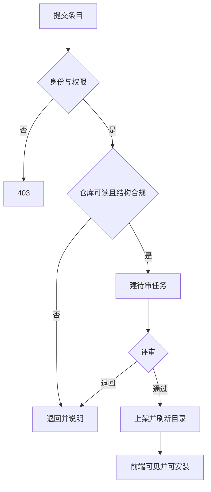

# 插件市场服务详细设计

## 文档信息

| 项 | 内容 |
|---|---|
| 文档编号 | CORP-DSH-DESIGN-012 |
| 文档名称 | 插件市场服务详细设计 |
| 版本 | V0.3.2 |
| 文档状态 | 草案 |
| 密级 | 内部 |
| 编制 | DSH 平台组（代拟） |
| 审核 | 待定 |
| 批准 | 待定 |
| 最后更新 | 2026-10-20 |
| 门禁 | G2 |
| 模块状态 | 规划 |

> 编制依据：2026-10-20 依据市场目标（浏览、下载、安装、上传、评价，且从企业 Gitee 发现插件）与上游包核验。**未核验**：Gitee API 的仓库检索与 release 字段、上游市场数据 schema。
>
> 关联文档：[企业插件市场](../plugins/forge-market.md)、[Gitee 接入](../plugins/forge-gitee.md)、[总体架构 §2 P5](../../architecture/platform-architecture.md)。

## 1. 结论

市场服务提供四件事：目录、版本、发布审核、Gitee 适配，外加两项用量计数。它是市场的唯一数据来源，"谁能上架、谁能评价"都在这里判定。

边界：不管包体存储（用 Gitee，制品库可选做缓存）、不跑构建（用企业流水线）、不做计费。

## 2. 目标与非目标

**目标**

- 一条目一记录：名称、说明、场景、维护人、仓库地址、版本、状态。
- 提交、评审、上架、下架、撤回全程留痕。
- 下载次数与 Gitee star 数可查、可展示，不存评论。
- 从专门 group 自动发现；组内公开可读，提交需组内成员。

**非目标**

- 不做代码托管与构建。
- 不做付费与许可证交易。
- 不做公网访问。

## 3. 需求与依赖

| 需求/验收 | 关系 | 说明 |
|---|---|---|
| REQ 可治理分发 | 直接实现 | 上架与版本可追溯 |
| REQ 推荐能力落地 | 支撑 | 用量与场景支撑采用 |
| 验收 A10 分发 | 支撑 | 安装可重复 |

| 依赖 | 类型 | 版本约束 | 缺失时的行为 |
|---|---|---|---|
| 企业 Gitee API 或 CLI | 服务 | 企业现有 | 发现与取归档不可用 |
| 企业身份（IAM） | 服务 | OIDC | 拒绝写入类请求 |
| 制品库（可选） | 服务 | 企业现有 | 不缓存，直连 Gitee |
| 元数据库 | 服务 | PostgreSQL | 服务不可启动 |

## 4. 扩展形态与边界

| 项 | 内容 |
|---|---|
| 形态 | 独立服务（HTTP JSON API）+ 后台任务 |
| 运行位置 | 企业内网，容器部署 |
| 目标 DSH 与 SDK | 不涉及（前端经 HTTP 访问） |
| 使用的 seam 或服务 | Gitee API、IAM 校验、制品库、数据库 |
| 不修改的核心 | DSH 与 Gitee |

## 5. 接口与配置

| 配置项 | 类型 | 默认值 | 必填 | 说明 |
|---|---|---|---|---|
| `service.listen` | string | `:8080` | 是 | 监听地址 |
| `service.db` | string | 空 | 是 | 数据库连接 |
| `gitee.host` | string | 空 | 是 | 企业 Gitee 主机 |
| `gitee.group` | string | 空 | 是 | 专门存放 DSH 插件的 group |
| `review.required` | boolean | `true` | 否 | 是否必须人工评审 |
| `metrics.syncHours` | number | `6` | 否 | star 同步间隔 |

```text title="端点（示意）"
GET  /api/plugins                  条目列表与筛选
GET  /api/plugins/{name}           详情、版本、聚合分
POST /api/plugins                  提交或更新条目
GET  /api/metrics?plugin=          下载量与 star
POST /api/admin/review             上架、退回、撤回
GET  /api/discover/gitee           扫描专门 group 的仓库
```

数据模型要点：

| 实体 | 关键字段 |
|---|---|
| plugin | 名称、说明、场景、维护人、仓库地址、当前状态 |
| version | 版本、标签、归档地址、`engines.dsh`、提交时间 |
| review_task | 条目、状态、评审人、理由、时间 |
| metric | 条目、下载次数、star 数、同步时间 |

## 6. 权限、凭据与数据

| 项 | 处理方式 | 生命周期 | 失败时 |
|---|---|---|---|
| 调用方身份 | OIDC 令牌校验主体与角色 | 单次 | 401/403 |
| Gitee 访问 | 只读服务账号，按仓库授权 | 随部署 | 标记不可见 |
| 条目数据 | 数据库，保留变更记录 | 长期 | 写入失败即回滚 |
| 用量计数 | 下载次数自增、star 定期同步 | 长期 | 保留上次值 |
| 审计日志 | 主体、动作、对象、结果 | 180 天 | 不影响主流程 |

## 7. 流程



**并发**：同一条目发布加锁，避免版本覆盖；评价按（条目, 主体）唯一约束。

**超时**：Gitee 调用超时按不可用处理，不落半条记录。

## 8. 失败模式

| 场景 | 行为 | 调用方可见结果 | 是否可重试 |
|---|---|---|---|
| 未登录 | 401 | 提示登录 | 登录后重试 |
| 非维护人提交 | 403 | 说明无权限 | 否 |
| 仓库不可读 | 退回 | 指出需授权 | 授权后重提 |
| 缺 `cordis.patch.yml` 或清单 | 退回 | 列出缺失项 | 修正后重提 |
| 版本已存在 | 拒绝 | 提示改用新版本号 | 否 |
| Gitee 不可达 | 503 | 提示稍后重试 | 可重试 |
| star 同步失败 | 保留上次值并标注 | 显示可能过期 | 可重试 |

## 9. 可观测性

| 事件 | 字段 | 去向 | 保留 |
|---|---|---|---|
| 提交与评审 | 条目、状态、评审人 | 审计 | 180 天 |
| 安装解析 | 条目、版本、归档地址 | 访问日志 | 90 天 |
| 计数变更 | 条目、类型、增量 | 审计 | 180 天 |
| 发现任务 | 扫描范围、命中数、耗时 | 任务日志 | 30 天 |

## 10. 测试矩阵

| 层级 | 覆盖 | 命令 |
|---|---|---|
| 单元 | 结构校验、版本冲突、评价去重 | 服务自带测试 |
| 契约 | 端点字段与前端一致 | 契约用例 |
| 集成 | 权限、退回重提、Gitee 不可达 | 仿 Gitee |
| 端到端 | 提交→评审→上架→安装→评价 | 手工 |

## 11. 打包、升级与回退

容器部署；数据库迁移向前兼容，升级前备份。

回退：保留上一镜像；数据模型只增不删，回退后新字段被忽略。

## 12. 未决事项

| 问题 | 需要谁回答 | 影响 |
|---|---|---|
| Gitee 检索与 release 字段 | Gitee 团队 | 第 5 节适配 |
| group 命名与管理员 | Gitee 团队、平台组 | `gitee.group` |
| 评审人与时效 | 平台组、PMO | 上架周期 |
| star 同步频率 | 平台组 | `syncHours` |
| 是否镜像归档到制品库 | IT、安全 | 可用性与审计 |
| 数据库选型与备份 | IT 团队 | 部署 |

### 需用户确认的设计选项（增益不明确，暂不采用，保留待定）

| 选项 | 可能的增益 | 代价 | 当前处理 |
|---|---|---|---|
| 服务内做在线构建 | 一条龙 | 与企业流水线重复 | 不采用 |
| 上传二进制包 | 不依赖 Gitee | 存储与审核成本上升 | 不采用 |
| 文字评论与星级 | 反馈更丰富 | 审核与治理成本 | 不采用 |
| 自动化免评审上架 | 快 | 安全风险 | 不采用 |
| 多租户部门市场 | 自治 | 治理碎片化 | 不采用 |

以上五项均不影响主链路；若后续确认增益，再单独评估。