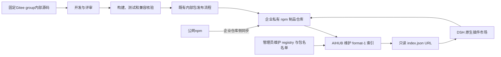

# 工程仓库结构与长期迭代设计

## 文档信息

| 项 | 内容 |
|---|---|
| 文档编号 | CORP-DSH-ENG-001 |
| 文档名称 | 工程仓库结构与长期迭代设计 |
| 版本 | V0.6.2 |
| 文档状态 | 草案 |
| 密级 | — |
| 编制 | DSH 平台组（代拟） |
| 审核 | 待定 |
| 批准 | 待定 |
| 最后更新 | 2026-10-22 |
| 门禁 | 工程整理已获准并完成；业务能力仍按 G0—G3 验证 |

> 编制依据：V0.1 于 2026-10-20 核对的初始仓库基线为提交 `034764487cddc87e8e1a0a2439d39168a4f28d4f`、12 个受跟踪文件及当时方案。用户明确后续覆盖完整方案、逐插件详细设计、全部插件开发及私有插件市场建设。初始实施记录的工具链为 Node.js 24.21.0、pnpm 11.28.5，属于历史实测，不代表后续会话默认环境；官方资料核对见 §3.3。V0.1 只形成设计，V0.2 已按批准范围完成工程整理，结果见 §4.8；未创建业务源码、插件清单、发布凭据或部署实例。V0.2.2 于 2026-10-20 复核现有入口与工程配置，修正时间与状态表述，未重新验证企业接口或部署。
>
> 关联文档：[总体架构设计](<../architecture/platform-architecture.md>)、[推广实施方案](<../plans/rollout-plan.md>)、[需求与场景基线](<../requirements/requirements-baseline.md>)、[文档清单](<../DOCUMENT-REGISTER.md>)、[项目协作规范](<../../AGENTS.md>)。

## 1. 结论

建议采用 **pnpm workspace 单仓多包（monorepo）**：文档按职责分类，客户端插件包、独立运行服务、部署资产、工程脚本及跨模块测试分别管理。该组织方式覆盖从方案评审到开发、测试、发布和运维的完整迭代，但不把本次目录整理等同于插件或市场已经实现。

工程整理已交付可执行检查、协作约定与各扩展包、独立服务的职责入口。其后 `forge-market` 建立过旧包清单与测试，`market-index` 曾建立 HTTP 参考实现；2026-10-21 市场改用轻量模式：DSH 原生「索引源」+ AIHUB 托管 format-1 JSON，`services/market-index` 只保留只读校验器，旧插件与 HTTP 服务转为历史参考。企业私有 npm 仍为唯一制品源（[ADR-11/13](<../architecture/plugin-registry-source-decision.md>)），本仓库不建生成器、不写前授权、不承诺全通道；索引交付与三目标安装为评审目标。

**工程整理已由用户于 2026-10-20 批准实施，§4.7 的顺序已执行，整理时点结果见 §4.8。** 该记录不等于后续模块或生产准入获批。仓库公开可见不改变敏感信息、许可证和一期产品边界；当前模块状态以[根 README](../../README.md)与[设计索引](../design/README.md)为入口。

## 2. 范围与非目标

### 2.1 本次工程整理范围

- 梳理文档体系及既有文件迁移，保留文档编号、历史和业务口径。
- 建立工作区、九个插件/组合包与两个独立服务的规划入口。
- 建立逐插件设计索引、统一设计模板、测试分层与发布约定。
- 将当前临时文档校验能力建设为仓库内可维护、可测试的工程工具。
- 增加贡献指南、安全约定、PR 模板与最小只读 CI 工作流。
- 保留仓库内 HTML，更新其可移植引用和项目入口。

### 2.2 明确不在本次实现

- 不编写 IAM、policy、MCP、市场发布等业务实现，不用空壳演示充当已实现能力。
- 不新增或猜测 DSH 服务方法、插件 Config、Slot、Tool 或企业 API；逐模块实现前须核对目标版本真实接口。
- 不自研 npm registry，不选定或部署 Verdaccio、Artifactory、Nexus、Kubernetes 等基础设施。
- 不接入真实 IAM、网关、Gitee 或 DevOps；不申请或保存生产凭据。
- 仓库公开（public）可见；不设置 GitHub Pages 或开源许可证，不启动公网服务。
- 不修改 DSH 核心，不建立新的 DSH 客户端 fork，不改变一期平台、人数和安全范围。
- 不将 GitHub Actions、分支保护、CODEOWNERS 或人工审批描述为已在服务端强制生效。

## 3. 现状与约束

### 3.1 已核实事实

迁移前（V0.1 基线）仓库只有方案、登记清单、七域询问函及 HTML 图解，没有工作区、检查器、测试或 CI；工程整理阶段建立了底座。2026-10-21 核对工作区，已存在市场插件实现和目录参考服务；IAM 已有 Host + Client 开发骨架与 OIDC mock 流程；其余七包无业务清单/源码，DevOps MCP 暂不建设。九包命名仍见[总体架构 §6](<../architecture/platform-architecture.md#6-软件包组合>)，不应另起一套命名。

迁移前的协作规范曾包含过时的模块及远端状态，工程整理时已同步纠正；当前 [AGENTS.md](../../AGENTS.md)负责 agent 的任务路由、授权与交付要求，[贡献指南](../../CONTRIBUTING.md)负责贡献流程，[文档总览](../README.md)负责文档导航与治理。现有文档编号和 REQ/A/M/CONF 标识均保持不变。

### 3.2 本设计作出的工程选择

| 选择 | 理由与代价 |
|---|---|
| 单仓多包，而非每插件一个仓库 | 跨插件协议和组合配置可同一变更审查；必须用明确依赖、按模块测试和受控发布避免耦合 |
| pnpm workspace，而非立即引入 Nx/Turborepo | 当前规模尚无复杂构建图或缓存需求；先减少工具维护，确有性能瓶颈再通过 ADR 引入 |
| `packages/` 与 `services/` 分离 | 区分安装进 DSH 的扩展和独立运行、部署、监控的服务，不误把服务端写成客户端插件 |
| 文档分类而非继续扩展 `subdocs/` | 总体方案、详细设计、外部契约、运维与协作的读者不同，避免所有材料堆入同一目录 |
| 真实模块启用前不生成包清单 | 不伪造入口、SDK 版本、兼容范围或测试；代价是初期工作区仅根工程有可执行检查 |
| 不预建 `common`、`shared`、`utils` 万能包 | 共享能力须有真实复用需求、明确接口和独立测试，再作为内部包引入 |
| 不永久保留旧路径的文档副本 | 避免多份真源；仓库内引用全部改写，旧版本通过 Git 提交追溯，迁移前须明确告知外部链接影响 |

### 3.3 官方资料与核验边界

- [pnpm Workspaces](https://pnpm.io/workspaces)：核对工作区、`workspace:` 本地依赖及共享锁文件。文档含高于本机 pnpm 11 的新特性；本方案不使用其中标注 v12.7.0 才支持的行为。
- [Node.js Releases](https://nodejs.org/en/about/previous-releases)：核对 Node 24 属于 LTS。初始工具链采用已实测的 Node 24.21.0 与 pnpm 11.28.5，不声称它们是官方最新补丁，也不自动下载安装新版本。
- [GitHub 贡献指南](https://docs.github.com/en/communities/setting-up-your-project-for-healthy-contributions/setting-guidelines-for-repository-contributors)：贡献流程、Issue/PR 说明应有清晰入口。
- [GitHub Actions 安全参考](https://docs.github.com/en/actions/security-for-github-actions/security-guides/security-hardening-for-github-actions)：CI 最小权限、外部动作依赖固定、敏感环境隔离及不可信 PR 防护。

以上资料支持工程原则，不提供适用于所有项目的唯一目录模板。本文件的目录和工程整理范围已按 §1 所记批准执行；业务设计、接口与部署仍须分别通过对应门禁，不由工程整理批准一并替代。

## 4. 工程组织与约束

### 4.1 目标目录

以下为**目标结构**，不是当前存在的文件清单。README 表示本次建立的模块职责入口；业务 `src/`、包清单和运行配置在对应设计确认后建立。

```text
heluo-forge/
├── README.md / AGENTS.md / CONTRIBUTING.md / SECURITY.md
├── package.json / pnpm-workspace.yaml / pnpm-lock.yaml
├── .node-version / .editorconfig / .gitattributes / .gitignore
├── .github/                  # PR、Issue 模板及工程检查 CI
├── docs/
│   ├── README.md / DOCUMENT-REGISTER.md
│   ├── requirements/         # 范围、场景、需求及指标基线
│   ├── architecture/         # 总体架构；既有 ADR 暂保留原章节
│   ├── plans/                # 推广、实施与分阶段计划
│   ├── design/
│   │   ├── README.md         # 逐模块设计索引、状态和依赖
│   │   ├── plugins/          # 各扩展包的详细设计
│   │   └── services/         # MCP 服务及市场目录服务设计
│   ├── contracts/           # IAM、网关、DevOps 等外部契约
│   ├── operations/          # 分发、发布、回滚、支持和试点运行
│   ├── collaboration/       # 跨团队询问与回函协作
│   ├── engineering/         # 本设计、开发、测试、发布约定
│   ├── templates/           # 受控文档及逐插件设计模板
│   └── assets/              # 受版本管理的 HTML 等阅读资源
├── packages/                # 九个规划包；逐包 README，状态待实现
├── services/                # 两个规划服务；逐服务 README
├── deploy/                  # 市场、registry、服务及双端分发入口
├── scripts/                 # 可执行工程检查与维护工具
└── tests/                   # 工程工具测试及后续跨模块测试入口
```

不预建空的多层源码目录，不用 `.gitkeep` 批量制造结构。各分类由 README、模板或真实资产承载；尚无内容的类别先在索引中约定，首个真实文档出现时创建。

### 4.2 九个包入口及对应设计

| 包名 | 代码位置 | 形态与边界 | 后续详细设计位置 |
|---|---|---|---|
| `@heluo/forge-enterprise` | `packages/forge-enterprise/` | umbrella bundle；组合、角色 preset、默认依赖，不重复实现各插件 | `docs/design/plugins/forge-enterprise.md` |
| `@heluo/forge-iam` | `packages/forge-iam/` | Host + Client；授权流程、令牌 broker 与账户 UI | `docs/design/plugins/forge-iam.md` |
| `@heluo/forge-gateway` | `packages/forge-gateway/` | 网关接入配置；不是服务端 AI 网关实现 | `docs/design/plugins/forge-gateway.md` |
| `@heluo/forge-policy` | `packages/forge-policy/` | Host 策略、执行前门禁与决策审计 | `docs/design/plugins/forge-policy.md` |
| `@heluo/forge-devops` | `packages/forge-devops/` | 复用现有 DevOps CLI，读取系统变更及独立验收；查询基线 + 受控写目标（待批/默认禁用），MCP 另评 | `docs/design/plugins/forge-devops.md` |
| `@heluo/forge-gitee` | `packages/forge-gitee/` | 复用现有 `gh` 兼容 CLI，提供查询基线及常规研发/评审写目标（待批/默认禁用） | `docs/design/plugins/forge-gitee.md` |
| `@heluo/forge-sdd` | `packages/forge-sdd/` | 最小企业指引 + 必要 CLI/CI 校验；优先复用，系统变更追溯与产物一致性 | `docs/design/plugins/forge-sdd.md` |
| `@heluo/forge-market` | `packages/forge-market/` | 历史参考包：Host + Client、十个工具、面板、bundle 与测试；不属轻量模式目标 | `docs/design/plugins/forge-market.md` |
| `@heluo/forge-brand` | `packages/forge-brand/` | 品牌配置；不隐含白标客户端发行授权 | `docs/design/plugins/forge-brand.md` |

上表九份设计正文均已建立；市场设计为正式评审稿，其余仍为草案，设计路径不是待创建项。**截至 2026-10-24**：`@heluo/forge-market`、`@heluo/forge-iam`、`@heluo/forge-policy`、`@heluo/forge-sdd`、`@heluo/forge-enterprise` 与 `@heluo/forge-devops` 已有包清单与源码/骨架（其中 IAM 的 Host + Client 骨架本地 mock 已验、真实 IAM 未联调，账户页暂走 interim route；devops 为只读查询 + 门禁骨架，企业 CLI 未联调），`@heluo/forge-brand`、`@heluo/forge-gateway`、`@heluo/forge-gitee` 仍只保留职责 README；逐包实现状态以[设计索引 §2.2](<../design/README.md#22-实现与验证入口>)为准。另有凭据支撑包 `@heluo/forge-credentials-keychain`（开发骨架），不在上述九个产品模块内，实现入口见[设计索引](<../design/README.md#22-实现与验证入口>)。

真实 Node 包启用时采用 `src/`、`test/`、`package.json` 等局部布局；配置 bundle 不强制建立空 `src/`。对外只能使用声明的导出，不跨包直接导入另一个包的 `src`。源码包之间采用显式 `workspace:` 依赖，并避免循环依赖；进入市场首版的实际发布包须将运行产物自包含，不携带需要终端解析的 workspace/外部 npm 运行依赖。新的 Node 组件默认 TypeScript；上游复用组件保留其合理语言，不因 monorepo 强制改写。

### 4.3 独立服务与私有市场分层

| 层次 | 位置 | 后续建设内容 | 本次交付 |
|---|---|---|---|
| DevOps MCP 服务 | `services/devops-mcp/` | 条件建设：仅当 DevOps CLI 无法满足已确认的结构化输出、用户授权或必要身份能力时，才评审 HTTP 工具面及服务端职责 | 当前不建设；保留边界 README 与条件设计，不启动监听或模拟生产接口 |
| 索引契约与校验 | `services/market-index/` | 只保留 format-1 只读校验器与契约；不建市场服务、生成器、数据库或审批后台 | 校验器与 13 项测试；无服务、无生产部署 |
| 私有 npm 制品仓库 | `deploy/registry/` | 企业私有npm承载公网同步和内部定制包；认证、内部scope、备份恢复、访问/撤回与保留策略 | 运维范围说明，不部署仓库或写入真实地址/令牌 |
| 原生市场接入 | DSH 内置 + AIHUB 索引 | 用户添加 AIHUB 只读 URL；官方 manager 从企业 npm 安装 | 不建自定义市场插件；`packages/forge-market/` 为历史参考 |
| 双端配置与分发 | `deploy/clients/` | Windows 与银河麒麟的配置、安装、更新及回退资产 | 规划说明，不提交 MSI/deb/凭据或自建新客户端 |

以下为ADR-11下的目标发布流程，不是当前Gitee归档参考实现的运行图；固定group用于内部源码，所有获批插件的制品都从企业npm取得。



该图描述轻量模式的索引与安装链路，不代表 AIHUB 已交付或三目标已验。AIHUB 在发布前策展并整体替换索引；本项目只校验 JSON 契约，不设单写发布、current 切换或写前授权。已发布版本不可变；更版按原生能力，没有通用 upgrade 时卸载后安装，不承诺原子升级或自动回滚。字段、认证与托管要求见 DESIGN-012 与 issue #12。

### 4.4 逐插件详细设计模板

每个模块详细设计至少包括：目标与非目标、对应需求和依赖、扩展形态、Host/Client/服务端边界、目标 DSH/SDK 版本、经核验的接口与配置 schema、权限与信任边界、数据与凭据生命周期、正常/异常/并发/退出流程、可观测性、测试矩阵、打包/升级/回退及未决事项。

设计应同时提供整体关系图、主流程及关键异常流程图；接口引用标明源码或 Inspect 核验基准和日期。身份、网关、DevOps 等外部契约在 `docs/contracts/` 维护唯一真源，模块设计引用而不复制一整套可漂移字段。

新文档按现有规范分配唯一编号，审核/批准保持待定。真实包只有在已确认设计、兼容声明和最小测试具备后才从“规划入口”进入“可构建”状态。

### 4.5 工具链、检查与协作

- 根工程 `private: true`，采用 Node 24 LTS；初始执行基准为已实测 24.21.0，pnpm 固定 11.28.5，维护单一工作区锁文件。Node 新主版本或包管理器升级单独评审，不修改用户全局 PATH 或包管理器设置。
- 本次不引入尚无真实消费者的 SDK、前端框架、构建缓存或发布工具依赖。根工程检查优先使用 Node 标准库，无需访问企业系统或下载业务依赖。
- 提供 `check:docs`、`check:repo`、`test:unit` 及聚合 `check` 命令；实现后才在 README 声明可运行。工程测试验证检查器本身，不伪称业务插件测试。
- 包内单元测试随包维护；跨模块契约、集成及双端端到端验证分别建设。没有真实测试时不提供会“零用例成功”的业务测试入口。
- 根工程及未启用模块不允许发布。首个真实可发布包出现时再引入 Changesets 等版本工具；各包维护版本，umbrella 固定经验证的组合，不强迫所有包每次同步升级。
- 建立 CONTRIBUTING、SECURITY、PR/Issue 模板及最小 CI。CI 仅执行离线工程检查，默认 `contents: read`，外部 Action 固定经核验的全长 SHA，不使用特权触发去执行不可信 PR。
- 不自动增加真实维护者名单、分支保护、生产 runner 或发布密钥。CODEOWNERS 与强制审批按维护者及平台能力确认后启用；安全报告渠道未明确前不得虚构联系人。
- 提交忽略规则覆盖依赖、构建缓存、日志、覆盖率及凭据；有意版本管理的 HTML 和明确的脱敏测试样例不一并忽略。

### 4.6 现有文件迁移表

本次使用 `git mv`，执行前核对解析后的绝对源/目标路径。表中目标路径属于提案，不是当前有效链接。

| 当前资产 | 建议目标 | 保留约束 |
|---|---|---|
| [总体架构](<../architecture/platform-architecture.md>) | `docs/architecture/platform-architecture.md` | 保留编号、ADR-1—ADR-10、全部业务设计与历史；不在本次拆散旧 ADR |
| [需求基线](<../requirements/requirements-baseline.md>) | `docs/requirements/requirements-baseline.md` | 保留 REQ-01—REQ-23、M1—M6 和范围唯一真源 |
| [实施计划](<../plans/rollout-plan.md>) | `docs/plans/rollout-plan.md` | 保留 A1—A14、15 周条件基准及 G0—G3 |
| [网关契约](<../contracts/gateway-contract.md>) | `docs/contracts/gateway-contract.md` | 字段和安全边界不变，仅重建引用 |
| [询问函](<../collaboration/team-confirmation-letters.md>) | `docs/collaboration/team-confirmation-letters.md` | 保留七封、45 项问题及其编号，不更改发函/批准状态 |
| [子文档索引](<../README.md>) | `docs/README.md` | 升级为文档总入口，保留十份领域交付物及待启动状态 |
| [文档模板](<../templates/_template.md>) | `docs/templates/_template.md` | 保留受控文档基本结构，新增单独的模块设计模板 |
| 本设计 | `docs/engineering/repository-structure-design.md` | 保留本次评审历史和批准边界 |
| [认证 HTML 图解](<../assets/enterprise-authentication-flow.html>) | 保持原路径 | 只重生成移动后的来源链接，保留八个面板和六张图 |
| [工程结构提案图解](<../assets/repository-structure-proposal.html>) | 保持原路径 | 本设计移动后同步其链接；提案批准不等于业务模块已实现 |
| [文档清单](<../DOCUMENT-REGISTER.md>) | 保持原路径 | 全部真实路径、版本与状态同步 |
| [根入口](<../../README.md>)及[协作规范](<../../AGENTS.md>) | 保持根目录 | 同步当前结构、工程状态和授权约定，不复制旧的无远端事实 |

迁移涉及引用修改的受控文档增加修订号，例如 V1.3 → V1.3.1；历史由 Git 承担；登记和索引增加次版本。历史编制依据中的“当时所读版本”不改写成新版本。既有业务内容、审批状态不变，不借目录调整重新决定业务方案。

不保留旧路径的重复正文或导航桩。仓库内链接和 HTML 来源全部更新；已有提交永久保留旧文件历史。仓库外 HTML 原副本不修改，其旧本机绝对链接可能不再适用于新结构；维护入口切换为仓库内版本。

上表已于 2026-10-20 执行，实际落位与目标一致，原 `subdocs/` 目录已不存在。

### 4.7 实施顺序与恢复

1. **确认设计并建立基线。** 记录 HEAD、索引、各文件指纹及迁移映射；发现并行编辑时暂停相应文件。此后再编写具体执行计划。
2. **先落地工程检查及测试。** 将临时校验逻辑整理到仓库；用坏链接、表格错列、版本不一致等失败样例证明检查确实能失败。
3. **迁移文档。** 按映射逐项 `git mv`，改写相对路径、模板、HTML 与所有索引；行号引用改用经核对的章节锚点或更新行号，不保留已失效位置。
4. **建立工程入口。** 创建工作区和模块职责 README、设计索引、协作文件及最小 CI；不创建业务包清单或声称模块可运行。
5. **交叉验收。** 运行结构、文档、HTML 和工程工具单元测试；核对编号、历史及源码内容的保留；审查 Git 差异后提交。

建议将检查工具、文档迁移、工程入口分成三个可审查提交。恢复通过针对相应提交的受控反向变更，不用 hard reset、清空目录或覆盖其他会话的改动。远端推送及任何部署按当次有效授权处理，不调整仓库可见性或发布权限。

### 4.8 工程整理实施结果（2026-10-20）

以下保留 §4.7 工程整理完成时的证据，不作为后续市场开发的当前清单。当前实现与验证入口见 §3.1 及设计索引。

| 项 | 结果 |
|---|---|
| 文档迁移 | 8 个文件按 §4.6 迁移，原子文档目录已移除；108 处相对链接重建，行号锚点改为章节锚点 |
| 版本与登记 | 五份主文档升修订号；新增设计索引 DOC-002、运维索引 DOC-003、开发约定 ENG-002，并同步文档清单 V1.8 |
| 工程底座 | pnpm workspace、`private` 根工程、固定 Node 24.21.0 与 pnpm 11.28.5、忽略规则、编辑器与换行约定 |
| 检查器 | `scripts/check-docs.mjs`、`scripts/check-repo.mjs` 与共享规则；24 个单元用例覆盖有效与失败样例 |
| CI | 只读权限工作流，两个外部动作固定到提交 SHA，仅执行离线检查 |
| 模块入口 | （2026-10-21 整理完成时）各包与两个服务各一份职责 README，均无包清单、源码或运行配置 |
| 图解 | 两个 HTML 按新路径重新生成，保留面板与源稿，无外部脚本与本机绝对路径 |

在上述整理完成时，业务插件、独立服务、私有 registry 与市场目录、双端安装包、企业接口联调与实机验证均未实现；后续市场模块开发不改变该历史结果，也不替代 G0—G3 门禁。

## 5. 失败模式

| 风险 | 处理与禁止事项 |
|---|---|
| 并行会话修改源文档或索引 | 指纹或内容冲突即暂停；不覆盖、reset 或擅自合并未知内容 |
| 路径调整造成链接、大小写或行号失效 | 对全部 Markdown 与 HTML 检查，Linux 大小写校验作为约束；不能只改根 README |
| 目录存在被误认为模块已开发 | 入口明确“未实现”；无真实包清单、源码与测试不进入可构建清单 |
| 市场接入 bundle 混入服务端或 registry 逻辑 | 分别放 packages、services、deploy，协议与发布权限分离 |
| 最新官方文档包含高于本机版本的功能 | 仅采用基准版本支持的功能；不凭新文档猜测本地工具能力 |
| CI 测试零用例、遇错跳过或自动触发生产发布 | 工程测试必须有实际用例；模块未就绪明确报告；本次无发布任务和生产密钥 |
| 扫描或测试中出现真实凭据 | 中止提交，仅报告脱敏位置；受控处置和轮换，不将秘密加入示例或日志 |

## 6. 验收

| 编号 | 可判定的验收条件 |
|---|---|
| ENG-A1 | 基线中的全部受跟踪文件有明确保留或迁移去向；无丢失、未知覆盖或未说明删除 |
| ENG-A2 | 受控文档编号、历史、23 项需求编号（REQ-11 已取消，22 条有效）、14 项验收、5 项指标及 45 项询问问题完整保留 |
| ENG-A3 | 全部 Markdown 本地链接、登记路径、表格列数及版本引用通过检查 |
| ENG-A4 | 认证 HTML 保留八个面板、六张图、可编辑源稿；来源链接有效，无本机绝对路径或外部脚本依赖，脚本 CSP 校验通过 |
| ENG-A5 | 九个包和两个服务的职责、扩展形态及“未实现”状态可查；逐模块设计索引和模板可用 |
| ENG-A6 | 根工作区为私有工程，版本固定，无虚构插件入口、SDK 兼容范围或意外发布任务 |
| ENG-A7 | 本地执行聚合工程检查成功；工程检查器具备正反向测试，失败样例能产生非零退出码 |
| ENG-A8 | CI 定义可静态审查，最小权限、依赖固定、无企业凭据与生产调用；首次远端 CI 未运行时明确报告未验证 |
| ENG-A9 | README、AGENTS、贡献与安全说明反映真实结构；未虚构维护者、许可证、审批或支持能力 |
| ENG-A10 | 市场客户端、目录发布与制品仓库的落位和后续建设范围独立，不将 README 或部署目录当作市场已建成 |

工程整理完成不代替插件兼容、真实 IAM/网关/MCP 联调、Windows/麒麟测试、制品发布或市场生产恢复演练。

## 7. 待确认

| 问题 | 需要谁回答 | 截止与是否阻塞本次工程整理 |
|---|---|---|
| 是否批准本文件的单仓结构、文档迁移及最小工程底座范围 | 用户 | 已批准（2026-10-20）；不再阻塞 |
| 目标 DSH/SDK、真实插件接口及企业资源契约 | 平台与对应团队 | 各模块详细设计/实现前；不阻塞离线工程整理 |
| 私有 registry 复用对象、市场发布责任、认证与制品保留策略 | IT、市场/平台、安全责任方 | 市场详细设计及部署前；不阻塞目录和设计索引 |
| 实际维护者、CODEOWNERS、强制审批和安全报告渠道 | 项目负责人 | 相应治理能力启用前；本次不虚构主体或平台生效状态 |
| 首个可发布包的版本工具、发布批准与私有仓库凭据 | 平台与发布责任方 | 真实发布前；本次不启用自动发布 |
