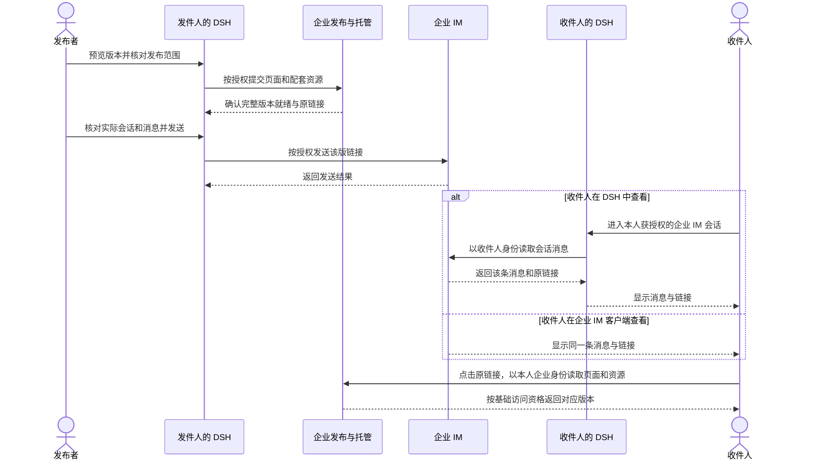

# 企业产物发布与分享设计的金鱼审查证据

记录日期为 2026-11-19。下列文本快照保留评审输入、目标及处置的原始内容。 [受控设计正文](../../design/enterprise-artifact-publishing.md)维护当前方案，企业接口与交付验收按其 §8 取证。

## 修订产物来源

受控设计首次登记时采用审查处置后的 V0.4 草案。原稿 SHA-256 为 `e87c00369dedbec89ecb51b78b08ff81d1613356d65cfda5841c8c11e35ca6ef`。正文登记文档编号，链接指向此归档的证据及仓库对应文档。

## V0.5 托管选型复核

项目负责人于 2026-11-19 确认采用私有 S3 兼容存储和企业产物阅读入口。独立金鱼审查以 V0.5 草案变更为输入，对照固定版本、读者本人授权、独立交付和首版集成判据。以下项均采纳。

| 级别 | 发现 | 处置 |
| --- | --- | --- |
| P1 | 同一阅读地址下，网页脚本可尝试借读者会话访问其他版本。 | 隔离各产物版本的执行上下文，独立验收已声明的交互和跨版本、会话及管理面隔离。 |
| P1 | 仅检查读者资格的缓存或预览可能在版本下架后继续显示内容。 | 复用前校验当前账号及权威版本状态，首版页面和资源禁止缓存，预览无法核验时显示文本链接。 |
| P2 | 对象前缀和路径不足以约束同键覆盖或恢复后的读取结果。 | 发布记录绑定固定对象身份或内容校验依据，验收覆盖对象变更及恢复。 |
| P2 | 登录回跳缺少与原地址的绑定及切号处理。 | 回跳绑定登录事务及原版本地址，补齐切号、过期回调和域外返回用例。 |
| P2 | 阅读入口的开工和退出判据依赖发布及 IM 联合交付。 | 读取自身接口取证后独立开工，用同契约预置记录与私有桶样本先行验收，另做首版全链路集成验收。 |
| P2 | 阅读入口和企业 AI 网关的授权职责容易混淆。 | 阅读入口按 IAM 会话和托管资格判权，企业 AI 网关承担模型访问。架构决策记录为 ADR-30。 |
| P2 | 审查时实施 Epic 尚无阅读入口子项。 | 阅读入口以 GitHub 原生子 issue 跟踪，实施联调保留在父 Epic。 [阅读入口 #387](https://github.com/hrygo/heluo-forge/issues/387) · [Epic #385](https://github.com/hrygo/heluo-forge/issues/385) |

以上为设计与任务拆分复核。目标存储、SSO、企业 IM 和 DSH 的实测证据按设计 §8 记录。

## 概念简报

原始 Markdown 的 SHA-256 为 `9ca77e71ecf7765f274b3863274d1218821c3431f8700a195c30cd64a3e24cdc`。

查看原始 Markdown

~~~markdown
# Heluo Forge 企业产物发布与分享

| 项目 | 内容 |
| --- | --- |
| 作者 | hrygo |
| 编制 | Agent（代拟） |
| 日期 | 2026-11-19 |
| 状态 | 产品概念简报 |

## 产品概述

员工在 DSH 中预览并选定个人助手生成的一版 HTML 产物，将页面及配套资源发布到企业内网 WebServer，再从助手把链接发到企业 IM。收件人点击链接，用自己的企业账号在线查看。首版适用于项目周报、分析报告、使用手册、方案说明等 HTML 产物。

这个流程的目标是减少上传文件和发送链接之间的手工切换。试点用同一产物对照企业已有的手工上传和发链接方式，记录实际操作及故障恢复。总体产品方向还包括将 PPT、Word 等成品发布到企业云文档并从助手分享。

## 首版 · HTML 发布与企业 IM 分享

### 发布确认与链接可见范围

普通链接可在企业内自由转发。持有链接且具备托管平台基础访问资格的企业员工，可以用自己的企业账号查看产物。普通发布适用于企业既有规则允许在该范围流转的产物。需要限定读者的材料使用具备相应访问控制的企业发布路径。

发布前，助手展示本次产物、版本和链接的实际可见范围。已选择 IM 会话时，同时展示发送目标。HTML 页面、配套资源直链及展示产物内容的 IM 预览遵守同一可见范围。未登录时引导企业登录并返回原链接。账号缺少访问资格时提示「无权访问」。

### 完整 HTML 的发布

一次发布对应一版产物。HTML 页面及完整阅读所需的图片、样式等配套资源随版本交付。需要保留的图表交互、脚本和其他运行依赖以企业托管和收件人浏览器实测支持的范围为准。预览和托管页面的执行权限限于阅读产物所需的浏览器能力。宿主能力和托管管理权限由既有内容隔离规则独立控制。

发布前在助手里核对该版预览及其配套资源。缺少必要资源或依赖超出已验证的支持范围时，明确提示原因，待产物完整就绪后才确认发布成功。

### 发布结果与发送恢复

发布与发送分别显示「成功」「明确失败」或「待核验」。发送前，员工核对目标企业 IM 会话和消息。收件端可核对发起员工或获授权的发送主体，以及消息中的实际链接。

| 操作 | 结果明确时 | 结果待核验时 |
| --- | --- | --- |
| 发布到 WebServer | 完整版本已就绪时提供该版链接。明确失败时显示原因，按托管端已验证的方式恢复。 | 当请求已提交而回执中断时，标记「发布待核验」，按托管端可关联本次发布的记录查证。确认成功后取回该版原链接，确认失败后按托管端已验证的方式重试。仍无法确认时保持待核验，发送入口仅接受已确认成功的版本。 |
| 发送企业 IM 消息 | 企业 IM 确认消息已发至目标会话时显示「已发送」。明确失败时保留已发布版本，用户可用原链接重试发送。 | 按企业 IM 已核验的方式查证目标会话及实际消息。待核验期间继续显示该状态，重试依据查证结果及提供方的已验证语义。 |

发布和发送分别遵循现行跨系统写入策略、适用的本机人工确认（`ask`）和目标服务端授权。客户数据遵循机构内数据边界。首版优先复用具有企业身份访问能力的内部托管和现有企业 IM。

### 已发布版本与链接有效期

修订版发布后取得新链接，旧链接在有效期内仍指向原版。托管服务按企业现有规则负责保留、到期和下架。收件人打开已到期或下架的链接时，由托管服务提示相应状态。试点核验实际保留规则和页面反馈。

## 可选 · 限制访问范围

限制访问范围优先级低于通用发布与分享，由发布者按具体场景选用。例如，一份只供项目群成员阅读的周报在发布时绑定项目群，确认界面展示实际读者范围。

WebServer 在打开报告或读取任一配套资源时，用读者的企业账号查验当时的群成员资格。群外员工和退群成员打开旧链接或转发链接时提示「无权访问」。转发后的链接沿用同一权限。群成员资格暂时无法查验时，启用了限群的产物显示「暂无法核验访问权限」，并保持原访问范围。普通链接按托管平台基础访问规则判权。

限群场景需核验稳定群标识、IAM 与 IM 的身份映射及成员变更后的生效情况。验收覆盖原链接、转发链接、资源直链、缓存和 IM 预览。按企业现有访问控制能力与实际缺口决定接入方式。

## 试点验收

| 优先级 | 场景 | 通过判据 |
| --- | --- | --- |
| 首版 | 可见范围与企业内转发 | 发布确认展示读者范围和已选发送目标。原会话外有权的企业员工用本人账号打开普通转发链接并查看完整内容。未登录时可登录回原链接，缺少基础访问资格的账号打开页面及配套资源直链均被拒绝。展示产物内容的 IM 预览遵循同一可见范围。 |
| 首版 | 收件人看到完整 HTML | 至少两种场景的样本经内网发布和实际 IM 分享后，收件端看到与该版预览一致的正文和配套资源，并可使用已纳入支持范围的交互。缺失必要资源或不受支持的依赖时，助手提示原因并保持发布未就绪。 |
| 首版 | WebServer 已接收，发布回执中断 | 助手显示「发布待核验」。查实完整版本已发布时，取回同一版原链接。仍无法确认时保留待核验，核对托管端未因恢复流程产生重复版本。 |
| 首版 | 真实会话、发送归属与结果 | 在目标 DSH 版本中选择真实 IM 会话，核对收件端的发送归属、消息和版本链接。发送明确失败时可用原链接重试，回执中断时按 IM 结果查证，并核对实际消息数。 |
| 首版 | 写入授权与链接生命周期 | 核对发布和发送各自的真实授权。操作被拒绝、用户取消或必要授权依赖失效时，对应写入按现行策略停止。发布修订版后核对旧链接仍指向原版，再验证到期或下架提示。 |
| 可选 | 按打开时的项目群成员资格授权 | 当前群成员可读取完整内容。退群后重开旧链接或直开任一资源均被拒绝，转发给群外账号同样被拒绝。查验故障时只显示权限暂无法核验的结果。 |

首版的内容范围、资源上限、托管生命周期、发布回查和 IM 发送能力以企业实测为准。实施范围以需求基线 §2 为准，纳入时同步受影响的架构与验收。

## 依据

- 用户确认的产品方向为通用 HTML 发布与企业 IM 分享，普通链接可在企业内自由转发，限群为低优先级的场景可选能力。
- 仓库依据为 `docs/requirements/enterprise-collaboration-chat-proposal.md` §3–7、§9，`docs/requirements/requirements-baseline.md` §2、§4.4，以及 `docs/architecture/platform-architecture.md` §2、§4.1、§7.6。
- 本简报的试点验证项对应 [Goldfish 审查报告](goldfish-review/consolidated_review_report.md)。
~~~

## V0.3 审查目标

原始 Markdown 的 SHA-256 为 `0a7ca1e77012852de580f851f21cefe23b89b512cc5a6534d43855a16c9fcbf7`。

查看原始 Markdown

~~~markdown
# Heluo Forge 企业产物发布与分享设计

## 文档信息

| 项 | 内容 |
| --- | --- |
| 文档编号 | 归档时登记 |
| 版本 | V0.3 |
| 文档状态 | 草案 |
| 密级 | — |
| 作者 | hrygo |
| 编制 | Agent（代拟） |
| 审核 | 待定 |
| 批准 | 待定 |
| 最后更新 | 2026-11-19 |
| 确认人 | 项目负责人（当前用户） |
| 确认日期 | 2026-11-19 |
| 确认事项 | 首版做通用 HTML 发布与企业 IM 分享，收件人可在 DSH 接收分享消息，普通链接可在企业内自由转发，限群为低优先级的场景可选能力 |
| 适用范围 | 已确认的产品方向 |
| 门禁 | 实施范围纳入需求基线 §2，首版必要接口取证通过，明确发布与发送的恢复规则及 DSH 收件契约，完成逐文件实施与测试清单。 |

## 1. 概述与问题

员工在 DeepSeek Harness（DSH）个人助手中生成 HTML 产物。交付同事在线阅读时，需要完成上传内容、取得可访问链接和把链接发到会话三件事。将这些动作纳入助手，目标是减少用户在托管平台与即时通信（IM）之间的切换，并在同一入口看清内容版本、可见范围和每项操作的结果。试点以同一产物对照企业现有手工上传和发链接的做法，记录操作次数及故障恢复表现。

首版支持项目周报、分析报告、使用手册、方案说明等各类符合托管要求的 HTML 产物。发布者选定一版成品及配套资源，发布到企业内网 WebServer，再从助手把链接发到实际企业 IM 会话。收件人可在自己的 DSH 或企业 IM 客户端接收该消息，点击原链接并用自己的企业账号在线阅读。

## 2. 首版目标与后续范围

| 目标 | 完成判据 |
| --- | --- |
| 通用 HTML 发布 | 发布者预览并选定一版产物，WebServer 提供对应版本的页面与必要资源。至少两类代表样本可由独立收件人分别从 DSH 和企业 IM 客户端打开并完整阅读。 |
| 企业内自由分享 | 发布确认展示链接实际可见范围。已预选会话时同时展示发送目标。持链接且具备托管平台基础访问资格的员工可以在线查看，原会话外的有权员工也可以打开转发链接。 |
| 助手直接分享 | 员工在 DSH 中核对企业 IM 会话和消息，经实际授权发出。验收核对发送归属、目标会话、对应版本及 IM 中的实际消息。 |
| DSH 收件 | 收件人使用自己的企业账号进入 DSH 中获授权的企业 IM 会话，能看到实际分享消息、发送者和该版本原链接。与企业 IM 客户端呈现同一次发送。 |
| 结果可查证 | 发布和发送各自呈现结果。回执中断后，原账号可在同一 DSH 环境中继续查证同一次操作。查实发布就绪时恢复同一版原链接，查实发送时核对目标会话中的实际消息。 |

按项目群限制阅读是低优先级的场景可选能力，设计见 §5。PPT、Word 等产物发布到企业云文档属于后续产品方向，各平台按其真实阅读、编辑与分享能力设计。实施范围由仓库需求基线 §2 维护。

## 3. 关键用户旅程

| 场景 | 前提与动作 | 可观察结果 |
| --- | --- | --- |
| 发布并发到 IM | 员工选择个人助手生成的分析报告及资源，查看待发布版本和可见范围，取得链接后在助手中确认目标会话和消息。 | 托管端就绪后提供内网链接。IM 确认写入目标会话后，助手显示「已发送」。 |
| 先发布，稍后发送 | 员工选定产物和可见范围，此时尚未指定 IM 会话。 | 发布成功后可取得原链接。员工之后选择真实会话，核对消息后发出。 |
| 在 DSH 收件 | 企业 IM 已把分享消息写入目标会话。收件人以本人企业账号进入自己的 DSH，打开对应的企业 IM 会话。 | DSH 显示该条消息及原链接。收件人点击链接，按托管权限在线阅读对应版本。 |
| 同事打开转发链接 | 群成员把普通链接转给另一位企业同事。收件人点开，必要时完成企业登录。 | 登录后返回同一版本。页面与配套资源按收件人的基础访问资格返回。 |
| 发布回执中断 | 员工已授权提交，托管方可能已经接收，助手没有收到确定结果。 | 助手显示「发布待核验」。查实版本已就绪后取回原链接，员工再决定是否发送。 |
| 发送未确认 | 链接已发布，IM 发送返回中断。 | 发布的链接仍可查看。助手显示「发送待核验」，核对该次发送在目标会话中的结果。 |

## 4. 技术方案

### 4.1 职责与信任边界

| 参与方 | 责任 |
| --- | --- |
| DSH 个人助手及扩展入口 | 发件端选择版本、预览、确认范围、受控发布与发送、呈现查证结果。收件端在本人获授权的企业 IM 会话中展示消息与原链接。宿主提供实际可用的扩展入口，客户端展示状态快照。 |
| 企业身份与访问管理（IAM）及既有策略 | 为实际员工提供相应资源的身份和授权依据。跨系统写入按现行策略、本机人工确认（`ask`）及必要审计执行。发布与发送分别核对授权。 |
| 企业发布与托管能力 | 接收并保存完整版本，确认就绪，提供版本固定的内网链接和可核对的发布记录。WebServer 对收件人的页面及资源访问执行授权，并负责保留与下架。 |
| 企业 IM | 管理会话与消息的授权、投递及记录。发件人选择实际会话，收件人按本人身份读取有权访问的消息。 |

企业托管和 IM 的写入分别由其服务端授权。企业 IM 授权收件人读取会话消息，WebServer 按收件人自己的企业身份授权页面和资源访问。DSH 入口按宿主支持的扩展机制接入，共享地址由企业托管服务返回。表中职责是设计目标，组件和接口能力以目标环境取证。

发布确认关联发起账号、所选版本和实际可见范围。发送确认另行关联发起账号、实际发送主体、稳定的目标会话、消息内容和版本链接。确认项变更时重新核对和确认。两次写入均在提交前执行现行策略及适用的本机人工确认（`ask`），落实必要审计和目标服务端授权。用户取消、策略拒绝或必要审计不可用时，对应写入保持未提交。

### 4.2 正常流程

### 4.3 产物、版本与接口语义

| 对象 | 所需信息与所有权 |
| --- | --- |
| 待发布产物 | 员工选定的版本、入口 HTML、配套资源及需保留的交互。预览和提交使用同一版资源集合。内容在确认后发生变化时，更新预览并重新确认待发布版本与范围。 |
| 发布结果 | 企业发布端是版本就绪状态、原链接、可见范围和生命周期的事实来源。发布记录应能关联到本次操作和所选版本。 |
| 发送结果 | 企业 IM 是目标会话、实际消息和发送状态的事实来源。发送关联信息对应单次操作、目标会话和已发布版本。 |
| 收件消息 | DSH 以收件人身份按企业 IM 授权读取会话。显示企业 IM 实际消息中的发送者、消息和原链接，实际消息按服务端标识或可核对的等价关联辨认。 |

发布按完整版本交付，宿主读取范围限于员工所选产物及其必要资源。入口 HTML 和配套资源在确认时对应同一版内容。托管就绪以该版入口及所需资源均可按授权取得为准。依赖目录、可用交互及允许的外部依赖以 §8.2 的样本支持清单为准。缺资源或超出支持范围时提示原因，界面保持未就绪。

接入需要提交并查证发布、选择已授权企业 IM 会话、发送并查证消息，以及以收件人身份读取会话消息。动作、版本引用和结果状态是设计语义。具体 DSH 扩展点、企业端 API 字段、协议和错误映射由真实接口核验后进入对应契约。

### 4.4 链接可见范围

普通链接可在企业内自由转发。读者持有链接并符合托管平台基础访问规则，即可用企业账号访问。普通发布适用于既有企业规则允许在该范围流转的内容。需要限定读者的材料通过具备相应访问控制的企业发布路径交付。

发布确认显示产物、版本和实际可见范围，可在选择 IM 会话前独立完成发布。已预选会话时显示发送目标，发送前核对实际会话与消息。WebServer 对 HTML 页面和配套资源直链使用同一权限。DSH 与企业 IM 客户端展示产物内容的链接预览（含缓存）都须经实测符合这一范围。内容预览条件不足时，核验对应客户端仅显示可点击链接的行为。未登录的收件人完成企业登录后返回原链接，缺少访问资格时提示「无权访问」。

一个链接指向一个已发布版本。修订版发布后生成新链接。原版在有效期内仍由原链接访问。到期、下架及相应页面反馈由托管平台按企业现有生命周期规则处理。

### 4.5 发布与发送结果

提交前为每次已确认的写入取得可由原账号重新找回的操作关联。发布关联账号、操作、所选版本及可见范围。发送关联账号、操作、目标会话及已发布版本，并以经核验的发送归属和消息内容校对。托管与 IM 各自提供结果事实。

| 状态 | 发布到 WebServer | 发送到企业 IM |
| --- | --- | --- |
| 未提交 | 产物未就绪、取消或门禁拒绝时展示原因。 | 版本未确认就绪、取消或门禁拒绝时展示原因。 |
| 请求中 | 提交预览确认的完整版本，等待托管结果。 | 发送已确认就绪的版本链接，等待企业 IM 结果。 |
| 成功 | 托管确认同一次发布的完整版本就绪，显示该版原链接。 | IM 确认同一次发送的消息写入目标会话，显示「已发送」。 |
| 明确失败 | 托管端给出可判定的失败结果。满足已验证的重试条件并核对当前授权后，可重新提交。 | IM 给出可判定的失败结果。保留已发布版本，满足已验证的重试条件并核对当前授权后，可用原链接重试。 |
| 待核验 | 按原账号及该次发布的关联查证版本就绪状态。查实成功后恢复同一版原链接。 | 按原账号及该次发送的关联核对稳定会话、实际消息和链接版本。查实后更新该次发送结果。 |

提交后回执丢失、查询延迟或匹配不唯一时进入或保持「待核验」。待核验期间仅查证该次操作。只有提供方已核验的记录足以确认失败、且符合其恢复语义时，才进入明确失败和相应重试流程。查询暂空仍按未知处理，除非核验确认它对该服务具有明确的终态含义。发送入口仅接受托管确认就绪的版本。

首版要求原账号在同一目标 DSH 环境退出或重启后可继续查证。切换账号时仅呈现当前账号有权访问的操作结果，切回原账号后按原关联恢复。优先使用按本人身份可回查的提供方记录，确需宿主保存引用时，只保留操作关联、账号归属及必要的版本或会话引用，按企业保留规则和提供方查证期限确定保存和清理。超出查证期限且仍缺终态证据时，提示暂无法核验并保持未知处理。关联来源、所有者和生命周期在 §8.1 取证后进入接入契约。

宿主将同一次确认的重复点击合并为一次提交。员工另行确认的发送属于新操作，即使会话和链接相同。验收分别核对宿主发起次数和提供方实际写入次数，覆盖同一会话中已有同文同链接消息的情况。

### 4.6 DSH 收件

一次分享将链接写入所选企业 IM 会话。收件人在自己的 DSH 通过企业会话入口读取同一条消息，企业 IM 客户端也可显示这条消息。DSH 收件采用 Forge Chat 产品方案中企业 IM 互通的接入方向，宿主入口、账号映射和消息读取方式按 §8.1 取证确定。收件人可以在 DSH 中直接打开消息里的原链接，由 WebServer 按本人权限返回页面和资源。

收件端以当前账号和会话服务端授权为准。切换账号时，仅展示当前账号获授权的内容。企业 IM 确认撤权后，停止展示对应消息及链接预览。缓存同样按当前账号及会话权限隔离。消息同步延迟或中断时提示状态，连接恢复后按核验过的读取语义刷新会话。收件查询与刷新读取企业 IM 已有消息。发件端的「已发送」以企业 IM 的写入结果为准。DSH 收件以消息在本人会话中实际显示、原链接可点击为验收依据。

## 5. 低优先级可选能力 · 限群

对需要限定项目组内部阅读的产物，例如一份受限周报，发布时选用限群并绑定企业 IM 中的稳定群标识。发布确认展示对应群与实际可见范围。WebServer 对页面和任一配套资源按打开时的群成员资格判定，使用访问者自己的企业账号。

群外员工及退群成员打开旧链接、转发链接或资源直链时得到权限拒绝。群成员查验暂时不可用时，启用了限群的产物保持原访问范围，显示「暂无法核验访问权限」。普通链接按托管平台基础访问规则工作，包括限群停用或成员查询不可用时。限群试点单独验证身份映射、当前成员查询、退群后生效，以及 DSH 和企业 IM 客户端的缓存与预览表现。

## 6. 安全、运行与回退

- **数据与内容隔离。** 用既有企业发布规则判定普通分享的适用内容。客户数据遵循机构内数据边界。预览和在线阅读在经核验的内容执行边界内运行，托管管理权限和 DSH 工具权限由对应宿主或服务独立控制。HTML 内容作为待发布数据处理。
- **权限与证据。** 发布和发送动作各自沿用现行授权与审计。业务权限拒绝、提供方故障和结果待核验须有可辨认反馈。发布物的页面、配套资源和展示内容的链接预览受同一可见范围约束。
- **排障和容量。** 审计按既有规则记录关联标识、操作、版本、必要的目标会话标识、状态及耗时。日志限于上述必要元数据，凭据仅通过宿主受信接口处理。IM 消息使用托管端确认的企业内网链接。按代表性样本测量产物体积、资源数、上传耗时、收件端加载耗时和查证结果，以提供方配额及实测确定上限。
- **停用与生命周期。** 停用助手入口时停止新发布与新发送。企业 IM 已投递的消息按其授权与保留规则读取。现有链接由企业托管按原权限和保留规则提供或下架。已确认发布、尚未发送的版本按托管生命周期管理。

## 7. 备选方案与取舍

| 方案 | 价值与适用条件 | 取舍 |
| --- | --- | --- |
| 复用现有企业 WebServer 和 IM，由 DSH 编排 | 满足在助手里发布、发链接和查证结果，并可在收件人的 DSH 看到消息。需要目标环境支持身份访问、版本托管、发布查证、受控发送和会话读取。 | 采用简报已确认的复用方向。核验缺口决定需补的适配，宿主及提供方接口保持事实驱动。 |
| 企业现有手工上传与发链接 | 使用成熟的托管、登录和消息界面，可作为试点对照。 | 员工分别操作两个系统，发布与发送的状态由员工自行对照。 |
| 通过 IM 发送 HTML 文件或导出物 | 适用于单文件流转或支持预览的附件。 | 完整资源、版本固定、在线交互及链接访问规则取决于 IM 附件能力，适用场景由实际平台决定。 |
| 在首版普遍按群限制访问 | 适用于读者必须限定为当前群成员的产物。 | 用户确定限群为低优先级、按场景选用。通用首版以企业内自由转发的普通链接为主。 |

## 8. 企业接口取证与首版验收

### 8.1 接口取证及通过判据

接口能力在取得对应证据前标为「待取证」。开工前可用最小探针核验单个接口。探针使用获授权的目标环境、合成 HTML 样本、测试会话和企业测试账号。身份覆盖发起员工、独立有权收件人、原会话外有权员工、无会话读取资格的账号和无托管基础访问资格的账号。每项记录目标版本与环境、核验日期、接口依据、授权范围、实际操作、预期结果及脱敏的提供方记录，结论标为「通过」「不通过」或「待取证」。宿主探针记录目标 DSH 能力，实际托管、IAM 和 IM 行为由目标企业环境取证。

| 接点 | 用例与操作 | 通过判据及证据 |
| --- | --- | --- |
| 目标 DSH 与 SDK | 在目标版本选定合成产物并预览，核对预览的权限隔离，修改资源后再次确认。分别发起受控发布和发送，检查取消、拒绝、必要审计不可用及同一次操作重复点击。 | 记录目标版本、SDK 和扩展入口。预览与提交可绑定同一版本和资源，预览内容在独立权限边界内执行。两条写入均经过现行门禁，拒绝场景无对应远端写入。宿主可选择真实企业 IM 会话。 |
| WebServer 发布与版本 | 以获授权员工提交两版产物，第二版替换同名资源。对照托管记录与两版原链接，核验就绪、阅读时的内容执行边界、有效期和下架。按 §8.3 查证回执中断后的发布。 | 托管仅对入口与配套资源就绪的版本确认成功，返回固定内网链接。两版链接及资源各自对应原版本。能按提交前已知的关联取回原链接，核验查证期限、查询为空及明确定案的语义。 |
| 企业 IAM 与阅读 | 实测发布者写权限。独立收件人分别从自己的 DSH 和实际企业 IM 客户端点开原链接，以本人账号完成登录。会话外有权员工打开转发链接。用未登录会话及无基础访问资格的账号检查页面、资源直链和内容预览，覆盖已有缓存的情形。 | 登录后返回同一版本。可见范围与确认所示一致，页面、资源以及两个客户端的内容预览与缓存遵循同一访问范围。仅展示可点击链接时验证实际客户端可打开。有权的会话外员工能读，拒绝场景只呈现对应状态。记录客户端、浏览器、登录回跳与实际访问结果。 |
| 企业 IM 发送及查证 | 选择实际授权会话，核对发送身份和消息，从助手发送原链接。按 §8.3 模拟服务已写入而回执中断，查询本次消息。 | 提供方记录能核对目标会话、实际消息、发送归属与链接版本。使用提交前可重新取得的关联辨认本次操作，核验查询为空、延迟、明确失败及允许重试的条件。 |
| DSH 收件与企业 IM 会话读取 | 独立收件人在自己的 DSH 中以本人企业账号进入获授权的实际企业 IM 会话，读取分享消息并打开原链接。验证账号切换、会话访问被拒或撤销、读取中断后刷新。 | 记录 DSH 版本和入口、IAM 与 IM 账号映射、服务端会话读取授权、消息和会话的标识或等价证据。与企业 IM 客户端核对同一条消息和原链接。拒绝或切号后无越权显示，刷新恢复同一条消息。 |
| 按群限制（可选） | 指定群标识，核验 IAM 与 IM 的身份映射和读时成员资格。验证退群、资源直链、缓存、IM 预览和成员查询故障。 | 启用限群的样本满足 §5。普通链接照常按基础资格读取。记录群成员服务与托管端生效及拒绝证据。 |

首版必要能力出现不通过或缺证时，记录受影响的自动路径和原因，该路径保留在取证阶段。独立探针可继续核验其他依赖。普通首版的完整验收由 §8.2 与 §8.3 的实际交付及恢复用例共同判定。手工上传和发链接用于对照。限群按可选路径取证。

### 8.2 收件人端到端验收

至少选用两类代表样本。每类样本在测试前登记入口 HTML、预期内容与行为、必要资源路径和外部依赖。样本清单逐项记录预览期望、收件端实测和结论。支持范围以企业托管及收件端通过验证的项目为准。

| 代表样本 | 应核对的内容与资源 |
| --- | --- |
| 图文类 HTML，例如项目周报 | 正文、表格、图片与样式。逐项核对页面及引用的必要资源。 |
| 带图表或交互的 HTML，例如分析报告 | 正文、图表、图片、样式、图表依赖的数据或脚本，以及样本声明保留的交互。 |

缺必要资源或超范围依赖的反例应显示未就绪及具体原因。

1. **发布同一版。** 发布者在目标 DSH 预览选定内容，核对版本与实际读者范围并提交。保留本次操作、所选版本、托管就绪记录及原链接。
2. **由助手发到企业 IM。** 在 DSH 核对真实会话和消息，再关联发送主体、目标会话、实际 IM 消息及其中同一版原链接。验一条先发布、稍后选择会话的路径。
3. **独立收件人接收并打开。** 收件人以自己的企业账号在 DSH 中进入获授权的实际企业 IM 会话，看到该条分享消息、发送者和原链接。先用 DSH 独立完成收件，再用实际企业 IM 客户端核对同一会话中的同一条消息。两个入口均在独立的干净浏览器会话中验证登录后返回同一原链接，按样本清单对照正文、必要资源和已声明支持的交互。
4. **转发与版本隔离。** 把普通链接实际转发给原会话外的有权员工，核对同版内容。以无基础访问资格的账号分别验证页面、资源直链与内容预览。发布替换同名资源的新版后，复验旧链接仍读取原版的资源。在限群停用或成员查验不可用时，再验证普通链接可转发，且有权收件人仍可读取页面和资源。

每类样本把同一次 DSH 发布、托管原链接、实际 IM 消息、DSH 收件记录、企业 IM 客户端收件记录和两端打开结果串成一个验收用例。核对目标会话、服务端消息标识或等价关联、脱敏的收件人身份和版本，以及对应一次发送的企业 IM 写入记录。DSH 收件取证及两端完整阅读均通过后，首版收件验收通过。另验无会话读取权限、切号、撤权和读取中断后刷新，核对会话展示与消息权限。链接到期和下架按托管记录及页面提示验收。

### 8.3 回执恢复、授权与试点对照

| 场景 | 通过判据 |
| --- | --- |
| 发布回执中断 | 在托管已接收后按授权测试方式模拟回执中断，助手保持「发布待核验」。退出重启后以原账号继续查证，转用其他账号时保持隔离。查实同一完整版本就绪后恢复原链接。核对托管记录和实际写入次数，验证状态仍未知时仅查证。 |
| 发送回执中断 | 预置同一会话的同文同链接消息，在 IM 已写入本次消息后模拟回执中断。助手保持「发送待核验」，覆盖退出重启、切号隔离和回到原账号。结果未知时只查证，查实后确认本次实际消息。对照目标会话、消息归属、版本链接与实际写入次数。 |
| 收件读取中断 | IM 已投递，DSH 暂未同步时显示收件端状态。连接恢复后，刷新读取原消息。发件端按其 IM 写入结果呈现状态，对照 IM 实际写入记录确认仍是同一次投递。 |
| 明确失败与授权变化 | 分别验证提交前取消、策略拒绝、必要审计缺失、确认后账号或版本、可见范围、会话改变的处理。核对对应远端请求次数和重新确认行为。托管或 IM 明确失败后按已验证规则演示重试。 |
| 试点收益 | 同一产物分别按现有手工流程和助手流程交付，以相同的版本、访问资格和完整阅读作为终点。记录用户操作次数、系统切换及故障后的恢复结果，用对照记录判断是否减少操作或切换。 |

## Detailed Implementation Plan

### 开工条件

1. **实施范围。** 按项目流程将普通 HTML 发布、企业 IM 分享与 DSH 收件纳入需求基线 §2，并同步受影响的架构与验收。
2. **接口与恢复契约。** §8.1 首版所需宿主、托管、IAM 和 IM 能力均取得对应通过证据。发布与发送各自确定接口、授权主体、对象及版本引用、结果和错误映射、逐次查证、允许重试的条件、关联状态所有者及其生命周期。DSH 收件确定会话入口、收件人身份映射、消息读取授权、消息关联和同步恢复语义。限群单独按采用范围取证。
3. **逐文件实施清单。** 按设计索引 §5 确认包与装配入口、每个源文件、构建和运行配置、测试及夹具的仓库相对路径。逐项标记新增、修改或删除，并记录模块职责、变更理由及适用的接口、配置 schema、导出面、依赖和兼容策略。逐阶段列出构建与验收命令。
4. **具名测试清单。** 每个用例记录测试文件和名称、运行命令、必要的服务替身或授权联调环境、触发点、期望状态和权威证据。涉及写入的用例列明宿主提交与提供方实际写入的次数断言。发布和发送的回执故障注入点分别位于提供方接收之后、助手确认结果之前。

| 必须列入测试清单的范围 | 最低用例 |
| --- | --- |
| 发布与完整 HTML | 正常发布、未选会话独立发布、缺资源、超范围依赖、隔离预览、外部授权拒绝、版本与资源就绪，以及旧链接逐版回看。 |
| 写入状态与权限 | 两条写入的取消、拒绝、审计依赖失效、确认项变化、重复点击、已接收丢回执、明确失败重试、退出重启与账号隔离。核对宿主提交次数与各提供方实际写入数。 |
| IM 与收件人验收 | 真实会话、可追溯发送归属、同文同链接历史记录消歧、同一消息在 DSH 和企业 IM 两端可见、会话访问拒绝、切号、撤权和同步恢复。两类样本均验两端打开后的完整阅读，另验普通链接转发和页面与配套资源的访问拒绝。 |
| 可选限群 | 启用后的读时成员校验、退群后旧链接和资源拒绝，以及成员查询异常及预览。在普通模式验证无须依赖群成员查询。 |

### 取证与实施顺序

| 阶段 | 工作 | 退出判据 |
| --- | --- | --- |
| 目标环境取证 | 执行 §8.1，记录各接口结论、版本、证据和影响。 | 对所选路径的接口能力有可判定结论，缺口已对应到具体操作。 |
| 设计收口与开工 | 固定适配及状态归属，补全逐文件和具名测试清单。 | 本节开工条件齐备，发布、IM 分享与 DSH 收件的构建、测试命令和验收证据位置已明确。 |
| 普通发布 | 实现成品选择、预览、发布确认、托管就绪及恢复。 | 本阶段具名构建和测试通过。目标托管端能确认完整版本、返回原链接并验证发布恢复。 |
| IM 分享与 DSH 收件 | 接入受控会话选择、发送及消息查证。收件端从 DSH 的企业会话入口显示已投递消息。在目标环境完成 §8.2、§8.3。 | 本阶段具名构建和测试通过。实际 IM 消息、DSH 收件记录和两个收件入口打开同版链接的证据可核对。 |
| 可选限群 | 按需核验及实现 §5。 | 独立通过可选用例，普通路径按自身结果验收。 |

### 拟议文档文件

| 文件 | 动作 | 用途 |
| --- | --- | --- |
| `docs/design/enterprise-artifact-publishing.md` | 新增 | 正式归档经确认的设计，登记编号与技术依据。 |
| `docs/DOCUMENT-REGISTER.md`、`docs/design/README.md` | 修改 | 正式归档时登记文档，并提供设计与验证入口。 |
| `docs/requirements/requirements-baseline.md`、`docs/architecture/platform-architecture.md` | 修改 | 纳入实施范围时同步范围项与跨域职责。 |
| `docs/contracts/enterprise-artifact-publishing-contract.md` | 条件新增 | 在现有契约不足且实际接口核验完成时记录发布、发送与收件的字段、错误与恢复语义。 |

具体源码、构建和测试路径随接口取证及宿主落点在开工前确定。文档归档时运行 `pnpm check:docs` 和 `git diff --check`。实施时按仓库约定执行 `pnpm check:repo`、`pnpm check:version` 和各阶段具名构建与测试。目标企业端到端验收按 §8 留存证据。

## 编制依据

- [设计 V0.2](design_v0.2.md)及[设计审查处置](design-review-v0.1/goldfish_review_report.md)。
- [《企业产物发布与分享》概念简报](concepts_brief.md)，编制输入 SHA-256 为 `9ca77e71ecf7765f274b3863274d1218821c3431f8700a195c30cd64a3e24cdc`。
- [概念简报审查处置](goldfish-review/goldfish_review_report.md)与[设计 V0.1 审查报告](design-review-v0.1/consolidated_review_report.md)，用于追溯可见范围、完整性、回执恢复及实施准入的设计依据。
- 仓库 `docs/requirements/requirements-baseline.md` §2、§4.4，`docs/requirements/enterprise-collaboration-chat-proposal.md` §3–7、§9，`docs/architecture/platform-architecture.md` §2、§4.1、§7.6。
- 仓库 `docs/engineering/dsh-plugin-conventions.md` §3，`docs/design/README.md` §5，`docs/README.md` §6。以上为 2026-11-19 的文档核对依据，服务端和宿主能力以 §8 指定的实测核验。

*Drafted with EGM*
~~~

## V0.3 金鱼审查汇总

原始 Markdown 的 SHA-256 为 `95c3a2c7bedfacb7897200e4fc1368dffaad1ee8f14f64958015f0d01d4ae30a`。

查看原始 Markdown

~~~markdown
# 《企业产物发布与分享设计》V0.3 · Goldfish 审查报告

| 项目 | 内容 |
| --- | --- |
| 审查日期 | 2026-11-19 |
| 审查目标 | [设计草案 V0.3](../design_v0.3.md) |
| 目标 SHA-256 | `0a7ca1e77012852de580f851f21cefe23b89b512cc5a6534d43855a16c9fcbf7` |
| 覆盖 | 五阶段汇总，十位独立审查者。设计正文第 1–205 行，实施计划第 206–251 行。 |
| 结论 | 4 项实施阻断、4 项重要意见。V0.3 可用于准备取证，DSH 独立收件及企业端贯通待实测。 |

V0.3 把 DSH 收件和企业 IM 客户端收件放在同一企业会话里，分别由 IM 控制消息可见、由 WebServer 控制页面及资源访问。普通链接可在企业内自由转发，限群按场景选用。以下实施阻断包括需要明确的行为和需要在目标环境通过的门槛。

## 实施阻断

### 1. 用独立收件端证明同一次投递

§8.2 已要求先在 DSH 收件，再去企业 IM 客户端对照。验收补充具体前提和辨认方法。发件人从 DSH 向真实测试会话发送新消息。在收件人侧企业 IM 客户端未运行、该消息尚未在收件端展示过的条件下，收件人仅用自己的 DSH 进入本人获授权的会话，找到这条分享并点击原链接。随后打开企业 IM 客户端核对同一会话中的消息。

预置一条同一会话、同文同链接的旧消息，用企业 IM 服务端消息标识或能唯一对应本次写入的权威关联区分新旧，并核对该次发送仅写入一次。按实际纳入交付的 DSH 宿主记录目标版本、系统、会话入口、链接打开方式和企业登录回跳。Forge Chat 产品方案给出互通方向。首版所需的会话进入、本人授权读取和按实际消息打开原链接，分别由目标宿主和企业接口取证。 [§4.6](../design_v0.3.md#L133-L137) · [§8.1–8.2](../design_v0.3.md#L169-L194) · [实施阶段](../design_v0.3.md#L229)

### 2. 定义授权不可核验与迟到响应的展示规则

§4.6 已定义确认撤权后的行为。仍需约定授权暂不可核验时缓存和预览的可见条件，以及先前发起的请求能否更新当前视图。展示绑定当前账号、会话及经核验仍有效的授权。授权失效或无法确认仍有效时，只呈现权限或同步状态。按当前上下文验收缓存、链接预览和迟到响应。

先用有权账号加载消息和预览，再分别测试掉线后服务端撤权、切号后旧读取才返回、重连时回放旧结果。观察会话视图、消息及链接预览，核对真实授权变化和拒绝生效的方式。授权可用期限和结果以提供方证据定案。 [§4.6](../design_v0.3.md#L137) · [§8.1](../design_v0.3.md#L173) · [§8.2](../design_v0.3.md#L194)

### 3. 按中断区间核对消息恢复

现有用例在刷新后读到一条消息即可通过。恢复契约需界定当前有权会话内、提供方可读历史所覆盖的中断区间，如何补齐、按权威消息标识处理重叠，以及如何提示仍存在的缺口。

让收件 DSH 在分享投递前断线，期间发送多条消息，其中包含同文同链但服务端标识不同的消息，并让本次分享落在恢复读取的首批结果之后。重复刷新，核对约定区间内每条实际消息只展示一次，收件恢复前后 IM 写入次数相同。再验 IM 已投递、发件端仍待核验的组合场景，收件按 IM 已有消息恢复，发件结果按其原操作独立查证。 [§4.6](../design_v0.3.md#L137) · [§8.3](../design_v0.3.md#L200-L204) · [具名测试准入](../design_v0.3.md#L211-L219)

### 4. 拆开开工取证和集成交付，形成可执行的清单

当前开工要求通过 §8.1，其中部分用例依赖尚待实现的受控 DSH 写入、重复点击、回执恢复与收件入口。开工证据可来自最小授权探针和现有服务的记录。收件探针可使用预投递的测试消息和固定测试链接，分别核验 DSH 扩展点、身份映射、会话读取、消息关联及恢复语义。完整助手编排、实际点击后的身份与链接回跳、两类样本完整阅读和综合故障用例在集成后验收。

仓库需求基线 §2 当前尚未承接本交付。达到开工条件时，按真实接口定稿发布、发送、收件契约及状态所有者，并列出源码、装配、配置、构建、测试和夹具的准确相对路径、变更动作、阶段命令与具名断言。文档归档清单和“待取证后确定”的用途是准备这些工作。 [§8.1](../design_v0.3.md#L165-L176) · [实施计划](../design_v0.3.md#L208-L241)

## 重要意见

### 5. 交叉验收会话权限与报告权限

使用同一条消息和原链接覆盖两组账号。会话有权、托管无权的收件人能看到会话消息与文本链接，页面、必要资源和内容预览按托管规则拒绝。会话无权、托管有权的员工看不到原会话消息和预览，经企业内转发取得的普通链接仍可打开完整同版内容。普通链接用未配置限群能力的环境实测。采用限群时，单独验证读时群成员资格、退群后旧链接和资源权限、缓存预览及查询故障。 [§4.1](../design_v0.3.md#L62) · [§4.4](../design_v0.3.md#L107-L113) · [§5](../design_v0.3.md#L139-L143) · [§8.2](../design_v0.3.md#L191-L194)

### 6. 将完整 HTML 的判据覆盖到版本依赖和执行隔离

§8.2 的两类样本保留。两个收件入口分别用实际受支持的阅读环境，从消息原链接核验本人登录、正文、必要资源和声明支持的交互。必要外部数据、脚本和样式随版本交付，或引用经核验的固定版本并执行对应访问规则。改变上游资源后复验旧版页面及交互。缺必要依赖时保持未就绪。对含脚本的样本，明确 DSH 预览与托管阅读各自的隔离责任，使用无害验证动作检查宿主工具、会话数据和托管管理权限仍受相应边界控制。 [§4.3–4.4](../design_v0.3.md#L98-L113) · [§6](../design_v0.3.md#L147-L149) · [§8.2](../design_v0.3.md#L178-L194)

### 7. 把接入取舍和操作术语写到使用处

在收件路径正文说明 Forge Chat 是待验证的互通方案，给出可定位引用。备选方案表用同一组首版需求比较各路径，包括对真实企业会话的同一消息、固定版本在线阅读和收件端授权。现有手工发布发链可用于试点对照，附件方式按实际预览、资源与交互能力判断用途。受控写入处说明 `ask` 由现行组织策略判定并解释触发后的用户动作。 [§4.1](../design_v0.3.md#L55-L64) · [§4.6](../design_v0.3.md#L135) · [§7](../design_v0.3.md#L152-L159)

### 8. 归档时保留可访问的审查依据

正式设计拟迁入仓库，当前相对链接指向会话产物。归档清单需为简报、前版设计及审查证据指定持久引用，并通过正式文档的链接检查。编号从受控正文登记，公共清单按仓库维护规则调整。 [拟议文件与编制依据](../design_v0.3.md#L232-L249)

## 企业接口取证清单

每条证据记录目标环境和版本、实际账号角色、授权、复现步骤、预期行为、脱敏的提供方记录、结论及影响。通过结论限定在已核验的实际宿主和接入形态。

| 接点 | 开工前的最小证据 | 集成交付的证据 |
| --- | --- | --- |
| DSH 与 SDK | 目标宿主支持会话入口、本人身份接入、消息展示及打开链接。记录展示和预览可用的权限边界。 | 独立收件人在目标 DSH 上从真实会话收件并点击原链接。验证切号、迟到响应与缓存隔离。 |
| 企业 IM | 核验目标会话的本人服务端授权、拒绝与撤权语义、区分实际消息的标识、可读历史及中断后查回方式。验证发件及查证接口的实际能力。 | 预置同文旧消息，核对两端同一次写入，同步中断后按真实记录补齐、去重和提示缺口。 |
| 企业 IAM | 核验 DSH 企业账号与 IM 收件人身份的映射，以及 WebServer 的独立阅读授权、会话失效与登录回跳。 | 从两个收件入口以本人身份返回原链接，交叉验不同会话与报告访问资格的账号。 |
| WebServer | 核验完整版本的就绪、固定链接、发布查证及页面、资源、必要依赖的版本和权限。 | 两类样本从实际消息打开后符合完整性清单。用修订版和上游变化复验旧链接，按托管规则验证拒绝。 |
| 限群（可选） | 按采用范围核验身份映射、稳定群标识和读时成员查询。 | 核验退群、原链接及资源、预览、缓存与成员查询故障。 |

## 意见追溯

| 汇总项 | 独立意见编号 |
| --- | --- |
| 1 DSH 独立收件与同次投递证据 | Z1、I1、D4、S1、K2、T1 |
| 2 授权失效、缓存和迟到响应 | Z2、D1、R3 |
| 3 中断区间恢复 | Z3、D2、M2 |
| 4 开工取证与实施清单 | M1、R1、R2、K1 |
| 5 会话与报告双权限、限群可选 | D3、S3、M3 |
| 6 完整 HTML、版本依赖和执行边界 | Z4、F1、S2、R4 |
| 7 取舍与术语 | F2、I2 |
| 8 归档与引用 | K3 |

阶段记录为[初始总览](zoom_out_report.md)、[独立复述](comprehension_report.md)、[设计与表述审查](critic_report.md)、[中途总览复核](intermediate_zoom_out_report.md)及[实施就绪审查](implementation_readiness_report.md)。核对的仓库依据包括需求基线 §2、企业聊天产品方案 §§3–7、设计索引 §5、文档总览 §6.3 和文档清单维护规则。
~~~

## V0.3 审查处置

原始 Markdown 的 SHA-256 为 `f7ebfd5dd1e352e81c3e0d77200abe9ee0d225000ac26e405f7717f9be9add7c`。

查看原始 Markdown

~~~markdown
Status: resolved

# 《企业产物发布与分享设计》V0.3 · Goldfish 审查处置

| 项目 | 内容 |
| --- | --- |
| 日期 | 2026-11-19 |
| 审查目标 | [V0.3 设计草案](../design_v0.3.md)，第 1–251 行，SHA-256 为 `0a7ca1e77012852de580f851f21cefe23b89b512cc5a6534d43855a16c9fcbf7` |
| 输入 | [V0.3 汇总审查报告](consolidated_review_report.md)，4 项实施阻断、4 项重要意见 |
| 修订产物 | [V0.4 设计草案](../design_v0.4.md)，SHA-256 为 `e87c00369dedbec89ecb51b78b08ff81d1613356d65cfda5841c8c11e35ca6ef` |
| 处置计数 | 采纳 8，争议 0，升级 0，拒绝 0，未处置意见 0 |

处置状态对应设计修订。企业接口取证、需求基线登记、实际实施文件和具名测试清单、目标环境集成交付均按 V0.4 的条件执行。

## 实施阻断

### 1. DSH 独立收件与同次投递

- V0.3 要求先在 DSH 收件，独立收件环境和同文同链接的消歧仍需明确。见 [V0.3 §8.2](../design_v0.3.md#L189-L194)。
- **PROPOSE FIX，已采纳。** 企业 IM 客户端保持关闭时，独立收件人只用自己的 DSH 取得新消息，从本次实际消息打开原链接。随后用 IM 客户端及提供方记录核对同一消息、同版资源和该次写入。预置同文同链接旧消息以检验权威定位。通过范围限定在实际宿主形态。见 [V0.4 §4.6](../design_v0.4.md#L136-L142)及[§8.2](../design_v0.4.md#L191-L207)。

### 2. 会话授权、缓存和迟到响应

- V0.3 规定确认撤权后停止展示，需要覆盖授权暂不可核验和旧响应迟到。见 [V0.3 §4.6](../design_v0.3.md#L133-L137)。
- **PROPOSE FIX，已采纳。** 展示绑定当前账号、会话及有效授权。授权失效、被拒或暂不可核验时只显示状态。切号、切回或切换会话后，旧上下文结果无法更新当前视图和可见缓存。故障用例包含预加载缓存后离线撤权、重连和迟到响应。见 [V0.4 §4.6](../design_v0.4.md#L136-L142)及[§8.3](../design_v0.4.md#L209-L221)。

### 3. 断线补齐、去重与缺口反馈

- V0.3 验证一次刷新读到原消息，缺少区间完整性和重复结果判据。见 [V0.3 §8.3](../design_v0.3.md#L196-L204)。
- **PROPOSE FIX，已采纳。** 按本人有权读取的服务端历史核对中断区间，只将位置推进到连续覆盖处，按服务端消息标识去重。断线多条、跨页或分批、重叠结果、同文同链接和无法补齐均有判据。已投递消息可独立恢复，发件端按原操作查证，核对恢复不增加 IM 写入。见 [V0.4 §4.7](../design_v0.4.md#L144-L150)及[§8.3](../design_v0.4.md#L209-L221)。

### 4. 开工取证、集成交付和文件准入

- V0.3 开工的部分证据依赖待实现的集成行为，拟议文件表主要为文档归档。见 [V0.3 §8.1](../design_v0.3.md#L165-L176)及[实施计划](../design_v0.3.md#L206-L241)。
- **PROPOSE FIX，已采纳。** 开工前用最小授权探针检查目标 DSH、IAM、IM、WebServer 及其权限、查证和恢复。用预投递消息和固定测试链接证明收件接入能力。正式集成后验收真实受控动作、两端完整阅读及故障场景。要求范围登记、接口契约、状态所有者、具体仓库路径和变更动作、阶段命令与具名测试证据齐备。见 [V0.4 §8.1–8.3](../design_v0.4.md#L174-L221)及[实施计划](../design_v0.4.md#L223-L251)。

## 重要意见

### 5. 会话权限与托管权限交叉验收

- 被授权读取会话和能打开普通报告链接是两项独立资格，需要以同一消息和原链接交叉验证。见 [V0.3 §4.4](../design_v0.3.md#L107-L113)及[§8.2](../design_v0.3.md#L191-L194)。
- **PROPOSE FIX，已采纳。** 两组相反资格的账号分别验证会话、普通链接、必要资源和预览。未配置限群时走通企业内普通转发。采用限群时单独验证读时成员资格、退群、预览缓存及成员查询故障。见 [V0.4 §4.4](../design_v0.4.md#L110-L116)、[§5](../design_v0.4.md#L152-L156)及[§8.2](../design_v0.4.md#L191-L207)。

### 6. 版本依赖和 HTML 执行边界

- 两类样本的完整性需要对必要外部依赖与执行隔离可判定。见 [V0.3 §4.3](../design_v0.3.md#L94-L105)及[§8.2](../design_v0.3.md#L178-L194)。
- **PROPOSE FIX，已采纳。** 必要资源随版交付或固定到经核验版本。两个入口按清单验正文、资源和交互，复验旧版、缺失依赖和执行隔离。DSH 宿主和 WebServer 分别承担预览与阅读环境的隔离职责。见 [V0.4 §4.3](../design_v0.4.md#L97-L108)、[§6](../design_v0.4.md#L158-L163)及[§8.2](../design_v0.4.md#L191-L207)。

### 7. 接入取舍和术语

- Forge Chat 接入方向、备选方案目的和 `ask` 的动作需就近说明。见 [V0.3 §4.1](../design_v0.3.md#L53-L64)、[§4.6](../design_v0.3.md#L133-L137)及[§7](../design_v0.3.md#L152-L159)。
- **PROPOSE FIX，已采纳。** 明确待验证的互通方案与实际会话读取的最小范围，在受控写入处说明组织策略触发及本机逐次确认。用同一消息、固定版本阅读、授权及实际适用性阐明各备选。见 [V0.4 §4.1](../design_v0.4.md#L54-L65)、[§4.6](../design_v0.4.md#L136-L142)及[§7](../design_v0.4.md#L165-L172)。

### 8. 正式归档的持久引用

- V0.3 的编制依据中有相对会话链接，正式归档要确认不同目录下的有效引用。见 [V0.3 拟议文件和编制依据](../design_v0.3.md#L232-L249)。
- **PROPOSE FIX，已采纳。** 归档清单登记简报、前版和审查材料对应的持久来源及版本，正式正文登记编号，按现行预留与导航规则维护索引，运行文档链接校验。见 [V0.4 拟议归档文件](../design_v0.4.md#L252-L262)。
~~~

