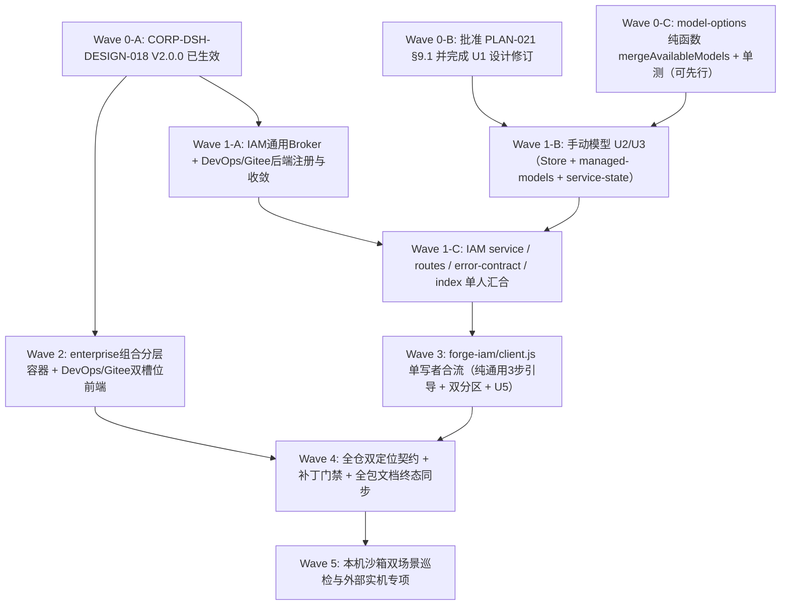

# 企业设置统一、Token 收敛与手动模型统筹实施方案

## 文档信息

| 项 | 内容 |
|---|---|
| 文档编号 | CORP-DSH-PLAN-022 |
| 文档名称 | 企业设置统一、Token 收敛与手动模型统筹实施方案 |
| 版本 | V0.2.0 |
| 文档状态 | 草案 |
| 密级 | — |
| 编制 | DSH 平台组（代拟） |
| 审核 | 待定 |
| 批准 | 待定 |
| 最后更新 | 2026-11-13 |
| 门禁 | 统筹执行总纲：设计基准 `CORP-DSH-DESIGN-018`（V2.0.0 已生效，严格零 DSH 改动、双定位零耦合、渐进披露去技术噪声）；手动模型行为分支（Wave 1-B / Wave 3 相关项）受 `CORP-DSH-PLAN-021` §9.1 与 U1 边界修订批准门禁约束；本地只做离线单测与合成探针，企业网关与系统凭据库未联调 |
| 文档层级 | L2 统筹实施计划；字段、接口与安全边界以设计文档、契约和已批准方案为准 |

> 编制依据：2026-11-13 已生效的[企业设置菜单统一与 Token 收敛详细设计](../design/enterprise-menu-and-token-unification.md)（CORP-DSH-DESIGN-018 V2.0.0）、[根 README](../../README.md)「企业级智能研发平台 × 智能个人助理」双定位、同日工作区方案[企业模型设置手动添加模型实施方案](2026-11-13-enterprise-manual-model-add-luna-guide.md)（CORP-DSH-PLAN-021 V0.3.0，针对 GitHub issue #273）、`main` 基线 `f8f7a29` 源码与 `packages/forge-iam/test/client-structure.test.mjs`、`packages/forge-enterprise` / `forge-devops` / `forge-gitee` 实核。全方案未经真实企业网关、OS 凭据库或双端实机验证。
>
> 修订说明：V0.2.0 对齐 `CORP-DSH-DESIGN-018` V2.0.0，全面引入「一体双定位物理/UI 解耦」与「去技术细节渐进披露」重构：`@heluo/forge-iam` 从直接写死 DevOps/Gitee 改为领域无关凭据注册表与 `heluo.iam.credential-item` 空时隐藏扩展槽位、`@heluo/forge-enterprise` 拆分通用基础组合与研发叠加层、Onboarding 收回 3 步通用流程、Wave 4 增补零研发渗漏双定位测试门禁。
>
> 关联文档：[企业设置菜单统一与 Token 收敛详细设计](../design/enterprise-menu-and-token-unification.md)、[企业模型设置手动添加模型实施方案](2026-11-13-enterprise-manual-model-add-luna-guide.md)、[IAM 接入详细设计](../design/plugins/forge-iam.md)、[企业组合包详细设计](../design/plugins/forge-enterprise.md)、[DevOps 接入](../design/plugins/forge-devops.md)、[Gitee 接入](../design/plugins/forge-gitee.md)、[逐模块设计索引](../design/README.md)、[总体架构](../architecture/platform-architecture.md)、[DSH 插件高阶规范](../engineering/dsh-plugin-conventions.md)、[SQLite 存储扩展与使用规范](../engineering/sqlite-storage-conventions.md)、[AI 网关契约](../contracts/gateway-contract.md)、[DOP CLI 规范](../contracts/dop-cli-spec.md)、[GH CLI 规范](../contracts/gh-cli-spec.md)、[forge-iam 开发指南](../../packages/forge-iam/docs/developer-guide.md)、[forge-iam 使用手册](../../packages/forge-iam/docs/user-guide.md)。

## 1. 统筹目标与合流结论

当前围绕企业设置与模型能力有两项强耦合工作流并存，均锚定于 `main`（`f8f7a29`，PR #272）：

1. **`CORP-DSH-DESIGN-018`（已生效 V2.0.0）**：在**不修改 DSH 宿主源码**的前提下实现面向双定位用户旅程的架构解耦与简洁化体验：
   - **双定位分层**：通用企业底座仅展示 **`企业账号`（`-10`）** 与 **`企业模型`（`10`）** 且对研发名词零耦合、3 步纯净引导；启用研发叠加层后追加 **`企业研发工具`（`30`）**，各工具扩展通过 IAM 领域无关凭据槽位（`heluo.iam.credential-item`）与通用 Broker 注册表按需挂载。
   - **去技术细节渐进披露**：隐藏内部 Token 协议栈与状态机名词，AI 服务已就绪默认折叠，外部扩展凭据默认平静单行（「跟随本机登录」），仅按需展开或真实故障时介入提示；同步完成 `cli-runner.mjs` 环境白名单收敛与 Gitee「高级」用户界面下线。
2. **`CORP-DSH-PLAN-021`（issue #273，V0.3.0 草案）**：企业模型设置支持手动添加模型——将企业模型准入从「网关目录唯一来源」调整为「目录 + 本机手动声明」两级权威，补齐 `heluo-iam/model-selection` 的 `manual` 局部放宽持久化、`stale` 口径修正、并发防竞态、`POST /api/forge-iam/models/manual`（原草案写 `PUT`，实现收敛为 `POST`）与客户端手动添加/删除/状态联动。

两项工作共同命中 **`packages/forge-iam/client.js`**（`Panel`、`ModelsPanel`/`renderModelsCard`、`Onboarding`、`useModelCatalogue`、`deriveModelUi`、`ERROR_NOTICE`）、IAM 服务端聚合入口、补丁分层与全仓 UI 契约测试。**统筹核心策略**：保持**零 DSH 宿主改造**与**单一文件单一写所有者（One Writer Per File）**，在六个波次（Wave 0–Wave 5）内将两条并轨推进线无冲突汇合，确保 `@heluo/forge-iam` 只重构一次、不写死任何研发业务名词，且 `renderModelsCard` 在迁入独立 `企业模型` 分区时直接一步到位承接 `PLAN-021` U5。

## 2. 冲突点与合流规则矩阵

| 耦合热点 | 不统筹时的冲突或返工风险 | 统筹合流规则 |
|---|---|---|
| `packages/forge-iam/client.js`（`Panel`、`Onboarding`、`renderModelsCard`） | 若先按旧单页改手动模型再拆菜单、或在 `forge-iam` 内写死 DevOps/Gitee 卡片，不仅两次重写卡片与静态测试，还破坏双定位零耦合 | **Wave 3 单写者一次性合流**：先独立抽取 `ModelsPanel`（`forge-models` `order: 10`）并一步内置 `PLAN-021` U5；`Panel`（`-10`）改为通用身份 + 折叠 AI 服务 + 空时隐藏的 `heluo.iam.credential-item` 扩展区；`Onboarding` 保持 3 步纯通用引导 |
| `packages/forge-iam` 后端与扩展工具包关系 | 在 `forge-iam` 写死 `devops`/`gitee` 枚举与路由会导致通用包被研发耦合、后续每接一个工具都要改 `forge-iam` 核心 | **Wave 1-A 改为通用 Broker 注册表**：`@heluo/forge-iam` 仅提供领域无关 `credential-registry` / `ext-token-store` 与通用槽位契约；`forge-devops` 与 `forge-gitee` 在各自包内主动注册自己，互相零耦合 |
| `packages/forge-enterprise/cordis.patch.yml` | 全量补丁默认强挂 `forge-devops`、`heluo-gitee`、`heluo-issue-delivery-skill`，非研发部署无纯净组合可用 | **Wave 2-A 拆清补丁层次**：区分「企业通用基础组合（含 `keychain`/`policy`/`iam`）」与「研发增强叠加层（含技能、容器与双工具）」，确保满足 `plugin-patch-layers` 跨包一致性 |
| `packages/forge-iam/test/client-structure.test.mjs` | 严锁 `§1`–`§17` 锚点、`RENDER_ARITY_BASELINE`（≤ 4 组入参）与单点状态读取 | 新增扩展槽位容器与 `ModelsPanel` 一律遵循 `{ h, ui, model, actions }` 组参；Wave 3 同步更新基线，绝不引入散乱裸读 |
| `docs/design/plugins/forge-iam.md` 与全仓 `tests/ui-contract.test.mjs` | U1 边界修订在前、全仓双定位 UI 契约检验在后；先后顺序颠倒会触发静态报错 | **Wave 0** 先通过 Gate B 完成 U1；**Wave 4** 代码全落地后再一次性升级 `tests/ui-contract.test.mjs` 覆盖「2 菜单通用态」与「3 菜单研发态」双场景 |

## 3. 前置门禁与并发执行纪律

### 3.1 双重准入门禁（解耦推进，互不卡死）

- **门禁 A（双定位结构解耦、扩展 Token 收敛与工程工具容器）**：`CORP-DSH-DESIGN-018`（V2.0.0）已 `生效`，对应 **Wave 1-A**（通用 Broker、DevOps/Gitee 声明接入与 `ENV_ALLOWLIST`）和 **Wave 2**（`@heluo/forge-enterprise` 组合分层/容器、DevOps/Gitee 客户端 Tab + IAM Token 项）**立即可排期启动**。
- **门禁 B（issue #273 手动添加模型行为变更）**：严格遵守 `CORP-DSH-PLAN-021` §9.1 与 §10：在用户明确批准以下 4 项前置裁决并完成 **Wave 0（U1 设计修订）** 前，**仅允许先行开发 `model-options.mjs` 的 `mergeAvailableModels` 纯函数与单测**；Wave 1-B、Wave 1-C 手动模型路由及 Wave 3 中 U5 界面提交不得提前落地：
  1. 两级权威口径（目录唯一提供元数据与可用性证据；手动声明不产生企业授权，网关侧裁决）；
  2. `stale` 仅基于 `catalogModels.length > 0` 成立；
  3. 上限取 `MAX_MANUAL_MODELS = 100`、目录 `500` 条；
  4. 添加手动模型本身不自动启用（批量「全部默认启用」维持显式覆写说明）。

### 3.2 并行关系与公共基线检查

- **PR #252（issue #202）正交兼容**：`mergeAvailableModels` 仅依赖归一化目录输出形态（`{ id, name, contextWindow, maxTokens, input, inputModalities }`），与 #252 合并次序无关；每波次启动前核查 `git status --short` 及 #252 状态。
- **DSH 宿主零改动与提交纪律**：严禁修改任何 DSH 宿主源码；提交说明不以 `#` 开头（引用 `issue #273`、`CORP-DSH-DESIGN-018` 等采用内联语法）。

## 4. 分波次实施路线图（Wave 0 – Wave 5）

### Wave 0 — 门禁裁决、U1 设计边界修订与纯函数先行

1. **W0-1 基线对齐**：核对 `git status --short`、确认 `HEAD` 与 PR #252 合入情况。
2. **W0-2 门禁 B 裁决与 `PLAN-021` U1**：确认 §9.1 第 1–4 项后，修订 [IAM 接入详细设计](../design/plugins/forge-iam.md) `§13`/`§13.1` 与 `IamView` 片段及[逐模块设计索引](../design/README.md)（**不改 `ERROR_STATUS` 与 §871 表**），回填确认记录至 `CORP-DSH-PLAN-021`。
3. **W0-3 可先行纯函数**：落地 `packages/forge-iam/src/model-options.mjs` 的 `MAX_MANUAL_MODELS = 100`、`mergeAvailableModels(catalog, manual)` 及 `test/model-options.test.mjs`。
- **Wave 0 出口**：`pnpm check:docs` 通过；`model-options.test.mjs` 全绿。

### Wave 1 — 后端底座实施与汇合（W1-A × W1-B 并行 → W1-C 汇合）

#### Track W1-A：领域无关凭据扩展底座 + 工具环境安全收敛（依赖 `DESIGN-018` V2.0.0）

- **`@heluo/forge-iam`（新增独立通用模块，零 DevOps/Gitee 硬编码）**：
  - `packages/forge-iam/src/credential-registry.mjs` 与 `src/ext-token-store.mjs`：定义 `registerExtensionCredential({ extensionId, storageRef, envKey, allowlistedEnvNames, detectRiskAndExternal })`，校验 `storageRef` 符合 `^[A-Za-z_][A-Za-z0-9_]*$`，按 `heluo-iam/ext-token-<extensionId>` 分区调用 `@heluo/forge-credentials-keychain` 读写并强绑定 `ownerSubject` AEAD AAD，串行 CAS 队列。
  - `packages/forge-iam/src/service-ext-tokens.mjs`：实现 `UNSET_NO_HOSTED` / `ENV_INHERITED` / `HOSTED_ACTIVE` / `OWNER_MISMATCH` / `IAM_NOT_SIGNED_IN` / `PENDING_WRITE` / `KEYCHAIN_UNAVAILABLE` 解析与 `execFile` 瞬态 env 注入；对外**严禁输出密钥原值或前后缀**。
- **`@heluo/forge-devops`**：
  - `src/cli-runner.mjs`：由 `{ ...process.env, ...normalizeEnv(env) }` 收敛至严格 `ENV_ALLOWLIST` + 显式 `DEVOPS_API_KEY`。
  - `src/cli-config.mjs` / `src/failure-face.mjs` / `src/http.mjs` / `src/index.mjs`：向 IAM Broker 注册 `HEL_EXT_DEVOPS_TOKEN` 扩展描述（保持单包独立无 IAM 时仍可用）；出错引导区分 CLI 路径（`设置 → 企业研发工具`）与凭据指定（`设置 → 企业账号` 或终端登录）。
- **`@heluo/forge-gitee`**：
  - `src/runtime-config.mjs`：保留 `authEnv` / `persistentToken` 后端契约与 `ConfigStandard` 不变。
  - `src/gitee-cli.mjs` / `src/index.mjs`：向 IAM Broker 注册 `HEL_EXT_GITEE_TOKEN` 与 `detectPersistentToken` / `authEnv` 状态报告，接通托管覆盖优先链（仍不碰 `~/.gitee-cli/config.json`）。

#### Track W1-B：手动添加模型存储与运行期合流（按 `PLAN-021` U2 + U3，需先通过 Wave 0-B）

- 独占改造 `packages/forge-iam/src/store.mjs`、`src/service-model-selection.mjs`、`src/managed-models.mjs`、`src/service-state.mjs` 及其配套单测（`model-selection-store`、`model-selection-service`、`managed-models` 含 `:21-25` stub、`service-state-*`、并发竞态与变异验证），规格全同 `CORP-DSH-PLAN-021` U2/U3（`manual` 局部放宽、`stale` 仅认最近成功目录、无 `backend &&` 的 `rebuildAdapter`、`optionsChain` + `await flight?.promise`、`MESSAGES`、非模型术语洁净对齐）。

#### Track W1-C：IAM 服务端单点汇合（依赖 W1-A + W1-B）

- 单写者统一合入 `packages/forge-iam/src/error-contract.mjs`、`src/service.mjs`、`src/routes.mjs`、`src/state.mjs`、`src/index.mjs`：
  1. 挂接 `POST /api/forge-iam/models/manual`（原草案写 `PUT`）与 `IAM_MANUAL_MODEL_{INVALID,LIMIT,CONFLICT,NOT_FOUND}` 映射；
  2. 挂接领域无关 `/api/forge-iam/ext-credentials[/<id>]`（原草案写 `/ext-tokens`；GET 仅吐脱敏态 + 人话所需状态位，PUT/DELETE 强制 `hasMutationHeader`），并导出扩展 Broker 注册端口给工具包消费；
  3. 跑通除 `client` 外三包全量后端单测。

### Wave 2 — `@heluo/forge-enterprise` 组合分层/容器与工程工具双槽位前端（可与 Wave 3 并行）

- **W2-A（`@heluo/forge-enterprise`）**：
  - 拆分清楚**企业通用基础组合**（不含研发包）与**研发能力叠加层**（含 `heluo-issue-delivery-skill`、`heluo-engineering-ui`、`forge-devops`、`heluo-gitee`），确保满足 `tests/plugin-patch-layers.test.mjs` 对 `heluo-policy` 6 条并集目录的逐字校验。
  - 新增纯展示 UI 容器 `packages/forge-enterprise/client.js`（注册 `forge-engineering` `order: 30` + icon + `heluo.engineering.tab` + 默认折叠「环境诊断（技术详情）」抽屉 + 一键脱敏复制）、`package.json`（`dsh.client` / `./client`）、`src/index.mjs`（空 `apply()`）与单测。
- **W2-B（`@heluo/forge-devops/client.js`）**：
  - 接入 `heluo.engineering.tab`（`order: 10`）与零竞态独立回退（`order: 30` + icon），合入单视图与唯一 `?refresh=1`，四层探测详情只进诊断摘要。
  - **同时向 `heluo.iam.credential-item` 注入紧凑 DevOps 凭据项**：正常态静默展示 `跟随本机登录（正常可用）`，按需点击「单独指定 Token」才展开输入框，仅遇 `OWNER_MISMATCH` 或认证失效才弹出人话恢复提示。
- **W2-C（`@heluo/forge-gitee/client.js`）**：
  - 接入 `heluo.engineering.tab`（`order: 20`）与独立回退（`order: 30` + icon），**彻底移除「高级 · 通常不用改」表单区块**（仅留 `cliPath`、`timeoutMs` 与只读 `host`），策略与变量名只进诊断。
  - **向 `heluo.iam.credential-item` 注入紧凑 Gitee 凭据项**：正常态静默展示 `跟随本机登录（正常可用）`，仅在扫到明文风险（`persistentToken`）或换号冲突（`OWNER_MISMATCH`）时展示人话处理建议与一键动作。

### Wave 3 — `@heluo/forge-iam/client.js` 一次性统筹重构（单一写者，依赖 W1-C）

由**单一执行者**完成全部 IAM 前端及测试同步，严格锁定零研发硬编码与静默渐进披露体验：

1. **纯净 3 步通用 Onboarding**：保留第 1 步（登录企业账号）→ 第 2 步（启用 AI 服务，自然语言说明）→ 第 3 步（确认默认企业模型）；**零 `dop`/`gh`/CLI 文案**。
2. **双顶级分区与矢量图标**：注册 `forge-iam`（`order: -10`, `企业账号`）与 `forge-models`（`order: 10`, `企业模型`）及对应 `settings.section.icon`。
3. **极简「企业账号」界面**：
   - 主区仅留「账号身份状态」与「AI 服务状态」（未授权引导录入；验证通过后**自动折叠为单行绿色 `AI 服务 · 已就绪`** + 轻量「更换」入口），**严禁露出 OIDC / Refresh Token / 静态 Key / CAS 等术语**；
   - 声明子槽位 `children: { 'heluo.iam.credential-item': { kind: 'list', scope: 'root' } }`：**当未挂载研发等扩展（`entries.length === 0`）时整块凭据扩展区完全隐藏**；有扩展注入时才紧凑呈现在 IAM 页面下方/标签区。
4. **独立「企业模型」+ `PLAN-021` U5 合流**：
   - 将 `ModelsPanel` 独立挂载至 `forge-models`（`order: 10`），未登录/AI 未就绪时渲染明确路径引导 `前往 设置 → 企业账号 完成准备`（含可选 `sectionNavigatorOf`）；
   - 完整实现 `PLAN-021` U5 手动添加模型全部状态、表单、来源徽章、删改与 `ERROR_NOTICE`（面向用户侧用人话说明，不露出内部状态码或合流机制），同步更新 `test/client-structure.test.mjs`、`test/client-managed-models.test.mjs` 与新建 **通用底座零研发渗漏测试**。

### Wave 4 — 全仓双定位契约收口、终态文档同步与离线验收

1. **升级 `tests/ui-contract.test.mjs` 覆盖双定位两组契约**：
   - **契约组 1（通用助理基础配置，无研发插件）**：验证仅存在 `forge-iam`（`-10`）与 `forge-models`（`10`），无 `forge-engineering` 菜单，IAM UI 与 Onboarding 中 `DevOps`/`Gitee`/`dop`/`gh`/扩展凭据区出现次数为 `0`；
   - **契约组 2（研发增强配置）**：验证 `forge-iam`（`-10`）、`forge-models`（`10`）、`forge-engineering`（`30`）三菜单与各自图标、`heluo.engineering.tab`、`heluo.iam.credential-item` 全部装配正确，旧 `29/50/60` 分区零残留，并验证正常可用状态下主界面不暴露实现级 Token 术语。
   - 同步确认 `tests/plugin-patch-layers.test.mjs`、`tests/bundle-closure.test.mjs`、`packages/forge-devops/test/delivery-selfcheck.test.mjs` 全绿。
2. **终态文档与包手册同步（`PLAN-021` U6 + `DESIGN-018` §8）**：更新插件设计文档、包指南、README 与 `docs/design/README.md` §2.2 实现态，保持 `docs/contracts/gateway-contract.md` 不变。
3. **全量离线验收闭环**：执行第 6 节检查清单与 `sensitive-scan` 验签。

### Wave 5 — 本地沙箱巡检与外部实机取证（不阻塞开发交付）

- 本机沙箱（可选）：分别以「基础通用组合」与「研发叠加组合」加载 `web` profile 巡检左侧菜单、默认折叠态、Gitee 无高级区、扩展凭据按需展开及手动添加模型流程，及运行扩展版 `run-iam-managed-models-probe.mjs`。
- 企业外部环境（单列 `未核验 / 未联调` 台账）：真实企业网关对手动模型 ID 的裁决、真实终端 `dop`/`gh` OS 凭据库联动及 Windows/麒麟双端实机验证。

## 5. 并行排期、文件所有权与回退控制

| 执行波次 | 并行轨道 | 独占文件域（严禁并行写冲突） | 汇合条件 |
|---|---|---|---|
| **Wave 0** | W0-2 // W0-3 | `forge-iam.md` + `design/README.md` vs `model-options.mjs` + `model-options.test.mjs` | Gate B 获批 + `pnpm check:docs` |
| **Wave 1** | W1-A // W1-B | `credential-registry`/`ext-token-*` + `forge-devops/src/*` + `forge-gitee/src/*` vs `store.mjs` + `service-model-selection.mjs` + `managed-models.mjs` + `service-state.mjs` | W1-A 与 W1-B 全绿后由 **W1-C 单人** 合入 `service.mjs` / `routes.mjs` / `index.mjs` |
| **Wave 2 & 3** | W2-A // W2-B // W2-C // W3 | 四包各自 `client.js` 与包级测试（W2-A 含组合分层补丁/`package.json`） | 四包各自单测与零渗漏测试通过后进 **Wave 4** |
| **Wave 4** | 全仓单线程收口 | `tests/ui-contract.test.mjs` + 同步 README/设计文档 | 全仓 `pnpm check` 与签名验签通过 |

**回退边界**：手动模型回退只需撤下 `POST /api/forge-iam/models/manual` 与界面入口，库内 `manual` 字段对旧端无害；研发容器与 IAM 扩展槽位均可独立按开关撤下，工具自动退回单包分区或系统本机认证，绝不改写用户 `~/.gitee-cli/config.json` 与 `~/.config/dop`。

## 6. 统一验收清单（合流双定位与 Issue #273 判据）

在仓库根目录执行，分支 `feat/epic-273-integration` 上离线闭环与 Wave 5 外部未联调项明确分列：

- [x] **离线结构与构建门禁**：`pnpm check:docs`、`pnpm check:repo`、`pnpm check:version`、`pnpm check`、`git diff --check` 与 `node scripts/sensitive-scan/verify.mjs --base origin/main --head HEAD` 全绿；DSH 宿主仓库零改动（注：跨平台与宿主版本相关 3 项用例按环境条件跳过，已在汇总记录）。
- [x] **双定位零耦合证明**：仅挂企业通用底座时，侧栏严格只有 `forge-iam`（`-10`）与 `forge-models`（`10`），3 步引导与账户页面 DOM 中零 `DevOps`/`Gitee`/`dop`/`gh`/外部 Token 区块；加载研发叠加层后三菜单（`-10/10/30`）、图标、双槽位按序生效且无 `29/50/60` 碎片（`tests/ui-contract.test.mjs` 与 `client-zero-engineering-leak.test.mjs` 离线覆盖；容器级跨工具状态条/诊断聚合保留为后续项）。
- [x] **去技术细节渐进披露**：正常可用状态下 `企业账号` 首屏折叠已就绪 AI 服务、外部扩展呈「跟随本机登录」平静单行，不暴露 `OIDC` / `Refresh Token` / `OWNER_MISMATCH` / `persistentToken` / `ENV_INHERITED` 等实现名词；按需展开或注入故障态时才出现具体操作与告警。
- [x] **Token 安全与 Gitee 收敛**：`HOSTED_ACTIVE` 覆盖生效、`OWNER_MISMATCH` 0 次启动拦截、`forge-devops` / `forge-gitee` 子进程剥离无关密钥、GET 零明文（实机采用 `/api/forge-iam/ext-credentials[/<id>]` 路由）；Gitee 主视图无「高级」表单且保留 `ConfigStandard` 与 `detectPersistentToken` 约束。
- [x] **手动添加模型闭环（issue #273）**：独立「企业模型」页支持合法 ID 添加、来源标识、配置、启用/停用与删除（经 `POST /api/forge-iam/models/manual` 与 `IAM_MANUAL_MODEL_*` 错误契约）；空/错目录可用性与 `stale` 修正、并发 `refresh()` 窗口保护、账号隔离、门禁拦截、变异测试与合成探针 `run-iam-managed-models-probe.mjs` 全数通过；明确区分本地离线验证与企业真机未联调事实。
- [ ] **Wave 5 本地真实 GUI 与外部实机专项（#285）**：本地 `web` profile 真实浏览器双场景 GUI 巡检、真实终端 `dop`/`gh` OS 凭据库联动、内网 `gh` 明文扫描实样、真实企业网关 403/404/400 裁决与 Windows/银河麒麟双端实机验收尚未执行（外部环境未开放）。
