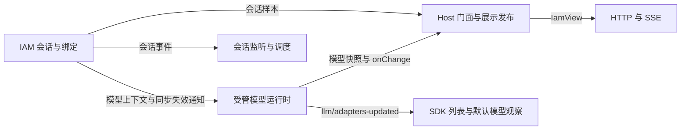

# IAM 会话与受管模型解耦实施方案

## 文档信息

| 项 | 内容 |
|---|---|
| 文档编号 | CORP-DSH-PLAN-029 |
| 文档名称 | IAM 会话与受管模型解耦实施方案 |
| 版本 | V0.2.1 |
| 文档状态 | 草案 |
| 密级 | — |
| 编制 | DSH 平台组（代拟） |
| 审核 | 待定 |
| 批准 | 待定 |
| 最后更新 | 2026-11-28 |
| 门禁 | 第一阶段实施暂缓。重新启动须确认长期维护收益并关闭实施就绪阻断项。交付须通过模型失效来源覆盖、只读投影、真实装配的通知隔离、原有派发时序及全量离线回归 |

> 编制依据为 2026-11-27 的 `main`（`bcca688d`）源码、既有用例及 [V0.1.0 的 EGM 审查](../engineering/reviews/2026-11-27-iam-session-model-boundary/consolidated_review_report.md)。[PLAN-014](2026-11-05-forge-iam-structure.md)记录 Host 分轴及客户端单入口，[PLAN-028](2026-11-27-iam-session-freshness.md)记录到期、续期与派发时序。实施就绪阻断项见 [V0.2.0 的 EGM 复审](../engineering/reviews/2026-11-27-iam-session-model-boundary/v0.2.0/implementation_readiness_report.md)。
>
> 关联文档包括 [IAM 接入详细设计](../design/plugins/forge-iam.md)、[IAM 实现与验证记录](../design/verification/forge-iam.md)和 [DSH 插件高阶规范](../engineering/dsh-plugin-conventions.md)。

## 1. 交付目标

候选方案的第一阶段切断显示视图触发模型采样的回边，以及模型目录变化触发会话调度的回流。IAM 保有会话、绑定、持久选型读写和最后派发校验。受管模型运行时拥有目录、应用后的选型快照、请求与流的生命周期。Host 门面组合并发布供界面使用的视图。

单独隔离目录发布会留下读时采样。单独拆出投影会留下会话调度回流。两处在一个变更单元内验收，复用现有状态所有者、目录单飞与派发门禁。交付沿用一个 `@heluo/forge-iam` 插件、一个浏览器 bundle，以及现有 `ctx.iam`、HTTP/SSE 接口、配置、凭据记录和错误契约。通过 §4 后第一阶段可独立交付，进一步拆分按 §5 决定。

## 2. 当前调用链与目标边界

[`service-state.mjs`](../../packages/forge-iam/src/service-state.mjs) 的 `view()` 调用模型 `getView()`，后者执行 `sample()` 并回读 `iam.getView()`。这一回边也负责处理部分没有现成通知的变化，例如普通网关回读清空摘要、另一 Host 替换同账号的登录实例，以及取消已结束的登录尝试。目录发布通过 [Host 装配](../../packages/forge-iam/src/index.mjs) 调用 `service.notifyView()`，触发会话监听、续期与到期调度。 [网关摘要采纳](../../packages/forge-iam/src/service-gateway.mjs) · [会话采纳](../../packages/forge-iam/src/service-reconcile.mjs) · [取消登录](../../packages/forge-iam/src/service-signin.mjs)



### 2.1 取样、投影与独占检查

| 边界 | 包内接口与语义 |
|---|---|
| 会话取样 | `service-state.mjs` 按同一次墙钟、单调时钟和当前驻留的会话及凭据摘要产生样本。会话发布、期限排程和持久写入确认消费该样本或所属的凭据摘要。 |
| 模型上下文 | `readModelContext(): ModelContext` 从同一取样路径同步取得 `state`、`error`、`principal`、`accessExpiresAt`、`renewal`、脱敏 `gatewayCredential` 和三个现有代际。该处 `gatewayCredential` 表示模型当前有效的绑定，IAM 已判定 provider 不可信时按缺失处理，即使显示摘要尚在。取样只使用驻留数据。 |
| 模型执行与设置 | 通过窄端口复用 `captureModelSession`、`resolveGatewayConnection`、`captureModelSettings`、`readModelSelection` 和 `saveModelSelection`。原生传输继续用 `withDispatchAccessToken()` 在派发前核验持久授权和绑定。非原生适配器沿用 `getAccessToken` 注入。 |
| 展示投影 | 门面将同一取样的模型上下文传给模型 `getView(context)`，再调用 `composeIamView(sessionSample, modelView): IamView`。运行时的直接读取可用 `readModelContext()` 补齐入参。无运行时时沿用空模型视图。模型投影异常时用既有 `ENTERPRISE_MODELS_UNAVAILABLE` 和空集合生成展示视图。会话状态、业务确认和错误码由其各自的结果决定。 |
| 公开出口 | `getView()`、`watch()`、登录启动及回调、`cancelSignIn()`、退出、Key 保存及清除、`hydrate()` 和 `syncFromStore()` 的直接或嵌套视图统一从门面组合。`/view`、`/models`、`/events` 及现有命令响应保留字段，与内部非枚举的 `sampledAt`、`sampledMonotonicAt` 及路由序列化对齐。 |

登录回调的 grant 提交与失败清理、Key 的写入确认、内部 `hydrate()` 和会话排程均在组合完整视图前完成。现有管理路由先显式完成存储同步、凭据加载或目录刷新，再返回投影。模型 `getView(context)` 和 `composeIamView()` 只计算输出，目录重拉、计时器更新、选型写入和租约取消由各自的运行时入口执行。

IAM 在 `getView()`、`watch()` 首帧、原生模型列表、预检与派发的入口保有动态独占复查。原生模型列表在采样前经私有端口调用 IAM 检查。首次发现官方账号服务晚挂或组合冲突时，IAM 在投影外提交冲突、清理待定观察并使受影响的模型授权失效。展示与操作使用原有错误语义，撤挂官方服务后仍维持已发现的拒绝状态。稳定状态下，入口检查后的读视图和模型展示发布只组合样本。

### 2.2 模型失效的来源与交付时点

`subscribeModelContext(listener, signal): unsubscribe` 使用会话轴中的私有监听集合。运行时成为当前实例后，先登记监听及取消清理，在同一同步调用内用首次样本初始化状态，再由 `ready` 发起首次目录发现。变更的所有者完成一组有效状态更新后同步交付样本。运行时回调在发布者返回前处理应当失效的租约及内存快照。回调故障与 IAM 的提交和调度隔离。目录请求、SDK 事件和展示发帧由运行时在当前调用栈退出后合并处理，沿用目录单飞。每次已确认的失效都须同步交付，恢复只为新的工作建立租约。

| 变化来源 | 写入所有者与通知时点 | 运行时判据 |
|---|---|---|
| 登录、换号、退出、到期与确认续期 | IAM 会话轴完成迁移或计算到期后发布会话事件及有效模型样本。退出在原有 `authEpoch` 递增点先使旧租约失效，最后发布持久化结果。沿用会话监听、续期、到期和默认模型观察的原有调度。 | 取消失效的旧工作。同一登录确认续期只更新授权期限，按现有轮换规则处理已受理流。 |
| 跨 Host 会话采纳 | `service-reconcile.mjs` 在采纳记录并完成绑定验证后比较模型上下文，包含 `sessionInstanceId`。即使公开会话字段同值，仍须交付有效的模型变化。 | 同账号的新登录实例使旧租约失效，按 §2.3 处理已确认目录及选型。 |
| 取消已结束的登录尝试 | `service-signin.mjs` 在非 `authenticating` 分支完成 `authEpoch` 推进和尝试清理后，先交付私有失效，再返回 `IamView`。公开帧仍按原会话事件条件发布。 | 旧请求失效，当前已安装模型可供新请求使用。 |
| 网关普通或强制回读 | `service-gateway.mjs` 的 `load()` 在现有 epoch、flight 和 provider 检查通过后，将采纳结果与最近交付的有效上下文比较。当前读取确认摘要变更或不可用时同步交付。被替换的读结果和同值回读保持静默。`sessionRefresh` 保有其会话发布语义，同一次采纳只交付一次模型变化。 | 失配或清空立即废弃旧租约和目录。有效新摘要触发适用的目录重建。无 `defaultModel` 时同样成立。 |
| Key 保存、清除和结果未知 | `service-gateway.mjs` 在既有 SQLite 写入及回读确认通过后发布绑定变化。确认结果未知时，沿用 `publishUnknown` 清除摘要并发布失效。等待确认期间沿用上次已确认摘要和 `accessEpoch` 对待派发工作的约束。 | 清除或确认未知使旧绑定失效。同址有效重存刷新目录与待派发上下文，已受理流沿用现有授权规则。 |
| 凭据服务、原子存储和机密来源解绑或恢复 | `index.mjs` 传递当前绑定的变动，IAM 在既有 provider 归属和信任检查后采纳。失去有效来源时先通知。恢复在 `hydrate()` 确认当前记录后通知并恢复原有续期安排。`service-store.mjs` 通过同一入口交付 `ensure()` 首次发现的有效 provider 失效。 | 旧实例迟到的完成结果不更新快照。实际失去授权后恢复时，新的工作使用新租约。 |
| 独占冲突 | §2.1 的 IAM 检查入口首次提交冲突时发布有效失效样本。 | 原生列表和派发关闭，旧授权保持已失效。 |

加载中的摘要暂清及写入确认等待属于作业中间态。有效变化以所有者完成采纳或确认失效为准，失败分支也须与最近交付的有效上下文比较。时效、绑定和代际比较沿用现有所有者，订阅复用本地监听与生命周期。

`notifyView()` 继续承接会话发布与排程。会话监听及排程使用会话样本，门面在公开出口组合视图。模型 `onChange` 调用私有 `publishModelView()`，只推送展示快照。`llm/adapters-updated` 独立保留 SDK 默认模型观察，允许其原有的有界凭据摘要读取，真实变化进入上表，同值读取保持静默。

公开视图仍通过 `watch(signal)` 提供异步帧。各订阅随自己的 `signal` 和 Host 生命周期关闭。关闭标志须覆盖等待、首帧暂停和有排队帧的位置，释放等待者并丢弃排队帧。运行时被替换时关闭旧实例的私有订阅，按实例归属忽略迟到回调。现有公开订阅继续消费当前实例的投影。

### 2.3 目录、选型与流的判据

| 依据 | 原有来源及用途 |
|---|---|
| `accessEpoch` | 复用 `authEpoch`、`sessionEpoch`、`selection.generation` 的组合。推进时按既有规则重核待派发或在途目录作业，运行时保有同一归属内已确认的选型。 |
| `sessionIdentity` | 复用 `sessionEpoch` 和已采纳 grant 的 `sessionInstanceId`。识别新登录实例，触发选型重读与路由重建。 |
| `authorizationEpoch` | 复用 `authEpoch`、`sessionEpoch`、`sessionInstanceId`。与主体、有效绑定和期限共同决定旧租约能否延续。 |
| 目录绑定与期限 | 目录沿用主体及已确认的脱敏网关摘要比较，包括 Key 的 `generation`。`accessExpiresAt` 和 `renewal` 决定显示的有效期限以及现有可恢复状态。 |

| 场景 | 当前样本的显示投影 | 运行时与授权 |
|---|---|---|
| 无运行时 | 以 `managed: true`、`state: 'unconfigured'`、空 `models` 为基础视图，`configured` 和 `baseURL` 由当前配置及摘要得出。 | 模型能力按既有不可用路径处理。 |
| 退出完成、有效绑定缺失或不匹配、不可恢复的会话 | 使用现有未配置投影，`models`、`enabled` 为空，`modelOptions` 为空对象，`defaultModelId` 为 `null`，`manualTruncated` 为 `0`。`configured` 和 `baseURL` 由当前配置及摘要得出。 | 旧授权按失效规则终止。 |
| 同一登录可续期到期 | 有已确认目录时保留缓存并显示 `stale` 和现有 `IAM_LOGIN_REQUIRED`。续期窗口变化在首帧和后续帧随当前样本体现。会话为 `unreachable` 且 `error !== 'IAM_CREDENTIALS_UNAVAILABLE'` 时沿用既有缓存展示与错误语义。 | 新派发须满足 PLAN-028 的一次有界续期条件。已受理流按截止、可信轮换和撤权判据处理。 |
| 同主体新登录且网关摘要同一归属 | 可展示已确认的标准目录。持久选型重读前隐藏旧手动条目、`enabled`、`modelOptions` 和 `defaultModelId`，标准条目的 `enabled` 与 `isDefault` 为假。 | 旧租约终止，重读该登录的选型后才重建可调用模型。 |
| 主体或目录绑定变化，包括同址重存 Key | 当场遮蔽旧绑定的目录和选型，显示当前摘要。重新读回确认后显示新绑定数据。 | 旧目录作业或待派发调用按现有代际作废或重核。同主体同址有效重存保留已受理流在原授权内的延续条件。 |
| 同一登录确认续期，或同归属设置变化 | 同一登录续期更新期限并保留有效目录和选型。设置变化显示最后确认的选择。 | 保留既有租约和选型写入确认机制。新派发继续检查当前授权、绑定和安装态。 |

## 3. 第一阶段实施步骤

### 3.1 固定基线与回归入口

- [ ] 按 §4.1 建立正常入口的回归，使用可控时钟、订阅与存储屏障、合成会话、真实 SQLite 测试存储和环回传输。已登录的 `apply` 夹具支持注册并调用原生适配器。使用真实模型 `onChange` 驱动用例，新旧代码通过同一装配入口比较。
- [ ] 产品代码改动前执行相关用例，记录新增缺陷断言在旧实现的失败位置，保留原有通过项。用于隔离投影的运行时夹具先改变样本，再控制监听投递。真实装配用例验证提交时同步撤回租约。

### 3.2 同批迁移投影、失效通知与装配

| 修改落点 | 工作项 |
|---|---|
| `packages/forge-iam/src/service-state.mjs`、`state.mjs` | 抽取共享会话取样。状态轴保有会话、期限及会话、私有模型、公开帧三组监听集合与清理。`composeIamView()` 放在 `state.mjs`，复用 `createView()`。 |
| `packages/forge-iam/src/service.mjs` | 经私有装配入口交付模型访问能力、订阅和 `publishModelView()`。公开门面在业务完成后组合各直接或嵌套视图。保留 `notifyView()` 的会话语义，以及令牌模块的两处直接会话监听。 |
| `packages/forge-iam/src/service-signin.mjs`、`service-signout.mjs`、`service-reconcile.mjs`、`service-gateway.mjs`、`service-store.mjs` | 在 §2.2 的事件所有者完成采纳时交付信号。验证凭据写入使用当前凭据摘要，内部登录、退出和恢复流程消费会话样本。完整视图在这些业务结果返回后由门面组合。 |
| `packages/forge-iam/src/index.mjs`、`managed-models.mjs` | 将运行时初始化、私有订阅、`onChange`、SDK 事件及销毁按实例接线。实例装配后由现有 `ready` 启动路径订阅并发现目录。从显式模型操作、定时器及 §2.2 的订阅推进运行时。模型 `getView(context)` 实现 §2.3 的纯投影。 |
| `scripts/probe/run-iam-managed-models-probe.mjs` | 与真实 Host 使用同一私有端口，保持模拟宿主的正常进入和销毁路径。 |

同步迁移 `packages/forge-iam/test/` 下直接创建运行时的 `automatic-renewal`、`gateway-save-confirmation`、`gateway-sqlite-regression`、`host-default-model`、`iam-call-recovery`、`managed-models`、`manual-models-backend`、`model-transport` 和 `model-transport-sqlite` 的 `.test.mjs` 夹具。`manual-models-backend.test.mjs` 直接构造状态轴的适用断言转到投影入口。`session-read-lock-recovery.test.mjs`、`session-renewal-view.test.mjs` 与 `iam-view-consumer.test.mjs` 的视图桩按新门面接线。

§3.2 的取样、投影、失效与发布作为一个可构建、可测试、可回退的代码单元。全部接线就绪后统一进入 §3.3。路由序列化、浏览器共享会话流、凭据及传输契约由 §4 的回归核对。

### 3.3 验证依赖边界与实现记录

- [ ] 扩展 `service-state-structure.test.mjs`，核对运行时只依赖私有模型端口，显示投影链没有 `sample()` 或业务写入，模型 `onChange` 只通向展示发布。三条边分别在隔离副本恢复一次，记录各自守卫因对应越界失败，恢复后通过。沿用状态所有权和横向 import 守卫。
- [ ] 运行 §4 的定向回归与全量离线检查，单独记录合成 Host 探针及目标环境证据。实现验收后，在 [IAM 详细设计](../design/plugins/forge-iam.md)、[模块 README](../../packages/forge-iam/README.md) 与 [模块验证记录](../design/verification/forge-iam.md) 回写边界、实测证据和目标环境待验项。

## 4. 验收与回退

### 4.1 可判定的回归

表中的测试位于 `packages/forge-iam/test/`。新增用例使用正常的命令、路由、SDK 或已验证的投影入口。测试中的初始注册、触发点和清理结果均由屏障或可控时钟确认。

| 场景与测试落点 | 通过条件 |
|---|---|
| 双 Host 网关清除、替换及回读失败。`gateway-sqlite-regression.test.mjs`、`gateway-provider-context.test.mjs` | 受控时钟越过缓存窗口后，用 `/view` 的普通回读发现变化，覆盖 `defaultModel` 为空。采纳后停止视图读取及新模型操作。已失效的旧租约在回读返回前取消，有效换绑按 §2.3 重建目录和待派发上下文。同值强读、迟到旧 provider 结果均产生零失效信号和零目录重拉。 |
| Key 写入回读确认。`gateway-save-confirmation.test.mjs` | 暂停写后回读，等待期间旧已受理流沿用已确认摘要。放行同址有效重存时只更新相应目录和待派发上下文。确认清除或结果未知时，旧绑定失效并取消相应租约。迟到的旧确认无法恢复过时的摘要或租约。 |
| 同账号新登录、取消已结束的登录尝试及快速失效后恢复。`gateway-sqlite-regression.test.mjs`、`managed-models.test.mjs` | 通过存储同步采纳仅换 `sessionInstanceId` 的 grant。即使公开字段同值，运行时仍使旧请求失效。取消分支在命令返回前撤销旧租约，当前已安装模型可用于新请求。暂停后续刷新，先失效再恢复时旧租约保持取消，恢复只带动一次适用的目录重建。 |
| 投影即时性。`managed-models.test.mjs`、`manual-models-backend.test.mjs` | 在运行时夹具中更新样本并暂停事件投递。对退出完成、清除凭据、同主体新登录、可恢复到期各连续读取两次，逐字段满足 §2.3。读取期间目录请求、模型通知、选型写入、计时器重排、租约取消均为零。投递后由运行时执行一次适用的状态变更。 |
| 展示故障与公开返回。`service.test.mjs`、`gateway-save-confirmation.test.mjs`、`session-read-lock-recovery.test.mjs`、`routes.test.mjs` | 注入模型投影失败，已确认 grant 保留，Key 保存与清除按原确认结果返回，内部存储恢复和会话调度完成。HTTP/SSE 及登录、取消、退出、凭据操作响应仍带契约规定的 `IamView` 与对应取样时钟。投影错误仅反映在模型展示。 |
| 目录发布隔离。`iam-view-consumer.test.mjs`、`model-selection-host.test.mjs` | 真实 `apply` 装配下先登录并绑定。受控热刷新使目录状态、模型 ID 或启用位发生一次可见变化，SSE 多一帧，SDK 列表与有界默认模型观察正常。同值绑定时模型会话订阅唤醒、续期重排和额外目录重拉均为零，相同失败不重复发帧。独立验证 SDK 回读发现真实变绑时进入失效通道。本阶段以现有展示去重签名为准，同 ID 元数据更新的展示时效单独评估。 |
| 首次订阅与卸载。`iam-view-consumer.test.mjs`、`managed-models.test.mjs`、`late-credentials-hydration.test.mjs` | 在安装监听与首读交界处推进会话或绑定，初次消费收敛到当前上下文。分别在订阅暂停于首帧、排队和等待时取消或销毁，迭代结束并释放等待者。替换模型运行时时，现有公开订阅继续收取新实例的帧，旧实例的迟到回调被丢弃。解绑与恢复按当前 provider 归属，恢复后原有自动续期可用。 |
| 到期、独占与乱序。`session-renewal-view.test.mjs`、`service.test.mjs`、`client-shared-session-stream.test.mjs` | 无界面读取时到期仍主动推送并按原有授权规则处理中断。将跨刷新截止的墙钟推进点从模型 getter 移到 IAM 取样与排程之间，保留原 `sampledAt`、下一次计时唤醒时发布 `renewal=unavailable`、零换票与无重复发布。迟到模型通知使用当前会话样本。官方账号服务迟到挂载时，`getView()`、SSE 首帧、原生模型列表及派发按各自契约拒绝，撤挂后仍拒绝旧授权。 |
| 派发与持久化对照。`iam-call-recovery.test.mjs`、`model-transport*.test.mjs`、`dual-process*.test.mjs` | 未派发的旧登录或失效绑定请求零 POST，已受理流遵守原授权截止和撤回判据。维持同一登录续期、同址重存 Key 的已受理流语义，以及 SQLite 双 Host 单飞与原子提交。确认未发的恢复沿用单次等待预算与最多一笔模型 POST，已发或结果未知保留派发记录。 |

### 4.2 离线验证与合成 Host 探针

从仓库根目录运行。使用 `.node-version` 的 Node 和仓库指定的 pnpm，离线环境的 `PATH` 只暴露所需工具，宿主探针在独立步骤执行。

```sh
(
  unset DSH_BIN DSH_HOST_PROBE_FORCE
  if command -v dsh >/dev/null 2>&1; then
    printf '%s\n' '请在 PATH 仅包含所需工具且不含 dsh 的环境执行离线检查' >&2
    exit 1
  fi
  iam_test_root=$(mktemp -d) || exit 1
  export DSH_HOME="$iam_test_root/dsh"

  node --test --test-timeout=120000 packages/forge-iam/test/*.test.mjs &&
    pnpm check &&
    git diff --check
)
```

准备目标版本的宿主后，按 [本地模拟测试指南](../../packages/forge-iam/docs/local-mock-testing.md#自动验证)配置 `DSH_BIN` 和 `DSH_NODE_MODULES`，单独运行 `node scripts/probe/run-iam-managed-models-probe.mjs`。记录实际宿主版本、目录注册、模拟对话、同登录续期与退出后拒绝。宿主缺失时记录该探针待验证。真实 Windows 制品、企业 IAM 与网关按 [PLAN-028 的目标环境判据](2026-11-27-iam-session-freshness.md#5-windows-与真实-iam-取证)单独取证。

### 4.3 回退

源码按 §3.2 的完整单元撤回，复跑失效通知、续期、路由与派发回归。制品回退使用兼容当前续期和退出协议的上一份完整验签制品，沿用原凭据库、配置和现有混跑约束。回退后验证原会话可恢复、计划续期成功、SSE 状态更新和模型单次派发。确认兼容前以隔离环境验证旧制品与现用记录组合。

## 5. 实施复评与后续模块拆分的停点

项目负责人于 2026-11-28 确认本方案以草案留档，第一阶段实施暂缓。现有证据已定位会话与受管模型的耦合，整改对长期演进的投入收益尚不明确。复评以真实变更、重复故障或可复跑的回归证据为依据，比较维持现状和包内整改的联动修改、排障与验证成本。确认维护收益足以覆盖改动及回归成本，并关闭 EGM 复审中的有效绑定与关键验收缺口后，再决定是否排期。

第一阶段满足 §4 后交付并暂停进一步拆分。后续评估以 [PLAN-014 的边界判据](2026-11-05-forge-iam-structure.md#11-边界判据m1m4)为据，由真实变更或可复跑的故障与测试证据说明拆分能改善变更局部性、单一写者、故障隔离或独立测试。目录与设置可由一个模块维护时，向派发提供的只读快照须表达适配器安装态和调用形态。请求与流继续拥有租约、派发记录及取消信号，并复用 `model-transport.mjs`。独立安装和发布由产品需求另行决定。
