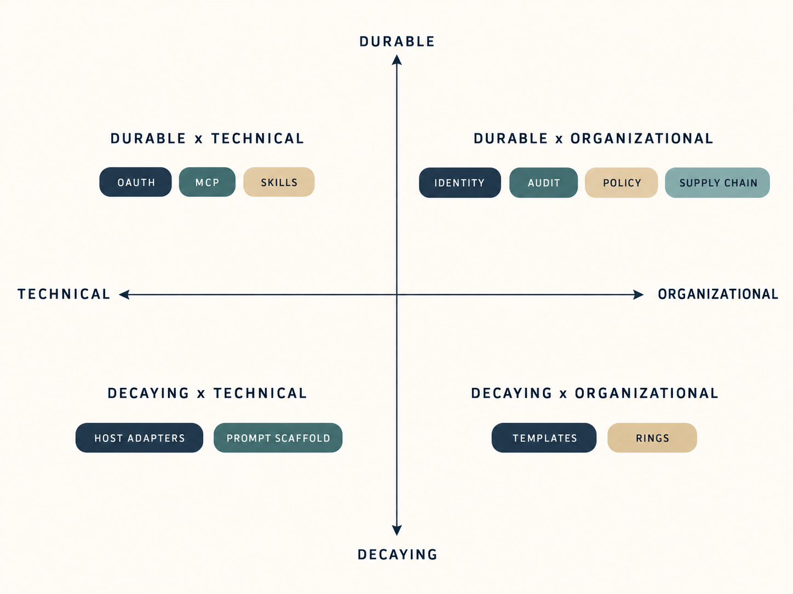
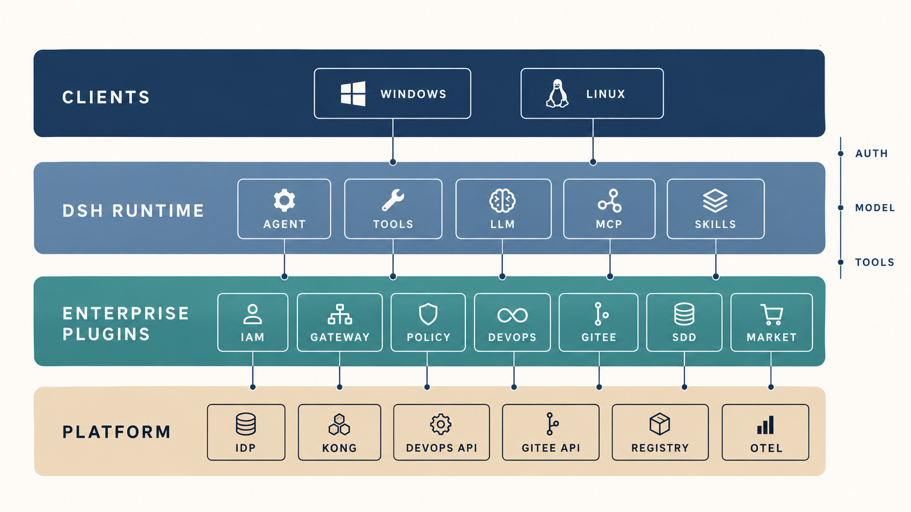

# 企业 DSH 研发平台总体架构设计

## 文档信息

| 项 | 内容 |
|---|---|
| 文档编号 | CORP-DSH-ARCH-001 |
| 文档名称 | 企业 DSH 研发平台总体架构设计 |
| 版本 | V1.0 |
| 文档状态 | 评审稿 |
| 密级 | 内部 |
| 编制 | DSH 平台组 |
| 审核 | 待定 |
| 批准 | 待定 |
| 最后更新 | 2026-10-20 |
| 文档层级 | L1 总体架构；字段级契约与运行手册由子文档承担（见 §12） |

## 修订记录

| 版本 | 日期 | 修订人 | 修订说明 |
|---|---|---|---|
| V0.1 | 2026-10-20 | DSH 平台组 | 初稿 |
| V0.2 | 2026-10-20 | DSH 平台组 | 增加标准符合性与能力价值复核 |
| V1.0 | 2026-10-20 | DSH 平台组 | 文档命名与内容正式化 |

> 编制依据：DSH `0.2.1-rc.2` 源码与官方文档，核验日期 2026-10-20；企业 IAM / Kong / DevOps 接口与银河麒麟实机尚未验证。
>
> 关联文档：[企业 DSH 研发平台推广实施方案](rollout-plan.md)（WBS、验收、风险与待确认事项）。

## 1. 背景与目标

企业研发体系由五个域组成，本方案回答的是“每个域用什么插件形态承接、边界在哪、失败时怎么办”。

| 域 | 现状 | 本方案的目标 |
|---|---|---|
| 身份与授权 | 自研 OAuth IAM，支持跳转登录 | 一次登录，DSH 内所有企业能力复用同一身份 |
| 模型与成本 | 自研 Kong AI 网关 | 客户端不持有网关 Key，按人 / consumer 计量与限额 |
| 工程系统 | 自研 DevOps（API + CLI）、Gitee | Agent 能读能写，写操作可审批、可追溯 |
| 研发流程 | oh-my-sdd 式重流程 | 只守三条不变量，流程由 skill 承载 |
| 分发与治理 | 无 | 私有市场、版本门禁、可回滚 |

**非目标**：多人共享单实例（多租户）、自建推理服务、替换 DevOps 平台、macOS 客户端。

## 2. 设计原则

| # | 原则 | 理由 |
|---|---|---|
| P1 | **核心不改，能力全插件** | DSH 是 MIT，但 fork 核心会在每两周一个 rc 的节奏下持续失血；只有一处必须补丁（MCP 按请求取 header），其余全部走插件与配置 |
| P2 | **一个会话，按资源取令牌** | 登录一次；模型网关用单一 `CredentialRef`，MCP 由 IAM broker 按 `resource` 取 token；轮换无需重启 |
| P3 | **策略下沉到工具管线** | 用 `tools/pre-execute` 与 `ctx.tools.guard()` 做硬门禁，不维护每宿主 hooks |
| P4 | **流程只守不变量** | 产物、冻结、原子 PR 三条不变量；不规定“必须先调哪个 skill” |
| P5 | **市场即治理** | 私有 registry + 私有 index + `engines.dsh` 门禁，公网源不可回落 |
| P6 | **每个能力可单独关闭** | 一个能力一个 bundle 行，出问题只禁用该行，不回滚整包 |

## 3. 复核与标准对齐

方案需同时适应两项变化：Harness 约每两周发布一个候选版本，模型约每半年更新一代。判断标准不是“当前可运行”，而是**能力增强时方案价值是上升、持平还是衰减**。

### 3.1 能力价值的时效性

| 能力 | 会衰减的部分 | 不衰减的核心 | 本方案的落点 |
|---|---|---|---|
| 登录 | 表单、页面、跳转细节 | 身份、同意、撤销、审计 | 标准 OAuth + claims；UI 可替换 |
| 模型接入 | 模型选择、prompt 技巧、参数调优 | 配额、成本、数据边界、审计 | 网关侧策略，客户端不内嵌 |
| 工具 | 工具数量、描述措辞 | 权限、审批、幂等、可追溯 | MCP 标准 + policy |
| 研发流程 | 环数、模板、编排顺序 | 产物契约、冻结、追溯 | skill 可随模型重写，契约在 CLI/CI |
| 分发 | 安装器、市场 UI | 供应链、版本、回滚 | npm + index 标准 |
| 策略 | 规则清单本身 | 决策点、fail-closed、审计 | host seam + 可配置规则 |



> 图：能力放在哪个象限，决定它随模型/宿主增强而升值还是贬值；本方案把投入集中在右上与左上。

三条判据：

1. **换更强模型是否需要改**：需要改的越少，价值越稳。因此 prompt 与工作流编排不进入“契约”，只放在 skill 里。
2. **Harness 升级是否需要改**：只依赖公开 seam（`tools/pre-execute`、`credentials`、`llm`、`mcp`、`skills`）的不用改；依赖内部文件路径或私有 API 的会碎。
3. **换一个宿主是否还能用**：`SKILL.md`、MCP 工具、OAuth token、OTel 事件都是跨宿主资产；宿主适配层不是。

结论：**把价值放在“组织事实”和“标准接口”上，不要放在“提示词脚手架”和“宿主适配”上。**

### 3.2 标准符合性

| 标准 | 要求 | 本方案 | 差距 / 决策 |
|---|---|---|---|
| OAuth 2.1（draft-15） | PKCE 必须；无 implicit / ROPC；redirect 精确匹配 | Code + PKCE，public client | 无 |
| RFC 8252 | 原生应用用 loopback；优先 IP 字面量 | `127.0.0.1` 回调 | 禁用 `localhost` |
| RFC 8707 | `resource` 参数标识目标资源 | 改为按资源取 token | 依赖 IAM 支持 `resource` |
| RFC 9728 | MCP server 暴露 Protected Resource Metadata | DevOps MCP 实现 PRM | 新增约 1 人周 |
| MCP 2026-07-28 | HTTP server 校验 `aud`；stdio 从环境取凭据 | DevOps HTTP + Gitee stdio | 与上一条同批实现 |
| MCP client 注册 | Client ID Metadata 优先，DCR 已弃用 | IAM 预注册 client | 无 |
| Agent Skills | `SKILL.md` frontmatter、渐进披露、<500 行 | SDD skill pack | 用 `skills-ref` 校验 |
| OTel GenAI | `gen_ai.*` 语义约定（仍为实验） | 决策审计 + 用量 | 只依赖稳定子集，内容默认不采 |
| SLSA / npm provenance | 构建来源可验证 | 内部 CI 出 provenance | 一期目标 L2 + 白名单 |

### 3.3 复核结论与待确认项

1. **网关额度（已确认）**：企业自研的 Kong AI 网关已具备详细额度管理，DSH 不在客户端做计量。仍需对齐的是额度维度、窗口、超额行为与剩余额度查询方式；`ai-proxy` 的 OSS / Enterprise 分层不再影响本方案。
2. **MCP OAuth 客户端缺失（待实施）**：DSH 的 `mcp-client` 没有 OAuth 客户端。由 IAM 插件充当 token broker，按 `resource` 取 token 并缓存；补丁从“塞 header”升级为“回调取 token”，约 +1 周。
3. **单一令牌的边界（已决策）**：RFC 8707 要求 token 绑定目标资源。一个宽 audience 的 token 会让泄漏半径覆盖所有服务，因此改为“一个会话 + 按资源签发”，模型网关仍用单一引用。

## 4. 总体架构

```text
┌─ 终端 ────────────────────────────────────────────────┐
│ Windows: DSH Desktop      银河麒麟: 浏览器 + dsh web   │
└───────────────────────┬───────────────────────────────┘
                        │ 同一插件组合，两套 profile（desktop / web）
┌───────────────────────▼───────────────────────────────┐
│ DSH 运行时（不改核心）                                 │
│  session / agent / tools / llm / mcp / skills / hooks  │
│  credentials / authorization / settings / webServer    │
└───────────────────────┬───────────────────────────────┘
                        │ 企业插件层（本文第 5–7 节）
┌───────────────────────▼───────────────────────────────┐
│ @corp/dsh-enterprise（umbrella bundle）                │
│  iam · gateway · policy · devops · gitee · sdd · market │
└───────────────────────┬───────────────────────────────┘
                        │
┌───────────────────────▼───────────────────────────────┐
│ 企业平台：IAM · Kong · DevOps API · Gitee · Registry   │
│           OTel Collector · 内部 Index                  │
└───────────────────────────────────────────────────────┘
```



> 图：客户端 / DSH 运行时 / 企业插件 / 企业平台四层；插件层每格对应一个可独立开关的 bundle 行。

三条请求路径：

1. **登录**：浏览器 → IAM（Code + PKCE）→ 本机回调 → Host 写令牌记录与镜像引用。
2. **模型**：`llm-pi-ai` 解析 `ENTERPRISE_ACCESS_TOKEN` → Kong 验签、映射 consumer、限额 → 上游模型。
3. **工具**：MCP client 向 IAM broker 取按资源 token → DevOps / Gitee API；每次工具调用先过企业策略插件。

## 5. 插件形态映射

DSH 提供六种扩展形态，企业能力必须落在正确的形态上，否则会制造不必要的维护面。

| 形态 | 能力 | 何时用 | 本方案落位 |
|---|---|---|---|
| Host 服务插件 | 注册 Cordis 服务、Remote 方法、工具、策略 | 需要跨会话状态、原生能力或 UI 后端 | IAM、policy（含审计） |
| Client UI 插件 | Slot 注册、登录态、设置卡 | 用户可见的交互 | IAM 的账户菜单与登录页 |
| 配置 bundle | 只改组合与配置，无代码 | 已有插件能满足 | gateway、market、brand |
| MCP bundle | 每 server 一行 `dsh-mcp-client` | 外部系统有 API/CLI | DevOps、Gitee |
| Skill pack | `SKILL.md` + 资源，按需加载 | 流程知识与模板 | SDD |
| Agent preset | 角色化工具集与提示 | 不同角色的权限与工具不同 | 开发者 / 评审 / 发布 |

原则：**能用配置 bundle 就不写代码；能用 MCP 就不写原生工具；只有策略与身份必须原生**，因为它们要在工具管线上做同步决策。

## 6. 软件包组合

| 包 | 形态 | 职责 | 依赖的 seam |
|---|---|---|---|
| `@corp/dsh-enterprise` | umbrella bundle | 组合下列行，给两端共用 | `cordis.patch.yml` |
| `@corp/dsh-iam` | Host + Client 插件 | OIDC/OAuth 登录、刷新、令牌镜像、账户 UI | `credentials`、`authorization`、`webServer`、`llm` |
| `@corp/dsh-gateway` | 配置 bundle | 企业模型路由、白名单、重试策略 | `llm-pi-ai` |
| `@corp/dsh-policy` | Host 插件 | 工具门禁、路径规则、决策审计 | `tools/pre-execute`、`tools.guard`、`otel` |
| `@corp/dsh-devops` | MCP server + bundle | 8–12 个研发平台工具 | `mcp-client` |
| `@corp/dsh-gitee` | MCP bundle | 复用 `mcp-gitee`，arm64 自编译 | `mcp-client` |
| `@corp/dsh-sdd` | Skill pack + CLI | 产物契约、freeze/指纹、归档与 PR | `skill-filesystem`；路径门禁由 policy 执行 |
| `@corp/dsh-market` | 配置 bundle | 私有 index、私有 registry、版本门禁 | `plugin-market`、`plugin-manager` |
| `@corp/dsh-brand` | 配置 bundle | 产品名、Logo、主题 token | `brand`、`client-ui-theme` |

组合方式：umbrella bundle 只做 `insert`，每个能力一行；任何一行都能被 profile patch 单独 `disabled` 或覆盖配置，满足 P6。

## 7. 领域设计

### 7.1 身份与令牌

**流程**：Authorization Code + PKCE（S256）→ 系统浏览器 → IAM 登录页 → `http://127.0.0.1:<port>/oauth/callback` → 校验 `state` / `nonce` / `iss` / `aud` → 写令牌。

**存储**：refresh token 与元数据存为 `CredentialKey` 记录；模型网关的 access token 镜像到 `CredentialRef: ENTERPRISE_ACCESS_TOKEN`，因为 `llm-pi-ai` 只解析引用。MCP 的 token 不落固定引用，由 IAM 插件的 token broker 按 `resource` 取用并缓存。

**按资源取 token**：RFC 8707 要求 token 绑定目标资源，MCP 的 HTTP server 按自己的 canonical URI 校验 `aud`。broker 在授权与刷新时带 `resource`，缓存键为 `(resource, scope)`；stdio server 按 MCP 规范从环境取凭据，复用同一 token。若 IAM 不支持 `resource`，退化为按 audience 预注册多个 client，仍保持一资源一 token。

**刷新**：把“判断有效期 → 刷新 → 写回”整体放进 `ctx.credentials.modifyRecord`。该 API 的互斥跨进程生效，正是防止桌面与 web 两个进程同时轮换 refresh token 的机制；在锁内先复查有效期，后到者直接复用。

**并发**：进程内 single-flight；跨进程靠 `modifyRecord`；刷新失败区分 `invalid_grant`（需重新登录）与网络错误（退避重试）。

**身份传播**：claims 至少包含 `sub`、`email`、`groups`、`aud`。`groups` 用于选择 agent preset 与策略档位；`sub` 进入审计，不进入模型上下文。

**失败模式**：IAM 不可达时保留上次令牌直到过期，UI 显示“待重新登录”；网关返回 401 时由模型适配层刷新并重试一次，仍失败则向用户报 `AUTH_EXPIRED`，不静默降级到其他模型。

### 7.2 模型与成本

纯配置，无代码：

```yaml
- name: '@deepseek-ai/dsh-llm-pi-ai'
  config:
    providers:
      corp:
        displayName: 企业 AI 网关
        api: openai-completions
        baseURL: https://ai-gateway.corp.example/v1
        apiKeyEnv: ENTERPRISE_ACCESS_TOKEN
        retryPolicy: { mode: normal, maxRetries: 2 }
        models:
          - id: corp-chat
            name: 企业对话模型
            contextWindow: 131072
```

网关侧：JWKS 验签、`key_claim_name=sub`、consumer 映射、模型白名单、上游真 Key 只存在于网关。**额度由网关统一承担**——企业自研的 Kong AI 网关已具备详细额度管理，DSH 不做本地计量。

**额度双维度**：网关必须能按人（`sub`）和按 consumer 记账，两者可同时生效，实际可用额度取更紧的一侧。

| 维度 | 主体 | 用途 | 典型场景 |
|---|---|---|---|
| 人 | `sub` | 公平性、个人预算 | 每人一套 DSH |
| consumer | consumer id | 成本归属、防滥用 | 团队共享服务、CI、外包 |

- 个人使用：consumer 与 person 1:1，两个维度数值一致，可从“人”切到“consumer”查看。
- 共享服务：workload consumer（如 `svc-ci`）承载团队预算，`sub` 仍是具体人，两个维度分别计，既避免单人耗尽团队额度，又能归因到人。
- 请求只带一个 token；网关从 JWT 派生 person、从凭证或注册信息派生 consumer，DSH 不传两个身份。

**超额错误契约**：

```http
HTTP/1.1 429 Too Many Requests
Retry-After: 37
RateLimit-Limit: 1000
RateLimit-Remaining: 0
RateLimit-Reset: 37
Content-Type: application/problem+json

{
  "type": "https://ai-gateway.corp.example/problems/quota-exceeded",
  "title": "Quota exceeded",
  "status": 429,
  "detail": "Personal daily token quota exhausted",
  "instance": "/v1/chat/completions",
  "quota_scope": "person",
  "quota_limit": 1000000,
  "quota_remaining": 0,
  "quota_reset": "2026-10-21T00:00:00+08:00"
}
```

- `429` + `Retry-After` 是 HTTP 语义（RFC 9110）；`RateLimit-*` 是 IETF 草案字段（draft-11，尚未成 RFC），可同时给 `X-RateLimit-*` 兼容旧客户端。
- body 用 RFC 9457 Problem Details；`quota_scope` 区分 `person` / `consumer`，DSH 据此显示“个人额度”或“团队额度”。
- `401` 只表示 token 无效，`403` 只表示无权限/模型未授权；**额度耗尽一律 429**，不用 403。
- DSH 收到 429 不自动重试，展示 `quota_reset`；若网关提供额度查询端点，可在设置页展示剩余额度。
- 客户端不持有上游 Key，也不做第二套账；成本以网关计量为准。

**审计口径**：客户端只上报“谁、何时、哪个模型、成功/失败”，token 数由网关回传或网关日志归集，避免两套账。

### 7.3 工程系统工具

**DevOps MCP**（自研，stdio）：只暴露 8–12 个高频操作，工具名 `mcp__devops__<verb>_<noun>`；默认只读，写操作在工具描述中标注 `mutating: true`，由策略插件转成 `ask`。

建议工具面：`pipeline_list`、`pipeline_get`、`pipeline_run`、`run_logs`、`deployment_list`、`deployment_status`、`deployment_rollback`、`issue_list`、`issue_get`、`issue_comment`。

**Gitee**：复用 `oschina/mcp-gitee`，arm64 自行交叉编译并校验 checksum；工具面默认只读，写操作（建分支、评论、提 PR）单独开关。

**按请求取 token**：`dsh-mcp-client` 当前 `headers` 在加载时求值。补一个 auth provider 回调，在 transport 的 `fetch` 包装里按请求向 IAM broker 取 token（缓存键为 `resource`），401 时刷新并重试一次；这是本方案唯一的核心补丁，约 50–80 行，向上游提 PR。

**HTTP server 的 OAuth 义务**：按 MCP 2026-07-28，DevOps MCP 需暴露 `/.well-known/oauth-protected-resource`（RFC 9728），校验 token 的 `aud` 等于自身 canonical URI，401 响应带 `WWW-Authenticate: Bearer resource_metadata=...`。Gitee 走 stdio，按规范从环境取凭据，不做 OAuth 流程。

**上下文预算**：每个 server 的工具数上限 12；不用的 server 在 preset 里禁用；流程性知识放 skill，不放工具描述。

### 7.4 研发流程（SDD）

只保留三条不变量与一个状态字段：

- **一致性**：canonical spec 与代码不漂移（freeze、SHA-256 指纹、stale 传播、archive）。
- **原子性**：一次交付的 PR 同时包含实现、spec、归档。
- **可追溯**：`change-id` 贯穿分支、commit、PR、tracker。

形态：1 个 skill（组合现有 `brainstorming` / `writing-plans` / `executing-plans` / `code-review-and-quality` / `test-driven-development` / `verification-before-completion`）+ 1 个约 300 行的 CLI（封装 openspec 的 new/validate/freeze/stale/archive/pr-body）+ 策略插件里的路径规则。阶段只写进 `.meta.json`，不驱动对话顺序。

**路径规则**（由 `@corp/dsh-policy` 执行）：`spec` 阶段只允许写 `openspec/changes/<id>/**`；`apply` 阶段 canonical `openspec/specs/**` 与 `proposal.md`/`design.md` 只读；`review` 阶段不再写源码。无 `.meta.json` 时只执行 HARD 规则，不阻塞普通开发。

### 7.5 分发与治理

- **必装**：`@corp/dsh-enterprise` 由 MDM / deb 预置进 profile，不依赖用户手动安装。
- **可选**：内部 index 列出经审批的插件；`plugin-market` 配上私有 index，`plugin-manager` 配 `registry` + `fallbackRegistries`，公网源不在列表内。
- **门禁**：index 生成时校验 `engines.dsh` 与 `dsh.bundle.patch`；安装前校验包名白名单与 checksum。
- **权限**：普通用户禁用 `plugin_manager` 工具；只有 Creator preset 可安装，且只能装内部源。

### 7.6 审计与可观测

- **决策审计**（`@corp/dsh-policy` 直接发 OTel event）：`sub`、`change_id`、`tool`、`decision`、`reason_code`、`latency`，不记参数正文，只记参数哈希。
- **会话审计**：`session-log` 通道可导出完整事件，但含正文与代码，默认关闭；确需开启时先做脱敏与保留期评审。
- **成本审计**：以网关的 consumer 计量为准；DSH 侧只记调用次数与失败率。
- **保留期**：决策审计 180 天；会话内容默认不落 SIEM。

## 8. 关键契约

| 契约 | 规则 |
|---|---|
| `ENTERPRISE_ACCESS_TOKEN` | POSIX 环境变量名，仅模型网关；每次登录/刷新覆盖写；消费方不得缓存跨请求 |
| claims | `sub` 必填；`aud` 必须包含目标服务；`groups` 缺失时按最小权限处理 |
| `resource` / `aud` | MCP token 绑定 server 的 canonical URI；broker 缓存键为 `(resource, scope)`；server 必须校验 `aud` |
| 额度错误 | `429` + `Retry-After` + `application/problem+json`；`quota_scope` ∈ {`person`, `consumer`}；`401`/`403` 不得复用 |
| OTel 字段 | 只用稳定的 `gen_ai.*` 子集 + `corp.sub` / `corp.change_id` / `corp.decision`；内容属性默认不采 |
| MCP 工具名 | `mcp__<server>__<verb>_<noun>`；只读与写操作在描述中显式标注 |
| 策略决策 | `allow` / `ask` / `deny` + `reason_code`；异常一律 `deny`（fail closed） |
| bundle manifest | `dsh.bundle.patch` 必填；`engines.dsh` 声明兼容区间；peer 依赖精确到 rc |
| 配置键 | 统一 `corp.*` 前缀；敏感值只放凭据引用，不进 YAML |

## 9. 安全设计

**信任边界**：终端（用户）→ DSH Host（同 OS 用户，可信）→ 企业网关/平台（网络边界）。DSH 的凭据文件是 0600，但 agent 以同一用户运行，**能读到令牌**；因此安全不能依赖本地保密。

| 威胁 | 处置 |
|---|---|
| Prompt injection 诱导调用写工具 | 写操作 `ask`；MCP 工具最小面；策略插件 fail closed |
| 令牌被 agent 读出并外传 | 短 TTL（≤60 分钟）、最小 scope、一资源一 token、Kong/DevOps 侧可撤销、终端出口管控 |
| 恶意插件 | 私有 registry + 包名白名单 + checksum + 安装需审批 |
| 供应链（依赖/构建脚本） | 锁定 lockfile、禁 `postinstall`、CI 重建、镜像内预构建；发布带 npm provenance（SLSA L2），安装校验 checksum 与白名单 |
| 越权读仓库 | Gitee/DevOps 侧按 token scope 限制；DSH 不自行扩权 |
| 审计缺失 | 决策与调用双路 OTel；缺 `sub` 视为失败并告警 |

## 10. 部署拓扑

| 端 | 安装 | 运行 | 更新 |
|---|---|---|---|
| Windows | MSI（官方或白标，P0 定） | DSH Desktop + `desktop` profile | 官方 feed 或内部 feed |
| 银河麒麟 aarch64 | deb + 内部 apt 源（自带 Node 24 与预构建 profile） | `systemd --user` 常驻 + `.desktop` 打开 URL | apt |
| 内部服务 | — | Registry、Index、Kong、IAM、OTel Collector | 各自发布 |

麒麟不在用户端编译：`node-pty` 等原生模块在 arm64 构建机预编译后打进 deb。沙箱按 P0 结论三选一（bwrap / Landlock / 自定义 runner）。

## 11. 版本与兼容性管理

- **锁版本**：一期固定 DSH `0.2.1-rc.2`；升级前跑内部兼容性套件（登录、模型、工具、SDD、市场）。
- **标准漂移**：OAuth 2.1 仍是 draft，MCP 规范按日期发版；兼容性套件里固定规范版本（PRM、`resource`、`aud`），规范升级时先跑套件再放行。
- **内部包**：SemVer；`engines.dsh` 写区间；host 插件与 client 插件同版本发布。
- **通道**：`internal`（默认）与 `canary`（试点）；canary 出问题只回滚该 bundle 行。
- **上游**：MCP 补丁提 PR；identity seam 以 RFC 形式提案，避免长期维护核心 fork。

## 12. 交付组织与职责

| 工作 | DSH 平台组 | IAM | 网关 | DevOps | 安全 | IT |
|---|---|---|---|---|---|---|
| IAM 插件 | A | C | I | I | C | I |
| 网关契约（验签/额度） | C | C | A | I | C | I |
| DevOps MCP | A | I | I | C | C | I |
| Gitee MCP | A | I | I | I | C | I |
| 策略与审计 | A | C | I | I | C | I |
| SDD skill 包 | A | I | I | I | I | I |
| 打包与分发 | A | I | I | I | C | C |
| 试点与推广 | C | I | I | I | I | A |

A=负责，C=协作，I=知会。

### 12.1 子文档清单与责任

本文只保留跨域决策；下列子文档由对应团队补充，字段级契约与操作步骤以子文档为准。

| 子文档 | 负责 | 必须包含 | 门禁 |
|---|---|---|---|
| IAM 接入 | IAM 团队 | 端点与 discovery、claims、`resource` 支持、client 注册、TTL、撤销 | G0 |
| 网关契约 | 网关团队 | 验签方式、consumer 生命周期、双维度额度、429 problem+json、模型目录 | G0 |
| 麒麟验证 | 平台组 | 附录 A 实测输出、沙箱结论、runner 方案、原生模块清单 | G0 |
| DevOps MCP | DevOps 团队 | 工具清单与 scope、PRM 端点、错误码、限流与幂等 | G1 |
| Gitee 集成 | 平台组 | 版本与 arm64 构建、scope、写操作开关、审计点 | G1 |
| 策略与审计 | 安全 + 平台组 | 规则清单、决策 schema、保留期、SIEM 字段、例外流程 | G2 |
| 分发与市场 | 平台组 + IT | registry 与 index、通道、兼容门禁、回滚步骤 | G2 |
| 终端打包 | 平台组 + IT | MSI/MDM、deb/apt/systemd、更新与回滚 | G2 |
| SDD 流程 | 平台组 | skill 结构、CLI 命令、CI 校验、产物契约 | G2 |
| 试点推广 | PMO | 批次与人数、指标、支持渠道、退出条件 | G2 |

子文档按 Design / Evidence 规范写，结论先行；主文档不复制子文档细节，只在决策变化时回写。

阶段门禁：G0 麒麟/IAM/网关冒烟（1 周）→ G1 PoC 10 人（3 周）→ G2 试点 50–100 人（4 周）→ G3 全量。

## 13. 验收标准

沿用推广方案的 A1–A11，另加两项：

| # | 验收项 | 判据 |
|---|---|---|
| A12 | 插件隔离与回滚 | 任一企业插件可单独禁用，其余能力正常；bundle 回滚 ≤10 分钟 |
| A13 | 审计完整性 | 每次模型调用与工具调用可按 `sub` + `change-id` 归因；缺字段为 0 |

## 14. 架构决策记录

| # | 决策 | 被否方案 | 后果 |
|---|---|---|---|
| ADR-1 | 每人一套 DSH | 共享实例多租户 | 少 8–12 人周，但无法团队共享会话 |
| ADR-2 | 令牌直通网关 | 客户端换发 API Key | 客户端无 Key；要求网关支持 JWKS 或 introspection |
| ADR-3 | 外部系统用 MCP，策略用原生插件 | 全部原生 / 全部 MCP | 工具面解耦；多一个 MCP 进程 |
| ADR-4 | `tools/pre-execute` + `guard` 做门禁 | 每宿主 hooks.json | 一条策略路径；hook 仅用于兼容既有 Claude/Codex 配置 |
| ADR-5 | 必装走 umbrella bundle，可选走市场 | 全部走市场 | 首次可用不依赖网络；市场只治理增量 |
| ADR-6 | SDD 做 skill 包，不做产品 | 五环七层产品 | 维护面小；流程强度靠策略插件补 |
| ADR-7 | 官方 App vs 白标 | — | 待 P0 决策；影响更新通道与签名成本 |
| ADR-8 | 一个会话、按资源取 token | 单一宽 audience token | 泄漏半径小；依赖 IAM 支持 `resource` |

## 15. 风险登记

| 风险 | 等级 | 处置 | 负责 |
|---|---|---|---|
| 麒麟沙箱 fail closed | 高 | P0 实机验证；预装 bwrap 或自定义 runner | 平台组 + 安全 |
| 上游 rc 节奏导致插件失效 | 高 | 锁版本 + 兼容性套件 + 内部镜像 | 平台组 |
| `node-pty` arm64 现场编译失败 | 高 | arm64 构建机预构建，deb 内带 `node_modules` | 平台组 + IT |
| 令牌被 agent 读取 | 中 | 短 TTL、最小 scope、出口管控 | 安全 |
| 白标与官方更新策略冲突 | 中 | 一期官方 App；白标单独立项 | 产品 |
| 网关验签方式待确认（JWKS / introspection） | 中 | P0 用真实 token 联调；不支持 JWKS 则改 introspection | 网关 + 平台组 |
| MCP OAuth broker 复杂度 | 中 | 先支持 `resource`；不支持则按 audience 预注册 client | 平台组 |
| 标准漂移（OAuth 2.1 / MCP） | 中 | 兼容性套件固定规范版本；升级先跑套件 | 平台组 |

## 附录 A 仓库结构

```text
corp-dsh/
├─ packages/
│  ├─ enterprise-bundle/   # umbrella patch
│  ├─ iam/                 # host + client
│  ├─ gateway-config/      # bundle only
│  ├─ policy/              # host plugin
│  ├─ devops-mcp/          # stdio server
│  ├─ gitee-bundle/        # mcp row + binary
│  ├─ sdd/                 # skills + CLI
│  ├─ market-config/       # index + registry
│  └─ brand-config/        # brand tokens
├─ profiles/
│  ├─ desktop/
│  └─ web/
└─ ci/
   ├─ compat.yml
   └─ market-index.yml
```

## 附录 B 插件组合示例

```yaml
# packages/enterprise-bundle/cordis.patch.yml
- insert:
    - id: corp-iam
      name: '@corp/dsh-iam'
      config:
        issuer: https://iam.corp.example
        clientId: dsh-desktop
        scopes: [openid, profile, offline_access]
    - id: corp-policy
      name: '@corp/dsh-policy'
      config:
        failClosed: true
        rules: enterprise
    - id: corp-gateway
      name: '@deepseek-ai/dsh-llm-pi-ai'
      config:
        providers:
          corp:
            api: openai-completions
            baseURL: https://ai-gateway.corp.example/v1
            apiKeyEnv: ENTERPRISE_ACCESS_TOKEN
            models: [{ id: corp-chat, contextWindow: 131072 }]
    - id: corp-devops
      name: '@deepseek-ai/dsh-mcp-client'
      config:
        serverName: devops
        transport: streamable-http
        url: https://devops.corp.example/mcp
        # 需 @corp 的 mcp-client 补丁：按请求向 IAM broker 取该 resource 的 token
        auth:
          type: broker
          resource: https://devops.corp.example/mcp
          scopes: [devops.read, devops.write]
    - id: corp-market
      name: '@deepseek-ai/dsh-plugin-market'
      config:
        indexes: [https://plugins.corp.example/index.json]
```

> 本文件为 Design，解释“怎么搭、为什么这样搭”；排期与验收执行以关联 Plan 为准。

## 附录 C 术语与缩略语

| 术语 | 全称 / 说明 |
|---|---|
| DSH | DeepSeek Harness，本方案的宿主运行时 |
| IAM | 企业统一身份认证系统 |
| PKCE | Proof Key for Code Exchange（RFC 7636） |
| MCP | Model Context Protocol |
| PRM | OAuth 2.0 Protected Resource Metadata（RFC 9728） |
| ADR | Architecture Decision Record，架构决策记录 |
| SDD | Spec-Driven Development，规格驱动开发 |
| WBS | Work Breakdown Structure，工作分解结构 |
| SSO | Single Sign-On，单点登录 |
| consumer | 网关侧的调用主体，可对应个人或工作负载 |
