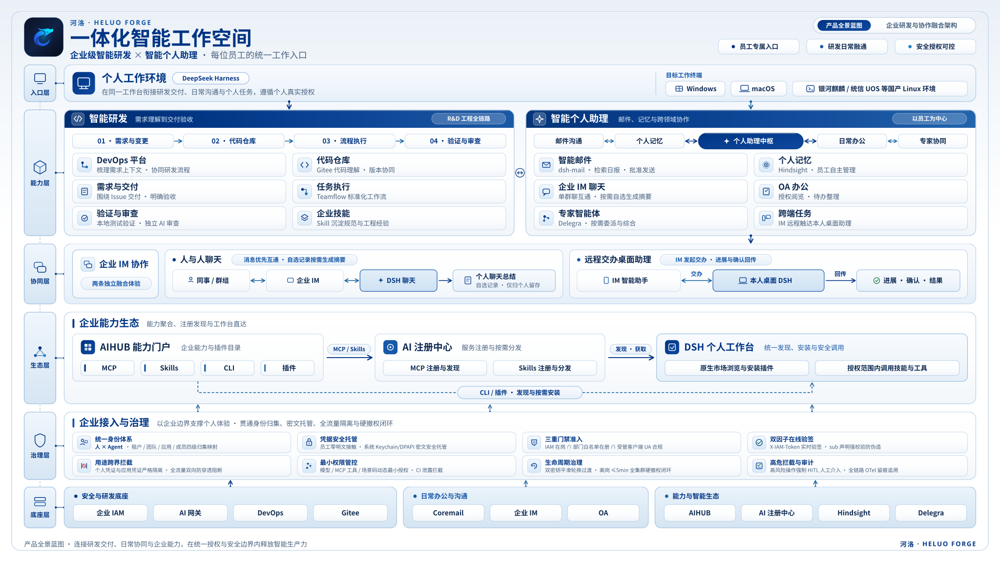

# 河洛 · Heluo Forge 产品手册

## 让每位员工有一位懂企业工作方式的智能助理

员工每天在邮件、群聊、OA 和各类业务系统之间切换。同一件事的通知、待办、处理记录和审批状态往往分散在不同入口。找齐这些信息需要时间，换个工具或隔几天继续，又要重新交代背景。企业引入 AI 后，还需要管清楚它代表谁、能访问什么、哪些操作要由人确认。

**河洛以智能个人助理为核心，为每位员工提供自己的 AI 工作台。** 员工可以在同一处查找信息、梳理待办、准备回复、接续任务，也能把专业问题交给有相应权限的专家智能体。**智能研发是个人助理面向研发岗位的特化场景**，在通用助理基础上接入研发系统、工程规范和交付流程，让研发人员从需求理解一路走到代码验收。

| 为什么值得投入 | 对企业和员工的价值 |
|---|---|
| **让工作接续起来** | 员工从一封邮件、一次讨论或一条业务待办开始，请助理找齐相关信息、标明依据并整理下一步。跨天跟进时，可以按自己的设置使用个人记忆。 |
| **让通用助理适配不同岗位** | 企业可按办公、人力、合同审批、研发等场景装配所需能力。员工沿用同一个入口，专业数据、业务规则和流程仍由现有企业系统提供。 |
| **复用企业已有投入** | 企业身份、业务权限、模型预算和审计沿用已有管理体系。岗位知识与工程方法可沉淀为 Skill，工具可通过标准接口复用，模型和工作台升级时仍能使用这些资产。 |

下文按产品蓝图描述员工的目标体验，场景中的操作遵循员工授权、企业规则和相应服务的访问边界。[总体架构与价值取向](architecture/platform-architecture.md#31-能力价值的时效性)

## 智能个人助理怎么用

### 会前整理邮件、群聊和待办

准备项目周会时，你可以对助理说：“找出本周和这个项目有关的邮件，把待办按事项、责任人和截止时间列出来，附上原文依据，帮我起草一封确认邮件。”

助理通过 dsh-mail 使用你获准访问的 Coremail 邮件。群里有补充讨论时，你可以在工作台与同事单聊或群聊，也可以从有权查看的聊天文字中主动选取片段，生成仅本人可见的总结。助理可以把你选定的讨论内容和获授权的 OA 待办一起整理，标出仍需核实的事项。你核对收件人、正文和附件后，批准发送 Agent 草稿。[企业聊天产品方案](requirements/enterprise-collaboration-chat-proposal.md)

### 接续上周的工作，离开电脑也能交办

下周继续跟进时，你可以请助理：“按我常用的周报格式，接着梳理上次留下的三项待办，用最新通知核对进度。”个人记忆基于 Hindsight，帮助助理延续员工的工作偏好和任务脉络。你可以管理自己的记忆，选择采集方式、查看或删除记忆，并控制助理是否可以使用它。

离开工位后，你也可以通过企业 IM 的智能助手向本人授权的桌面 DSH 交办：“整理今天的项目跟进记录，把待确认的事项发回这个会话。”桌面助理处理授权范围内的任务，进展、确认请求与结果回传至 IM。蓝图把同事聊天与远程交办画成两条路径，分别服务日常沟通和员工本人交办任务。[员工个人记忆方案](requirements/employee-assistant-memory-proposal.md)

### 让专家智能体连接企业业务系统

当工作涉及专业制度、审批流程或某个业务系统时，你可以在助理中查看有权使用的专家及其职责和权限摘要，用 `@` 选定一位专家，再写清要办的事和本次委派所需的资料。个人助理发起委派、呈现进展，收到成果后整理结论和来源，方便你核对和追问。

| 连接的既有系统 | 员工可以怎样交办 | 专家可以提供什么 |
|---|---|---|
| **OA** | “帮我查这张申请单流转到了哪一步，还有什么需要我处理。” | 办公流程专家查询获授权的 OA 记录，说明当前环节、待办和记录出处。 |
| **HR 系统** | “帮我查适用于我的请假流程，列出要准备的材料和申请入口。” | 人力服务专家结合获准使用的制度和人力系统信息，说明办理步骤并附上依据。 |
| **合同审批系统** | “汇总这笔申请的当前状态、退回原因和待补材料，附上系统记录。” | 合同审批专家在经办人员获授权的业务范围内查询记录，整理办理信息供人工复核。审批决策及其记录由既有业务流程承载。 |

企业可以按场景扩展专家，为每个专家配置职责、专业知识、可用工具、数据范围及允许的动作，再通过插件接入企业认可的接口、MCP 工具或 CLI。新增一个专家时，员工仍沿用同一套发现、选择、交办和查看结果的方式。专家调用受员工授权、专家工具权限及业务系统规则共同约束。[专家智能体产品设计](requirements/delegra-experts-prd.md)

## 智能研发是个人助理的专业场景

研发人员沿用个人助理的沟通、资料整理和任务接续能力。当任务涉及代码交付时，工作台叠加 DevOps、Gitee、企业 Skill 和 Teamflow，把一项研发任务推进到可验收的代码版本。

例如，你接到一条修改订单校验规则的 Issue，可以请助理：“先查清所属变更、代码仓库和验收条件。信息齐全后按团队规范实现，给我测试和审查结果。”

1. **确认交付范围。** 助理在授权范围内通过 DevOps 和 Gitee 核实所属变更、关联仓库及验收要求。关联冲突或验收条件不清时由你确认。跨仓库任务按可独立验收的 Issue 拆分。
2. **执行并验证。** Issue 信息充分时可直接作为交付依据。企业 Skill 提供团队规范，Teamflow 按任务复杂度和风险组织必要的设计、实现、本地验证和独立 AI 审查。
3. **核对实际交付。** 你根据实际代码版本、测试和审查结果决定是否验收。远端写入遵循实际开放范围、企业规则和服务端权限；推送确认由部署者按需开启，开启后逐次确认。

[Issue 交付模型与受控研发目标](requirements/requirements-baseline.md#23-issue-交付模型与受控研发目标需求已确认)

## 按蓝图理解技术架构

[查看高清蓝图](assets/product-blueprint.svg)

蓝图在能力层并排展开日常助理和研发流程。两者共用员工的个人工作台与企业接入边界，研发流程展示个人助理在研发岗位如何装配专业能力。

| 蓝图层级 | 职责 |
|---|---|
| **入口层 · 个人工作环境** | DeepSeek Harness（DSH）提供员工交办任务、核对资料、确认操作和获取结果的工作台。河洛沿用官方宿主，通过公开接口按需装配插件。蓝图面向 Windows、macOS、银河麒麟和统信 UOS 等工作终端。 |
| **能力层 · 个人助理及岗位能力** | 智能个人助理组织邮件、记忆、日常办公与专家协作。研发场景在同一助理上叠加 DevOps、Gitee、企业 Skill 和 Teamflow。其他岗位可按业务场景接入专家及所需工具。 |
| **协同层 · 企业 IM** | 同事沟通侧连接单聊、群聊和个人总结。远程交办侧连接企业 IM 智能助手和员工本人的桌面 DSH，传递任务、进展、确认请求和结果。 |
| **生态层 · 能力发现与分发** | AIHUB 聚合 MCP、Skills、CLI 和插件目录。Nacos AI 注册中心负责 MCP 注册与发现及 Skills 注册与获取。AIHUB 提供经策展的插件版本索引，DSH 原生市场提供安装入口，企业私有 npm 提供制品。 |
| **治理层 · 企业接入与控制** | 企业 IAM 管理身份及授权生命周期，AI 网关负责模型准入、路由、限流和个人及团队预算。终端保护凭据，通过策略、沙箱和人工确认约束助理操作。各业务系统在服务端执行资源权限，审计记录重要动作与决策。 |
| **底座层 · 企业系统与服务** | DevOps、Gitee 提供研发数据，Coremail、企业 IM、OA 及可扩展接入的 HR、合同审批等系统提供业务记录与流程。Hindsight 提供个人记忆服务，Delegra 承载专家配置和任务执行，DSH 插件承接员工侧的发现、委派和结果呈现。 |

以查询 OA 申请为例，员工在 DSH 选择办公流程专家，个人助理发起委派。专家在授权范围内通过工具查询 OA，助理将 OA 返回的流程状态和出处带回原工作台。企业 AI 网关对其中的模型调用执行模型访问控制。

企业治理目标包括终端凭据加密托管、网关核验个人凭据及人员归属、个人与应用凭据及用途隔离，以及高风险动作确认与决策审计。生产网关以业务正文零留存为验收要求。当前设备退出时，工作台停止该会话的企业调用。企业侧须验证从 IAM 实际停用或网关实际封禁起，最迟五分钟拒绝受影响的新模型请求。关键授权或安全条件无法确认时，相关企业能力停止开放。[总体架构与信任边界](architecture/platform-architecture.md#41-系统责任与信任边界) · [网关契约](contracts/gateway-contract.md) · [市场设计](design/plugins/forge-market.md)

## 当前进展与推广路径

| 方向 | 截至 2026-11-19 的项目记录 |
|---|---|
| **智能个人助理** | dsh-mail 已将邮件入口带入 DSH，实际使用取决于安装与邮箱授权。个人记忆和企业聊天已有产品草案，IM 远程交办和 OA 为待确认或候选方向。 |
| **专家智能体** | 已有产品草案和 Delegra 接入方案，暂缓实施。上文的 OA、HR、合同审批场景用于说明扩展方式，具体专家和业务接入按范围、授权和环境分别确认。 |
| **智能研发与企业治理** | 身份、凭据、策略、企业组合、DevOps 和 Gitee 已有部分本地实现及离线验证。企业研发接入以只读查询为基线，实际的企业 IAM、网关、研发 CLI 和目标终端仍需分别联调。 |
| **企业能力生态** | AIHUB、Nacos 与原生市场的职责已有产品或架构设计，索引已有离线校验工具。企业资源发现、安装、授权和调用需按实际服务验证。 |
| **目标终端与试点** | 一期试点规划以 Windows 和银河麒麟 ARM 为主，安装、企业登录、模型调用与业务接入按目标终端分别验收。 |

首期试点以真实研发任务检验个人工作台与企业接入，观察登录激活、安装成功、持续使用和员工使用意愿，并验证研发交付、授权、配额、撤权和审计。后续场景按需求基线和确认结果推进，推广取决于实机验收与试点观察。[实现与验证记录](design/README.md#22-实现与验证入口) · [专家接入方案](plans/2026-11-18-forge-experts-integration-proposal.md) · [实施与推广方案](plans/rollout-plan.md) · [需求范围基线](requirements/requirements-baseline.md#2-范围边界唯一真源)

## 文档信息

| 项目 | 内容 |
|---|---|
| 文档编号 | CORP-DSH-DOC-004 |
| 文档名称 | 河洛产品手册 |
| 版本 | V0.3.0 |
| 文档状态 | 草案 |
| 密级 | 待定 |
| 编制 | Agent（代拟） |
| 审核 | 待定 |
| 批准 | 待定 |
| 最后更新 | 2026-11-19 |
| 门禁 | 产品表述待确认 |
