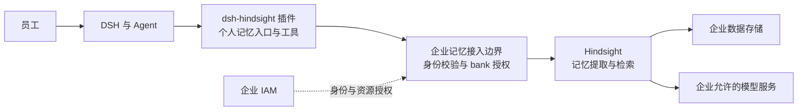

# 员工智能助理个人记忆产品方案

## 文档信息

| 项 | 内容 |
|---|---|
| 文档编号 | CORP-DSH-REQ-005 |
| 文档名称 | 员工智能助理个人记忆产品方案 |
| 版本 | V0.1 |
| 文档状态 | 草案 |
| 密级 | — |
| 编制 | Agent（代拟） |
| 审核 | 待定 |
| 批准 | 待定 |
| 最后更新 | 2026-11-12 |
| 门禁 | 产品方案评审、范围基线同步、接口与宿主准入；企业环境验证后试点 |
| 确认人 | 项目负责人（当前用户） |
| 确认日期 | 2026-11-12 |
| 确认事项 | 基于 Hindsight 的员工智能助理记忆；DSH 专用插件；每人一个、不按项目划分的 bank；员工配置记忆采集，自动采集默认仅限对话文本；删除记忆系统中的原始内容及其派生记忆；企业管理员不能查看记忆内容；不要求使服务器、数据库或模型服务技术人员无法读取明文 |
| 适用范围 | 上述产品方向与可见性边界；不代表全文、技术方案、实现或企业联调已获批准或完成 |

> 编制依据：当前用户确认的产品方向，以及 2026-11-12 对项目需求、设计索引和第 8 节官方资料的只读核对。Hindsight、DSH 插件、企业 IAM、记忆服务和模型链路均未因本文完成实机验证。
>
> 关联文档：[需求与场景基线](requirements-baseline.md)、[实现与验证入口](../design/README.md#22-实现与验证入口)、[DSH 插件高阶规范](../engineering/dsh-plugin-conventions.md)。

## 1. 产品定位与效力

员工使用 DSH 智能助理时，由 `dsh-hindsight` 插件提供个人长期记忆：员工可以决定记忆如何采集，查看自己的记忆，并让 DSH Agent 在获得许可时使用这些记忆。Hindsight 承担记忆提取、检索和推理；企业身份用于建立和访问员工本人的 bank。

每名员工对应一个个人 bank，同一员工的不同 DSH 会话、工作目录和设备使用同一个 bank；项目名称、仓库路径与会话 ID 不决定 bank。首期仅接入 DSH，不建设供其他助手使用的产品入口。不同员工的记忆不可互相访问，企业业务管理员不具备查看员工记忆内容的产品权限。

本文是产品方案草案，不是第二份项目范围基线。[需求基线 §2](requirements-baseline.md#2-范围边界唯一真源)是项目范围唯一真源；产品方案和范围获确认后，同步基线及受影响的架构、计划和验收。基线的 N1 排除多人共享单个 DSH 实例；本方案设想每名员工使用各自的 DSH，并通过企业服务访问各自的个人 bank，不据此声称共享服务已在现有基线内。

## 2. 用户体验

| 场景 | 员工可以做什么 | 产品边界 |
|---|---|---|
| 配置记忆 | 配置自动记录、确认后记录或手动记录；可暂停记忆采集，并控制 Agent 是否使用记忆 | 首次使用在解释数据流向后由员工选择；选择前不自动采集。自动采集默认仅限对话文本，其他内容由员工单独选择 |
| 日常对话 | 告诉 DSH“记住我的偏好”，或在启用相应模式后使用持续记忆 | 是否记录及召回受员工设置与企业数据处理规则约束；同一人的所有会话共用一个 bank |
| 查看记忆 | 从插件的“我的记忆”入口浏览、搜索和查看记忆内容及可用的来源、时间、处理状态 | 只返回当前身份有权访问的内容；没有来源或仍在处理中时据实展示 |
| 管理记忆 | 发起修正或删除，查看处理结果 | 删除记忆系统中对应的原始内容及派生记忆；异步任务与备份的处理须验证，不能把隐藏或失效说成删除完成 |
| 使用记忆 | Agent 按设置检索相关记忆，用于理解员工偏好和持续任务；必要时展示可用的记忆依据 | 记忆是可能过时的资料，不是新的系统指令、权限或事实保证；来源和引用以可验证返回为准 |
| 退出或故障 | 员工可以停止使用记忆、退出账户或查看失败状态 | 退出、换号、身份失效或服务不可用时停止相关记忆调用；已有请求结果未知时不显示成功或盲目重发 |

确认后记录模式应让员工看到将提交的内容和处理目的，再作选择；确认前不将候选内容提交给 Hindsight 持久化。形成候选若需要向其他企业模型传输会话内容，应在传输前说明并取得员工选择；不能满足时提供手动填写。开启自动记录时，默认采集员工和助手的对话文本；工具调用及结果、附件、文件、Git 历史和既有历史会话不作为默认自动采集材料，其他材料须由员工单独选择。对话文本本身可能含员工粘贴的其他内容，界面应准确说明。

暂停采集与停止 Agent 召回是独立控制：前者阻止新增采集，不自动删除已有记忆；后者阻止新的召回和注入。已经进入模型上下文的内容不能声称立即消失，员工可开启新会话；已交付给服务的在途任务不保证能撤销，界面应据实显示处理状态。每人配置如何在设备间同步，以及暂停时在途任务的取消和结果处置，须在详细设计中明确。

## 3. 组成与职责建议

以下为代拟的技术方向，待产品方案评审和接口核验，并非现有实现。

| 部件 | 职责 | 不承担 |
|---|---|---|
| `dsh-hindsight` | 接入 DSH 生命周期与原生工具；提供员工设置、查看和管理入口；按员工配置发起记忆操作 | 不能把页面账号、工作目录、本地环境变量或 Agent 自报身份当作服务端授权依据 |
| 企业记忆接入边界 | 校验访问凭据与当前人员授权；确定该员工的 bank；代理个人记忆操作和必要的非内容审计 | 不向业务管理员提供员工记忆内容；不允许客户端指定其他人的 bank |
| Hindsight | 持久化、提取、检索和派生记忆，返回其实际支持的状态和结果 | 单凭 bank 名称或共享 API Key 不证明员工身份隔离 |
| 企业 IAM 与模型服务 | 分别提供可核验的人员身份、资源访问能力，以及符合企业数据边界的模型处理能力 | 现有 IAM 登录或模型网关凭据不自动成为记忆服务可接受的凭据 |

建议在企业受控环境部署 Hindsight 与接入边界，客户端只访问经授权的记忆入口；使用独立接入服务还是经现有受信网关及 Hindsight 扩展实现，待确认企业能力与部署成本后确定。无论选择何种形态，所有可达入口（包括原生 HTTP、MCP、管理与后台路径）都须覆盖同一授权边界，不能直接暴露可任意指定 bank 的上游接口。首期不建设通用跨助手接入平台。

仓库中 DSH 扩展包采用 `@heluo/forge-*` 命名约定；若本方案纳入本仓库，建议将 `dsh-hindsight` 作为插件产品名、`@heluo/forge-hindsight` 作为包名。最终包名和发布形式待确认；设计准入前不预建空壳包。

## 4. 身份、数据与安全边界

### 4.1 人与 bank 的绑定

1. 接入边界校验由企业 IAM 签发、对记忆资源有效的凭据，并核对签发方、有效期、受众、人员状态及所需授权；实际令牌和撤权机制以提供方契约为准。
2. 使用经验证且稳定的身份标识建立员工与服务端生成的 bank 标识之间的一对一映射。可用的 `iss`、`sub` 和组织边界需以 IAM 实际契约核验；显示名、邮箱、目录名、客户端传入的 `bank_id` 均不能单独作为身份凭据。
3. 首次准入可按需创建 bank；并发请求与重复登录应复用同一个绑定。改名、换设备和切换工作目录不改变绑定；身份合并、签发方迁移、员工停用和恢复按已确认的生命周期契约处理，不自动把数据绑定给另一个人。
4. 所有列表、检索、内容读取、写入、状态查询、修正与删除都按服务端确认的当前身份授权。未登录、身份无法映射、权限失效或无法验证时拒绝记忆访问，不回退共享账号或客户端自选 bank。

现有设计索引记录 `tokenFor(resource)` 尚未落地，真实人员和用途授权未闭环；不能把现有令牌附加资源标签就当作资源令牌，也不能把 IAM 界面显示已登录当作记忆服务授权已完成。接口和服务端身份校验应另立契约并核验。

### 4.2 可见性与处理

- 员工只能以个人身份通过产品访问自己的记忆；业务管理员可以维护服务配置和必要的运行指标，但管理身份和管理接口不能查看、搜索或导出员工记忆内容，审计与日志不记录记忆正文、提示词或凭据。身兼业务管理员的员工仍可通过个人身份访问自己的 bank，不能凭管理身份访问任何人的记忆。
- Hindsight、存储和模型服务在处理内容时可能接触明文。用户确认不要求对管理服务器、数据库或模型服务的技术人员实现不可读取；因此本方案不宣称端到端加密或零知识。实际运维权限、数据保留及人员职责仍需明确并告知员工。
- 记忆处理遵循[需求基线的数据约束](requirements-baseline.md#44-数据与合规约束)。目标部署、模型提供方、传输与备份位置须在采集前确认；不得将未经许可的数据发送到上游默认云端。
- 员工的配置决定产品采集方式，但不能扩大企业数据处理授权。凭据和敏感数据不应作为记忆内容采集；过滤手段及其漏检边界需验证。
- 被检索内容按不可信数据处理，不因记忆文字要求而改变系统指令、授权或工具权限；提示注入防护需评估，不能承诺仅靠提示词阻止所有攻击。

### 4.3 记忆生命周期

Hindsight 的记忆写入和观察归纳包含异步阶段。界面应区分“已接收”“处理中”“可供检索”“失败或结果未知”；请求提交成功不代表派生观察已经完成。员工删除一条记忆时，产品目标是删除记忆系统中与其对应的原始内容或片段及派生记忆；原始内容若与其他记忆共享，处理不得静默删除无关内容。删除后的浏览、召回和重新处理不能恢复已删除内容；异步任务及备份恢复路径也须验证并说明保留限制。仅隐藏或软失效不能标记为删除完成；删除是首期验收必备能力，无法达到删除目标时不进入首期验收或试点。

记忆系统的删除不自动删除 DSH 中的原始对话；该对话属于独立数据，需员工另行处理。相同内容仍在后续对话中出现时，能否再次记录由员工当时的采集设置决定，界面应说明这一边界。

员工停用或离职时应立即按企业身份和授权状态停止新增访问。保留多久、是否允许恢复、何时删除，以及身份重新启用如何恢复绑定，尚无用户决定；在规则明确之前不得自动删除或转移个人记忆。

## 5. 官方插件参考与差异

以下是对用户指定的官方插件源码与文档的静态核对，核验日期为 2026-11-12；代码基准为 Hindsight commit `7cec128b8fdb0a696366d888e63be71fe1d52338`，其中 coding-agents 包版本为 `0.8.7`。这不是本项目对该版本或目标 DSH 宿主的运行验证。

| 方面 | 官方插件事实 | 本产品方向 |
|---|---|---|
| 宿主接入 | [DSH 接入代码](https://github.com/vectorize-io/hindsight/blob/7cec128b8fdb0a696366d888e63be71fe1d52338/hindsight-integrations/coding-agents/src/dsh.ts)通过原生插件注册 Agent 事件和工具，支持会话启动、步骤前召回、轮次结束采集与卸载处理 | 优先研究复用事件桥、会话过滤和工具接入方式；对目标版本、账户切换、会话分叉与卸载重新验证 |
| bank 选择 | [官方说明](https://github.com/vectorize-io/hindsight/blob/7cec128b8fdb0a696366d888e63be71fe1d52338/hindsight-integrations/coding-agents/README.md#bank-resolution)默认按仓库解析 bank；静态 bank 和本地映射可配置 | 改为服务端按已验证员工身份绑定；客户端设置或本地 `{user}` 不能代替身份认证 |
| 数据采集 | 官方插件面向编码记忆，可自动采集会话及 Git 历史；其[配置](https://github.com/vectorize-io/hindsight/blob/7cec128b8fdb0a696366d888e63be71fe1d52338/hindsight-integrations/coding-agents/src/core/config.ts)含云端与自动采集默认值 | 员工选择采集方式；不沿用默认云端、Git 历史导入或自动采集。已有会话与仓库历史不自动导入 |
| Agent 工具 | 官方提供原生 `hindsight_*` 工具、知识页与记忆注入 | 评估能否复用工具思路；遵守员工设置、最小授权、目标宿主事件及本项目产品语义 |
| 员工查看 | 官方工具主要面向 Agent 与项目知识页，未提供本方案所需的员工个人记忆管理界面 | 新增员工可见的“我的记忆”入口；Hindsight 记忆列表、修正和派生状态以[官方 API](https://hindsight.vectorize.io/developer/api/memories)和实测为准 |
| 隔离 | 官方[内置 API Key 扩展](https://hindsight.vectorize.io/developer/extensions)在共享 `public` schema 使用 API Key 校验 | 服务端根据人员身份强制绑定并鉴权；评估受信网关或租户扩展的全部可达路径 |

优先保留上游适配与更新能力，具体采用依赖、最小适配还是受控复用源码，须核对发布制品、许可、企业制品源、版本兼容及可维护性后决定；不把静态引用解释为可以原样安装或已完成联调。

## 6. 功能验收目标

| 编号 | 场景 | 可判定目标 |
|---|---|---|
| MEM-AC-01 | 一人一个 bank | 同一员工切换 DSH 会话、目录及设备仍进入同一 bank；不同员工进入不同 bank；客户端伪造 bank 或身份不能访问他人内容 |
| MEM-AC-02 | 员工控制 | 未选择采集方式前没有自动采集；启用自动采集后默认仅记录对话文本，其他材料须单独选择；确认后、手动和暂停行为符合界面说明，关闭召回后不再把新记忆提供给 Agent |
| MEM-AC-03 | 记忆查看 | 员工仅能浏览、搜索本人有权查看的记忆，内容、已知来源与处理状态一致；空记录和失败状态可区分 |
| MEM-AC-04 | 管理员权限 | 企业业务管理员的管理身份及其可达管理接口不能读取、搜索或导出员工记忆正文；身兼管理员的员工可用个人身份访问自己的 bank；日志和审计不含正文或凭据 |
| MEM-AC-05 | 修正与删除 | 员工删除后，记忆系统对应原始内容或片段及派生记忆均按目标清除，不静默删除无关记忆；浏览、召回与重新处理不恢复已删除内容；队列及备份恢复的处置可核验，不把处理中或软失效显示为删除完成 |
| MEM-AC-06 | 身份变化 | 退出、换号、停用、过期和授权失败均阻止未经授权的记忆操作；旧请求的迟到结果不显示给新账户 |
| MEM-AC-07 | 助理集成 | 启用后 DSH Agent 能在允许的场景检索本人记忆；来源不可得、内容过时、服务不可用和召回关闭均有明确行为 |
| MEM-AC-08 | 采集与重试 | 自动采集遵循员工选择，不默认导入 Git 或历史会话；处理中、失败和结果未知不伪装成成功，未知写入不盲目重发 |
| MEM-AC-09 | 企业部署 | 实际认证、受控模型与数据流向、权限隔离、目标 DSH 版本及目标平台安装均有可复核证据；本地模拟不能替代企业联调 |

## 7. 待确认事项与准入顺序

| 问题 | 需要谁回答 | 截止门禁 |
|---|---|---|
| 首次使用的采集模式默认值、确认粒度、其他内容的选择方式、设置跨设备同步方式 | 项目负责人（当前用户） | 产品方案评审 |
| 员工离职、停用、恢复、身份合并时的保留、恢复和删除规则 | 项目负责人（当前用户）及实际数据治理要求 | 生命周期设计与试点前 |
| 产品和服务部署归属、`dsh-hindsight` 包名、上游依赖或源码复用方式 | 项目负责人（当前用户） | 详细设计与建包前 |
| IAM 可提供何种适用于记忆资源的令牌、稳定身份和停用／撤权证据 | 企业 IAM 提供方 | 接口契约与真实接入前 |
| Hindsight 模型流向、原文与派生项删除、备份及异步任务一致性 | 部署方和 Hindsight 版本实测 | 持久化与试点前 |
| 目标 DSH profile 的生命周期事件、记忆界面挂载点和多设备／换号行为 | DSH 宿主实测 | 插件设计准入前 |

先评审产品方案与范围，再完成上游和宿主最小探针、身份及记忆接口契约、插件详细设计与登记；随后才能建立产品包、实现和验证。真实 IAM、模型服务、企业目标环境与员工数据的接入各自以实际授权和核验为准。

## 8. 资料与证据

- [Hindsight coding-agents 官方仓库及 DSH 接入说明](https://github.com/vectorize-io/hindsight/blob/7cec128b8fdb0a696366d888e63be71fe1d52338/hindsight-integrations/coding-agents/README.md)：插件形态、bank 选择和自动采集；源码基准为上述 commit。
- [Hindsight DSH 会话提取](https://github.com/vectorize-io/hindsight/blob/7cec128b8fdb0a696366d888e63be71fe1d52338/hindsight-integrations/coding-agents/src/core/transcript-dsh.ts)：会话输入的静态实现，不代表企业采集策略已生效。
- [Hindsight Extensions](https://hindsight.vectorize.io/developer/extensions)：认证与租户扩展能力；具体制品和企业 IAM 适配待验证。
- [Hindsight Memories API](https://hindsight.vectorize.io/developer/api/memories)、[Documents API](https://hindsight.vectorize.io/developer/api/documents) 与 [Operations API](https://hindsight.vectorize.io/developer/api/operations)：记忆、文档及异步操作的公开接口；具体删除与恢复语义待实测。
- [Hindsight Retain](https://hindsight.vectorize.io/developer/retain)：记忆提取与观察异步归纳；不能据此推断目标部署的完成时间。
- [Hindsight 许可证](https://github.com/vectorize-io/hindsight/blob/7cec128b8fdb0a696366d888e63be71fe1d52338/LICENSE)：上游仓库许可证；依赖、模型和具体交付制品需分别核对。
