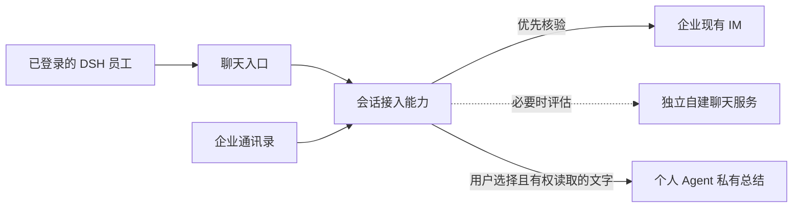

# Agent 增强的企业聊天产品方案

## 文档信息

| 项 | 内容 |
|---|---|
| 文档编号 | CORP-DSH-REQ-003 |
| 文档名称 | Agent 增强的企业聊天产品方案 |
| 版本 | V0.1 |
| 文档状态 | 草案 |
| 密级 | — |
| 编制 | Agent（代拟） |
| 审核 | 待定 |
| 批准 | 待定 |
| 最后更新 | 2026-11-11 |
| 门禁 | 需求基线同步、接入可行性与详细设计；企业实机验证后试点 |
| 确认人 | 项目负责人（当前用户） |
| 确认日期 | 2026-11-11 |
| 确认事项 | 服务对象与人员来源；单聊和群聊优先互通企业 IM；独立自建备选；首期聊天能力与个人私有总结的范围、可见性和通知方式 |
| 适用范围 | 已明确的产品方向；不代表本文全文、技术选型、实现或企业联调已获批准或完成 |

> 编制依据：当前用户对上述产品方向的确认，以及 2026-11-11 对需求基线、实现与验证索引和 §8 所列公开资料的只读核对。企业 IM、通讯录、DSH 聊天界面及会话引用、真实 IAM 和模型链路均未因本文完成联调。
>
> 关联文档：[需求与场景基线](requirements-baseline.md)、[总体架构设计](../architecture/platform-architecture.md)、[实现与验证入口](../design/README.md#22-实现与验证入口)、[DSH 插件高阶规范](../engineering/dsh-plugin-conventions.md)。

## 1. 产品定位与效力

本产品暂称 **Forge Chat**，面向已安装 DeepSeek Harness（DSH）并通过企业统一身份认证（IAM）登录的员工，在 DSH 工作环境中提供基于企业通讯录的人与人单聊、群聊，以及个人按需调用 Agent 总结聊天内容的能力。产品、需求、项目、研发和测试人员可以围绕具体工作开展沟通，员工再自行决定是否使用邮件、OA、DevOps、Gitee 等已有工具继续工作。

首选与现有企业即时通信（IM）的单聊、群聊互通并同步消息；对接受阻或无法满足必要需求时，评估基于成熟开源方案自建聊天服务。企业 IM 确实无法互通时，可采用独立聊天空间，人员仍来自企业通讯录。**接口存在、接入可行和产品能力已实现均不是本文结论。**

本文是产品方案草案，不是第二份范围基线。[需求基线 §2](requirements-baseline.md#2-范围边界唯一真源)是项目范围唯一真源；产品方案获确认并纳入项目范围时，同步该基线及受影响的架构、计划和验收。现有基线排除多人共享单个 DSH 实例或协作同一个 DSH 会话；本方案设想每人使用自己的 DSH，通过聊天服务进行人与人通信，不因此声称现有基线已包含本能力。

## 2. 用户与场景

| 用户或角色 | 主要场景 | 产品要求 |
|---|---|---|
| 产品、需求、项目人员 | 与研发、测试讨论需求、进度和待解决问题 | 在单聊或群聊中沟通；按需取得个人总结 |
| 研发和测试人员 | 讨论实现、缺陷及验收，交换图片和附件 | 可与同事通信、查看历史、发送内容并在群内提及成员 |
| 企业 IM 群成员 | 使用现有 IM 参与同一会话 | IM 互通路径下继续使用已有 IM 客户端；DSH 插件能力面向已安装 DSH 且通过 IAM 登录的员工 |

典型流程：员工从通讯录或会话列表找到同事和工作群，阅读并发送消息；讨论后，在自己的 DSH 对话中选择某一聊天及文字范围，让 Agent 整理结论、分歧和待办；员工查看仅本人可见的结果，再决定是否发起后续工作。

## 3. 首期产品能力

下表是产品目标，不表示 DSH、企业 IM、通讯录或其他工具已提供相应接口。

| 能力 | 首期目标 | 边界 |
|---|---|---|
| 登录与人员 | DSH 用户通过企业 IAM 登录；从企业通讯录检索、选择同事 | 通讯录、IAM 和聊天账号的身份对应及服务端授权须核验；查到人员不等于已有聊天权限 |
| 单聊与群聊 | 发起和参与单聊、群聊；查看会话列表及群成员，并按实际权限建群、邀请和退出 | 首选与企业 IM 的单聊、群聊互通；操作以聊天服务端允许的范围为准 |
| 消息 | 收发文字，查看可访问的消息历史和未读状态 | 发送者是发起操作的员工；历史和未读的获取及跨客户端状态以实际服务能力为准 |
| 图片和附件 | 在单聊、群聊中发送、接收和打开受支持的图片与附件 | 大小、格式、下载权限及失败提示遵循实际服务限制；聊天中收发附件不代表 Agent 默认读取附件 |
| 群内提及 | 在群聊中选择并 `@` 群成员，正确显示被提及人员及服务端支持的提示 | 提及身份和通知语义须随真实服务验证；不将 `@所有人` 视作已确认能力 |
| 个人总结 | 在自己的 DSH 对话中选择本人有权访问的单聊或群聊，请 Agent 总结所选文字 | 默认不读取图片或附件；摘要仅调用者可见，不自动发回聊天，也不向其他成员逐次通知 |
| 后续工作 | 员工自行决定是否向个人 Agent 提出后续请求，使用实际可用的 mail、OA、DevOps、Gitee 等工具 | 不预设自动联动或固定业务流程；各工具仍受其实际能力、权限和既有规则约束 |

搜索、撤回、消息编辑、表情及 `@所有人` 不属于已确认的首期必备清单；是否提供由接入能力和产品排期确定。首期 Agent 能力为个人私有总结，不设计群内公开 Agent、自动旁听或主动发言。语音视频、移动端和无人值守应用 Agent 不作为本方案的首期承诺。

### 3.1 两种不同的引用

群聊中的 `@` 用于提及群成员，是人与人聊天的首期必备能力。个人 DSH 对话中引用某个聊天，用于指定 Agent 总结的数据来源；`@聊天会话` 是可选交互形式，不预设 DSH 已支持该语法或接口。若原生语法不可用，应验证 DSH 中可行的会话选择入口，不修改 DSH 核心来假定能力存在。

### 3.2 私有总结的输入与输出

1. 员工主动指定一个本人有权读取的单聊或群聊，选择需要总结的文字范围。界面应显示所选会话、时间范围和内容类型，并允许调整；范围未明确时先选择，不静默扩大到全部历史或其他会话。
2. 默认只向 Agent 提供所选范围内可见的文字；图片和附件不默认读取或解析。是否提供用户主动选择附件后的解析能力，另行设计，不由聊天附件收发能力推定。
3. 输出整理讨论结论、分歧、待办及已明确的负责人或期限；没有明确依据的内容标为待确认，不编造。结果应注明来源会话、实际覆盖的时间或消息范围；权限不足、截断或历史不完整时明确提示。
4. 结果只呈现在调用者的个人 DSH 对话中，不自动发送至原聊天或其他系统，其他成员不收到逐次调用通知。聊天正文是待处理的资料，其中的指令性文字不能自动成为用户授权或工具执行指令。

## 4. 接入路径与决策条件

图为产品能力关系，不证明宿主扩展点、进程边界、接口协议或任何服务已经存在。

| 路径 | 目标行为 | 数据与决策边界 |
|---|---|---|
| 现有 IM 互通 | DSH 用户与 IM 用户在同一单聊或群聊中交流，支持首期必备消息能力 | IM 服务及其授权决定会话、成员、消息与历史的可访问范围；接口、身份映射和同步语义待实测 |
| 独立自建 | 基于成熟开源方案提供满足首期能力的独立聊天空间，人员来自企业通讯录 | 自建服务承担消息和附件保存、权限、备份恢复与运行维护；不默认继承或同步原 IM 的群、成员、消息和历史 |

现有 IM 路径须逐项核验单聊与群聊的收发、历史、文字、图片、附件、群成员 `@`、身份映射及访问授权。必要能力无法取得或无法满足需求时，记录具体缺口并评估独立自建；是否启用自建以可行性、企业运行条件和产品决定为准。普通故障不触发静默切换，两个系统的会话和消息不自动合并或迁移。

## 5. 身份、数据与安全边界

| 对象 | 产品边界 |
|---|---|
| 登录和账号 | DSH 的 IAM 登录是使用前提；IM 或自建服务仍须独立校验适用于该资源的身份与权限。不能把客户端显示的账号或 IAM 登录状态当作聊天服务端授权。 |
| 通讯录 | 查找和新增聊天对象以企业通讯录为来源。既有 IM 会话中存在无法映射、已停用或不在通讯录的成员时，按实际服务权限和企业规则处理；不伪造身份或自动扩大访问。 |
| 聊天正文和附件 | IM 路径遵循 IM 的权限和保存规则；自建路径的保存、备份及恢复由实际运行方案确定。消息或文件是否可见以当前服务端授权为准。 |
| 总结输入 | 仅使用调用者选定且有权读取的会话文字；读取期间权限失效时停止后续读取并说明覆盖范围，不从缓存、搜索结果或旧账号绕过授权。 |
| 总结结果 | 仅在调用者的个人对话呈现；账号切换后不向其他账号展示。历史摘要与缓存的保存期限依企业和 DSH 实际策略确定，不擅自删除用户已有数据。 |
| 模型与日志 | 个人可见不表示模型、传输链路或服务端不处理数据。模型访问遵循[需求基线的数据约束](requirements-baseline.md#44-数据与合规约束)；诊断和产品日志默认不记录聊天正文、附件或凭据，实际处理位置、保留和审计能力待验证。 |

若权限在内容已提交模型后发生变化，产品应停止尚未提交的读取和处理；不能声称已提交的内容必然可以撤回。数据保留和管理员访问均以经过核验的企业规则及对应系统能力为准，不因摘要只对调用者显示而宣称零留存。

## 6. 失败体验与可观测性

| 场景 | 产品行为 |
|---|---|
| IAM 未登录、身份无法映射或聊天服务拒绝 | 不读取或发送无权访问的内容；提示相应登录、映射或授权状态，不以共享账号冒充员工。 |
| 通讯录不可用 | 明确人员检索不可用，不自动创建未知员工身份或扩展访问权限。 |
| 同步延迟、历史不完整或网络中断 | 标明同步或覆盖不完整；恢复连接时按已验证的服务语义补齐，不能把缺失消息展示为完整历史。 |
| 发送、附件上传结果未知 | 保留可辨识的未知或失败状态，不显示成功，不盲目重复发送；恢复及重试遵循已验证的服务语义。 |
| 群成员变更或撤权 | 后续读取和发送以服务端当前授权为准；不可访问时停止并提示，不从缓存恢复越权内容。 |
| 模型或总结不可用 | 提示失败或未覆盖范围，不将不可用的总结显示为成功；聊天服务可用且用户有权访问时，普通聊天仍可使用。 |
| 功能或消息类型不受支持 | 明确显示限制；必要的首期能力缺失时，现有 IM 互通路径不作为完整达标交付。 |

运行指标可记录活跃协作人数、消息同步失败情况、总结使用及用户反馈，不以采集聊天正文作为指标前提。试点规模、统计口径及数值目标待真实环境核验后确定。

## 7. 验收目标

各条在真实目标系统和支持的终端上留证；模拟结果只证明相应本地行为，不替代企业接口或实机验收。

| 编号 | 场景 | 通过判据 |
|---|---|---|
| CHAT-AC-01 | 身份与人员 | 通过 IAM 登录的员工可查找授权范围内的企业通讯录人员；身份无法对应或无聊天权限时不能冒用他人身份。 |
| CHAT-AC-02 | 单聊互通 | 在现有 IM 路径上，两名授权员工分别使用 DSH 和 IM，双向收发文字、图片和附件，并在各自授权范围内查看历史；实际文件能够打开。 |
| CHAT-AC-03 | 群聊互通 | 多名授权员工在 DSH 和 IM 参与同一群，双向收发文字、图片和附件；`@` 指向正确群成员，群成员和消息按服务实际授权可见。 |
| CHAT-AC-04 | 群与未读 | 已授权员工能够查看群成员并执行允许的建群、邀请或退出；会话历史和未读状态正确呈现，跨客户端同步能力据实说明。 |
| CHAT-AC-05 | 私有总结 | 调用者选择一个有权读取的聊天和文字范围，看到所选范围后发起总结；结果标识实际来源和覆盖范围，只有调用者在个人对话中可见。 |
| CHAT-AC-06 | 图片与附件边界 | 聊天中图片和附件可正常收发；默认总结不读取或解析它们。缺少文字依据时，摘要不虚构图片或附件内容。 |
| CHAT-AC-07 | 通知和后续动作 | 总结不自动发回聊天或其他系统，其他成员不收到逐次通知；聊天正文中的指令不会自动触发工具操作；后续工具使用由员工提出，并受工具实际权限和规则约束。 |
| CHAT-AC-08 | 隔离与撤权 | 非成员或撤权用户不能新增读取受限内容；账号切换后其他账号看不到调用者的个人摘要；处理中途失权时停止后续读取并如实提示。 |
| CHAT-AC-09 | 故障与完整性 | 断网、结果未知、历史不完整、附件失败和权限不足时提示真实状态；不虚报成功、不静默扩大范围、不盲目重复发送。 |
| CHAT-AC-10 | 独立自建 | 采用独立自建时，另行验证 IAM／通讯录对应、单聊群聊、首期消息能力、授权与运行恢复；不以 IM 路径或模拟测试代替，也不宣称自动继承原 IM 历史。 |

终端以[需求基线](requirements-baseline.md#21-一期范围)中的 Windows、银河麒麟和 macOS 目标为参照；实际 DSH 版本、系统版本、架构和各端能力须在接入验证时确定。必要功能未验证或不满足时，该路径不得标记为首期完整通过。

## 8. 自建候选与公开依据

以下为 2026-11-11 查阅公开资料所得，仅作参考，不是选型、安装或企业兼容性结论：

| 候选 | 可验证的公开依据 | 后续重点 |
|---|---|---|
| Matrix / Synapse | [Matrix Client-Server API v1.19](https://spec.matrix.org/v1.19/client-server-api/)定义消息同步等客户端接口；[Synapse](https://github.com/element-hq/synapse)可按 AGPL 或商业许可使用，并提供 [OIDC 配置](https://element-hq.github.io/synapse/latest/usage/configuration/config_documentation.html#oidc_providers)。 | Synapse 是服务端；企业 IAM、通讯录同步、DSH 客户端接入和运行成本仍须分别验证。 |
| Mattermost | [Team Edition 许可](https://docs.mattermost.com/product-overview/faq-license)与 [OIDC 功能文档](https://docs.mattermost.com/administration-guide/onboard/sso-openidconnect)列明不同版本或计划的能力。 | 确认实际版本、通用企业身份提供方和目录同步所需计划、许可及费用。 |
| Rocket.Chat | [9.0 认证变更](https://docs.rocket.chat/v1/docs/prepare-for-authentication-changes-in-9-0-0)说明社区版与其他计划在 LDAP、SAML 和自定义 OAuth 上的区别。 | 确认目标版本、适用计划、企业身份与目录能力，以及人数和部署条件。 |

开放协议、支持 OIDC 或存在第三方桥接不等于满足本企业的 IAM、通讯录、IM 互通、首期消息能力或运营要求。选型应比较实际版本和许可、人员生命周期、消息与附件能力、授权、备份恢复、安全更新、网络限制及运营投入；目前没有足够证据量化成本或确定最终候选。

## 9. 待核验事项

| 事项 | 所需事实来源 | 截止门禁 |
|---|---|---|
| 企业 IM 产品、单聊和群聊接口、身份授权、消息／附件／`@`、历史及成员事件 | 企业 IM 提供方的有效文档与真实授权环境 | 互通路径详细设计及联调前 |
| 通讯录查询、人员唯一标识、账号映射、停用与已有群内非通讯录人员处理 | 通讯录及 IAM 提供方，结合真实样本 | 身份与权限设计前 |
| DSH 聊天界面扩展、会话选择或引用、个人会话隔离与上下文传递 | 目标 DSH 版本的接口资料与宿主探针 | 插件详细设计及准入前 |
| 模型网关、总结输入输出、日志、保存期和权限变化的实际处理 | 企业模型与相关服务的有效契约、真实配置与联调 | 真实内容试用前 |
| 试点人数、终端版本、可接受同步时延与可用性目标 | 项目负责人、目标环境及试点实测 | 试点准入前 |
| 自建方案的具体版本、许可、企业认证、运行资源、备份恢复及维护责任 | 候选产品资料与目标部署环境 | 确定自建路径前 |

外部提供方是接口、权限和运行事实的来源，不替代项目负责人作产品决定；未经真实证据不把接口开放、环境可用或企业联调写成已完成。
