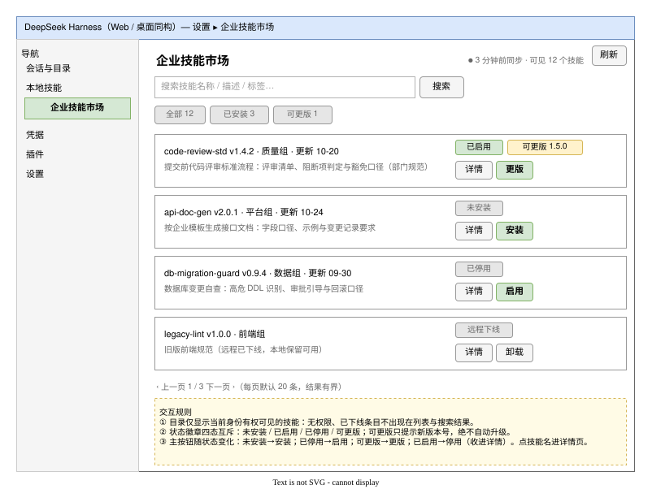
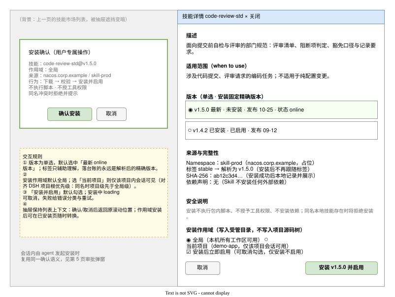
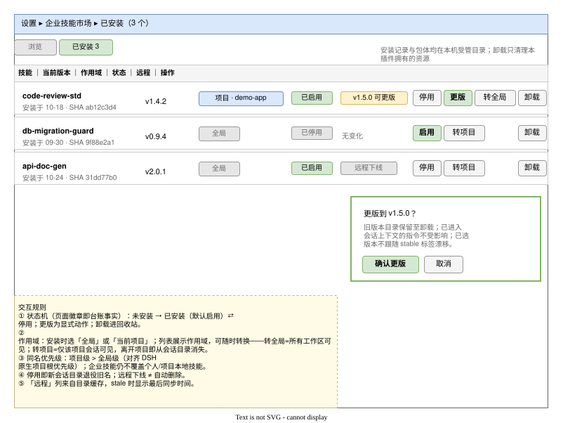
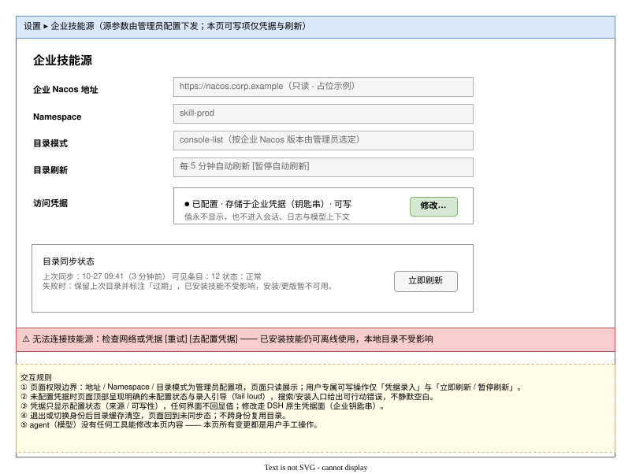
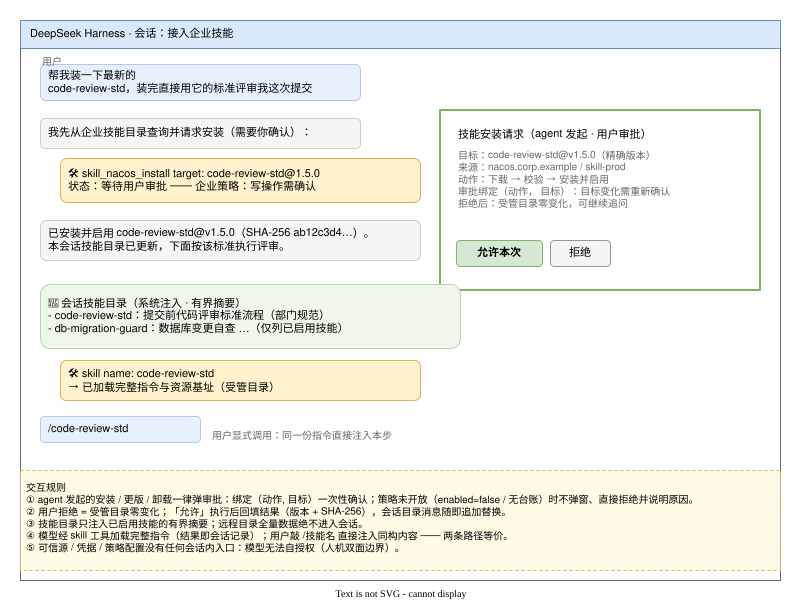
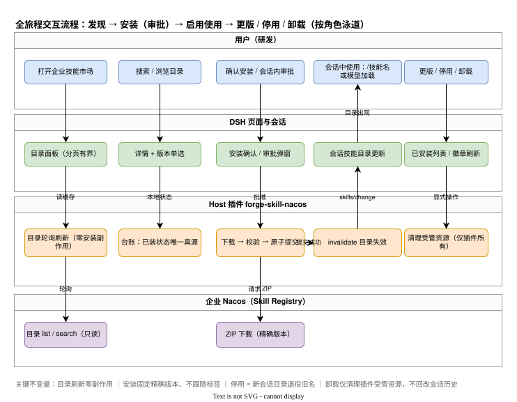
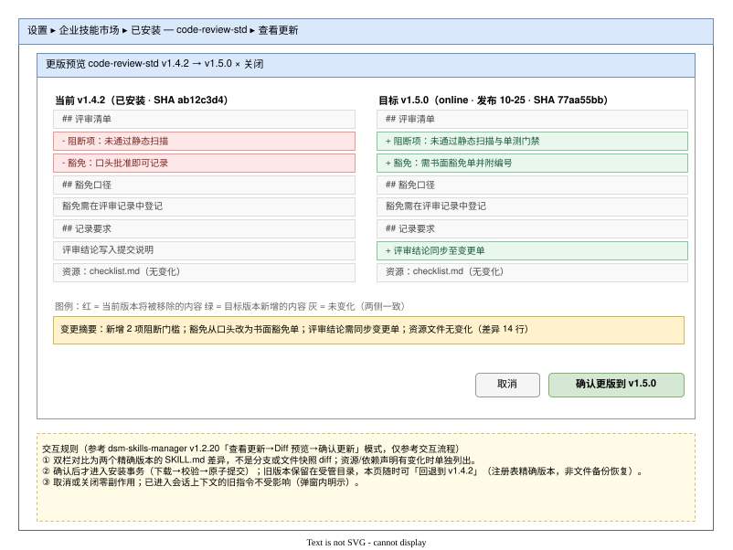
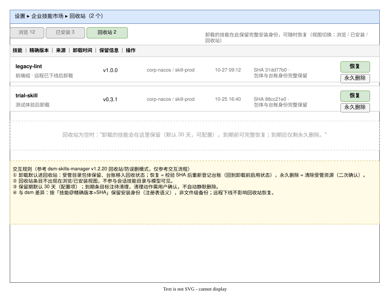

<!-- 目标读者：heluo-forge 产品/研发/安全评审；技术契约见 docs/design/plugins/forge-skill-nacos.md；交互效果图见 docs/assets/skill-nacos/forge-skill-nacos-prd-mockups.drawio（8 页） -->

# PRD（V0.2）｜DSH 对接 Nacos 动态获取与加载企业 Skill

## 文档信息

| 项 | 内容 |
|---|---|
| 文档编号 | CORP-DSH-REQ-006 |
| 文档名称 | DSH 对接 Nacos 动态获取与加载 Skill——产品需求设计文档 |
| 版本 | V0.2 |
| 文档状态 | 草案（代拟，待评审） |
| 密级 | — |
| 编制 | DSH 平台组（产品视角代拟） |
| 审核 | 待定 |
| 批准 | 待定 |
| 最后更新 | 2026-10-28 |
| 门禁 | 范围与取舍确认；企业 Nacos 联调与目标平台验收详见[详细设计](../design/plugins/forge-skill-nacos.md)（CORP-DSH-DESIGN-018） |
| 关联文档 | [需求 issue #97](https://github.com/hrygo/heluo-forge/issues/97)、[技术详细设计 forge-skill-nacos.md](../design/plugins/forge-skill-nacos.md)、[交互效果图 forge-skill-nacos-prd-mockups.drawio](../assets/skill-nacos/forge-skill-nacos-prd-mockups.drawio)（8 页） |

> **编制依据**：
>
> 1. 技术与需求输入同 V0.1（#97、技术设计文档、Nacos 3.2/develop 源码核验、DSH 0.2.1-rc.3 扩展点核验）。
> 2. **UI 交互参考登记**：交互流程与界面组织模式参考开源项目 [MichengAI/dsh-skills-manager](https://github.com/MichengAI/dsh-skills-manager) **v1.2.20 @ commit `b3538863406022e72bf313f5770b55fd9f5c8e44`**（Apache-2.0，2026-10-26 核验：仓库 README、源码结构、三张界面截图）。参考范围限定为**交互模式与信息架构**：四视图工作区、来源折叠分组、内联启停开关、宽屏详情弹窗、更版 Diff 预览确认、回收站防误删、侧边栏入口开关。**未复用其任何代码、图形资产与界面文案**；实现遵循清洁室纪律（见附录 C）。
> 3. 文中所有地址、技能名、数据均为占位示例；界面文案以 locale 字典（zh/en）为唯一真源，本文中文文案为语义示意。

**修订记录**

| 版本 | 日期 | 变更 |
|---|---|---|
| V0.1 | 2026-10-27 | 初稿（完整 PRD，6 页效果图） |
| V0.2 | 2026-10-28 | B+ 路线定稿：登记交互参考来源；新增 §6.7 更版差异预览（P7）、§6.8 回收站与恢复（P8）；范围表新增 F11/F12；异常表补恢复校验行；埋点补恢复/清除事件；验收补 P-AC9；附录 B 交互参考对照、附录 C 清洁室红线自查 |
| V0.2.1 | 2026-10-28 | 作用域需求（需求方确认）：已安装列表显示全局/项目级并可随时转换；安装确认增加作用域选择（P2/P3 效果图更新）；F8 升 P0；§7/§9/§11/§12 联动；附录 B 补写入目标选择模式 |

## 1. 背景与问题

**现状**：企业技能（编码规范、评审口径、变更自查等）以文件形式在各终端间手工复制：IM 传压缩包、网盘下载、同事 U 盘拷贝。

**三类痛点**：

| 痛点 | 具体表现 | 业务代价 |
|---|---|---|
| 版本漂移 | 同一规范在团队内存在 3+ 个版本并行使用 | 评审口径不一致，返工与扯皮 |
| 来源不可追溯 | 没人说得清手里这份规范是谁发的、第几版、是否仍有效 | 过期规范继续执行，合规风险 |
| 分发无权限边界 | 技能文件无访问控制，离职/换岗后仍持有私有技能 | 权限回收无从谈起 |

**机会**：企业已用 Nacos 集中管理配置，3.2 起提供原生 Skill Registry（发布、版本、审核流水线）；DSH 有原生技能加载机制（目录、`skill` 工具、`/技能名` 调用）。两者之间缺一个"发现→安装→原生使用"的产品闭环——本需求即补齐这一环。

**产品定位一句话**：让研发在 DSH 内像逛应用商店一样获取企业技能，装完即用、版本可信、离线可用。

## 2. 目标与成功指标

**业务目标**：企业技能从"文件"变成"受管资产"——统一发现入口、精确版本固定、权限内可见、可停用可卸载。

**产品目标**（对应 #97 目标 1–5）：状态分离（可发现/已安装/已启用可调用）、精确版本安装、原生机制使用、复用 Nacos 与 DSH 既有能力。

**成功指标**（试点期 6 周，目标值为提议值，口径待数据方确认）：

| 维度 | 指标 | 目标 | 说明 |
|---|---|---|---|
| 采纳 | 企业技能安装人数 / 活跃研发数 | ≥ 60% | 覆盖 3 部门试点 |
| 采纳 | 安装技能的会话使用率（装后 7 天内至少调用 1 次） | ≥ 40% | 装了不用=发现或质量有问题 |
| 一致性 | 已安装版本 = 远程最新 online 版本的比例 | ≥ 80% | 更版提示有效性 |
| 效率 | 安装全程（确认→可用）P95 耗时 | ≤ 10s | 内网正常网络 |
| 效率 | 目录搜索结果返回 P95 | ≤ 2s | 含缓存 |
| 安全（反指标） | 策略拒绝后的受管目录变更数 | = 0 | 必须为零，非趋势项 |
| 安全（反指标） | 凭据值出现在会话/日志/截图的事件数 | = 0 | 同上 |
| 支持 | 安装失败率（按操作计） | ≤ 2% | 失败原因可按错误分类归因 |

**不做为成功负责的**：技能内容质量（归维护方）、企业 Nacos 可用性 SLA（归运维）。

## 3. 用户与场景

**角色矩阵**：

| 角色 | 与本功能的关系 | 关键诉求 |
|---|---|---|
| 研发（主用户，约 800 人） | 浏览、安装、启停、更版、卸载、会话中使用 | 快速找到可信技能；装完即用；离线不断粮 |
| 企业技能维护者（AIHUB/各组） | 在 Nacos 上发布技能（本功能范围外） | 技能被准确发现、版本被正确固定 |
| 安全/合规 | 制定策略与凭据边界 | 拒绝即零副作用；凭据不落明文；全操作可审计 |
| 平台管理员 | 配置技能源（地址/namespace/模式） | 配置下发，终端只读 |

**核心用户故事**（验收场景基准）：

- **S1 新人入职**：加入团队第一天，打开"企业技能市场"搜索"code-review"，看到部门评审规范技能，确认安装 v1.5.0；新会话中模型自动按规范评审我的提交，我也可以敲 `/code-review-std` 直接调出标准。
- **S2 规范更新**：质量组发布 v1.6.0。我在已安装页看到"可更版"徽章，打开差异预览核对新增阻断项后确认更版；旧版本保留，正在进行的会话不被打扰，随时可回退到已安装版本。
- **S3 会话内发现缺口**：让模型"按企业规范生成接口文档"，模型发现自己没装对应技能，主动发起安装请求；我收到审批弹窗（绑定技能名+精确版本），允许后当轮会话即可使用。
- **S4 出差离线**：无内网环境下，已安装技能照常可用（本地受管目录）；市场页显示离线横幅，安装/更版入口禁用并说明原因。
- **S5 同名冲突**：我本地自写了同名个人技能，安装企业版时被明确拒绝并指出冲突来源——企业技能永不覆盖个人/项目技能。
- **S6 误卸恢复**：手滑卸载了仍在用的技能，到回收站一键恢复，安装身份（精确版本+启用状态）原样回来。

## 4. 需求范围与优先级

| # | 功能 | 优先级 | 理由 |
|---|---|---|---|
| F1 | 技能市场浏览与搜索（效果图 P1） | P0 | 发现是采用的前提 |
| F2 | 技能详情 + 精确版本选择 + 安装（P2） | P0 | 核心闭环 |
| F3 | 已安装管理：启停 / 更版（差异预览确认）/ 卸载（P3、P7） | P0 | 生命周期完整性 |
| F4 | 技能源与凭据设置（P4） | P0 | fail loud 引导 + 权限边界展示 |
| F5 | 会话内审批弹窗（P5） | P0 | agent 代办写操作的安全闸 |
| F6 | 会话内原生使用（目录/`skill` 工具/`/技能名`） | P0 | 价值兑现点（复用 DSH 原生，无新页面） |
| F7 | 更版批量提醒、技能收藏、使用频率展示 | P1 | 采纳深化 |
| F8 | 安装作用域：全局 / 项目级选择 + 列表作用域展示与随时转换（P2、P3） | P0 | 需求方 2026-10-28 确认：列表须体现作用域且可调整；项目级仅该项目会话可见，对齐 DSH 项目根优先级。profile 级作用域仍为 P2 待裁 |
| F9 | 技能评分评论、推荐流 | 不做 | 非目标：不自建内容社区 |
| F10 | 技能开发/发布工作台 | 不做 | 非目标：发布归 Nacos/AIHUB 既有流程 |
| F11 | 回收站与恢复（P8） | P1 | 防误删保障；参考上游模式，企业语义为"安装身份"恢复 |
| F12 | 分类整理与拖拽归类 | P2 | 纯本地组织功能；参考上游模式 |

**范围声明**：首版即含轻量管理面板（F1–F4），回答 #97 待确认 7，理由同 V0.1（800 人自助采用需要非会话入口；会话审批不能是唯一通道；面板复用 Host 同一业务服务）。资源受限降级路径：F1/F2 合并为极简列表页、F3 并入已安装 tab，F4 不可降级。

**实现路线声明（B+）**：实现全部按 heluo-forge 约定自研（技术设计文档为准），UI 交互设计参考 dsh-skills-manager 的已验证模式（附录 B 对照表），不复用其代码、资产与文案。

**非目标**（与 #97 一致）：不改 DSH 核心；不替换插件市场（#12）；不自建审批后台/身份系统；安装技能不授工具权限、不执行脚本；不承诺擦除已进入会话的指令；**不做 20+ 外部 Agent 目录管理**（上游插件的个人收纳定位，对企业场景是范围噪声）。

## 5. 信息架构与入口

```
设置 ▸ 企业技能市场（视图切换：浏览 / 已安装 / 回收站）   ← 主入口
 ├─ 浏览：搜索 + 筛选 + 来源折叠分组 + 技能卡片
 │   ├─ 技能详情抽屉（宽屏弹窗：正文高亮 + 复制）
 │   └─ 安装确认弹窗
 ├─ 已安装：行式管理 + 启停开关 + 更版差异预览 + 卸载
 └─ 回收站：恢复 / 永久删除

设置 ▸ 企业技能源                ← 源状态 + 凭据录入（低频）
设置 ▸ 凭据（原生页面）           ← 凭据记录实际写入处

会话
 ├─ 技能目录消息（系统注入，原生能力）
 ├─ 审批弹窗（agent 发起安装/更版/卸载时）
 └─ /技能名 直接调用（原生能力）

可选：主侧边栏「技能」常驻入口（开关控制，借鉴上游 sidebarEntry 模式，
     与设置入口数据/状态 100% 同步）
```

入口原则：**发现与管理集中在设置域**，会话域只承接"使用"与"审批"，两域共用同一 Host 业务逻辑，状态实时一致。

## 6. 页面与交互详述（对应效果图，[交互参考] 标注借鉴来源）

### 6.1 技能市场·浏览与搜索（效果图 P1）

**布局**：左侧导航（企业技能市场高亮）｜右上同步状态+刷新｜搜索框+状态筛选（全部/已安装/可更版）｜技能卡片列表｜分页。`[交互参考]` 借鉴上游"搜索+状态筛选+分组列表"的组织方式；分组维度为**来源分组折叠**（维护组/质量组/平台组…，按 Nacos 目录元数据），而非上游的 20+ Agent 工具目录。

**卡片信息层级**（一眼可判定）：技能名+当前相关版本 → 描述（截断）→ 徽章（未安装/已启用/已停用/可更版，四态互斥）→ 操作按钮（随状态切换：安装/启用/更版/详情）。

**交互规则**：
1. 列表仅显示当前身份有权可见条目；无权限与已下线条目不出现（不是置灰，是不存在）。
2. 搜索分页有界（默认 20/页）；结果为目录缓存，页面标注最后同步时间。
3. 主按钮语义：未安装→安装；已停用→启用；可更版→更版；已启用→收进详情（列表只保留详情）。
4. 空态三种各配文案与动作：无结果（换关键词/清筛选）、未配置凭据（去配置）、离线（已装技能入口引导）。
5. 远程下线条目保留显示并标注（如"远程下线"），供用户决定卸载与否。

**验收要点**：无权限条目不可见且搜索不出；筛选数量与徽章一致；分页边界正确。

### 6.2 技能详情与安装确认（效果图 P2）

**布局**：右侧宽屏详情抽屉（保持列表上下文）：描述 → 适用范围 → 版本单选 → 来源与完整性 → 安全说明 → **安装作用域选择** → 底部操作（取消/安装并启用）。`[交互参考]` 借鉴上游宽屏详情弹窗模式（大版心、等宽字体代码高亮、一键复制 Markdown 正文、可垂直拉伸）与**写入目标选择**（destination-picker：用户目录 / 工作区项目目录）模式。

**交互规则**：
1. 版本单选默认选中最新 online 版本；**安装永远固定为解析后的精确版本**，标签（stable 等）只作解释性展示。
2. **安装作用域**（写入受管目录，不写入项目源码树）：默认「全局」（本机所有工作区可用）；可选「当前项目」（仅该项目会话可见，同名时项目级先于全局级生效）。
3. "安装后立即启用"默认勾选（显式安装即意图使用），可取消勾选实现"仅安装不启用"。
4. 确认弹窗列明：技能@精确版本、**作用域**、来源、行为边界（不执行脚本/不授工具权限/不装依赖）、同名冲突拒绝规则。
5. 安装中：按钮 loading 可取消；成功徽章翻转"已启用"；失败给错误分类（见 §9）+ 重试入口。
6. 已安装版本在版本列表中标注当前状态，选择旧版本即降级安装（走同一确认）；安装后作用域可在已安装页随时转换（§6.3）。

**验收要点**：标签漂移不改变已选版本（S2）；安装失败不残留半状态；二次安装同版本幂等提示；项目作用域安装在项目外会话不可见。

### 6.3 已安装技能管理（效果图 P3）

**布局**：行式列表：技能（含安装时间+摘要前 8 位）｜当前版本｜**作用域**（全局/项目·项目名）｜状态徽章｜远程列（无变化/可更版/远程下线）｜操作（停用/启用/更版/**转全局/转项目**/卸载）。`[交互参考]` 借鉴上游内联启停开关与行式布局；差异=每行携带精确版本、摘要与作用域信息。

**交互规则**：
1. 页面徽章即本地台账事实，与重启无关；内联开关直接切换启用状态。
2. **作用域展示与转换**：每行显示作用域徽章（全局=灰、项目=蓝+项目名）；「转全局」=对所有工作区可见，「转项目」=仅该项目会话可见，离开该项目即从会话目录消失。转换为台账级操作，包体不动，新会话生效；同名时项目级优先于全局级（对齐 DSH 原生项目根优先级），企业技能仍不覆盖个人/项目本地技能。
3. 停用：即时生效——新会话目录退役该名称，模型再调用报 unknown；旧会话历史不回改（弹窗明示）。
4. 更版：入口进入**差异预览确认**（§6.7）。
5. 卸载：默认进回收站（§6.8），弹窗明示两点边界——仅清理受管资源；无法撤回已进入会话的指令。
6. "远程"列来自目录缓存，stale 时显示最后同步时间而非最新事实。

**验收要点**：四态徽章互斥且与实际行为一致（对应 #97 AC7）；停用后 `/技能名` 失效；卸载后列表与目录消息同步消失；作用域转换后项目内/外可见性符合预期。

### 6.4 技能源与凭据设置（效果图 P4）

**布局**：源参数（地址/Namespace/目录模式/刷新频率，只读）｜访问凭据卡片（状态+修改入口）｜目录同步状态卡（含立即刷新）｜异常横幅（离线/未配置）。

**交互规则**：
1. 源参数由管理员配置下发，页面只读展示——用户可写项仅凭据与刷新，**agent 无任何工具可触达本页任何变更**（用户专属）。
2. 凭据只显示配置状态与来源（钥匙串/环境），任何界面不回显值。
3. 未配置凭据：页面顶部明确未配置状态+录入引导；市场/安装入口给可行动错误（fail loud），不静默空白。
4. 刷新失败：保留上次目录并标注"过期"，已装技能不受影响，安装/更版禁用并说明。
5. 退出/切换身份：目录缓存清空回未同步态，不跨身份复用。

**验收要点**：对应 #97 AC2（凭据不进会话/日志）、AC8（撤权与离线行为）。

### 6.5 会话内审批与使用（效果图 P5）

**布局**：用户消息 → 模型回复+工具卡片（安装请求，等待审批）→ 审批弹窗（允许本次/拒绝）→ 结果回执 → 会话技能目录消息（系统注入）→ `skill` 工具加载 / `/技能名` 直接调用。

**交互规则**：
1. agent 发起的安装/更版/卸载一律弹审批，**绑定（动作, 技能@精确版本）一次性确认**；目标变化需重新确认。
2. 策略未开放（enabled=false 或无台账）时不弹窗、直接拒绝并给出原因——拒绝路径零副作用。
3. 允许后回执包含精确版本与摘要前 8 位；会话目录消息随即追加替换（新会话或下一步生效，按 DSH 原生目录机制）。
4. 技能目录只注入已启用技能的有界摘要；远程目录全量数据绝不进入会话。
5. 模型加载与用户 `/技能名` 注入的是同一份内容（同构渲染），用户手势优先。

**验收要点**：对应 #97 AC3（发现无副作用）、AC9（人机双面一致、agent 不能自授权）。

### 6.6 全旅程状态流转（效果图 P6）

泳道图定义四角色（用户/页面与会话/Host 插件/Nacos）在"发现→安装→审批→使用→更版/停用/卸载"各环节的职责与四条不可违背的不变量：目录刷新零副作用；安装固定精确版本不跟随标签；停用即目录退役旧名；卸载仅清理插件受管资源、不回改会话历史。

### 6.7 更版差异预览（效果图 P7）`[交互参考]`

**布局**：宽屏弹窗：左栏当前已安装版本 / 右栏目标版本，行级红绿灰差异着色（红=移除、绿=新增、灰=未变化）；下方变更摘要条；底部取消/确认更版。

`[交互参考]` 借鉴上游"查看更新 → Diff 预览 → 确认后更新"的确认流。**企业化差异**：对比对象是两个**精确版本**的 SKILL.md 与资源/依赖声明（注册表语义），不是分支或文件快照 diff；回退语义为"回退到已安装的精确版本"，非文件备份恢复。

**交互规则**：
1. 差异由 Host 基于本地已装版本正文与目标版本详情计算，不把两个全文灌入模型上下文。
2. 确认后才进入安装事务（下载→校验→原子提交）；确认前零副作用，取消即丢弃。
3. 更版成功后旧版本保留在受管目录，本页提供"回退到 v<旧版本>"入口（显式操作，同样走确认）。
4. 弹窗明示：已进入会话上下文的旧指令不受影响。

**验收要点**：差异着色与实际 diff 一致（含资源/依赖声明变化单独列出）；取消/关闭零副作用；更版后可回退且回退后目录消息正确替换。

### 6.8 回收站与恢复（效果图 P8）`[交互参考]`

**布局**：视图切换（浏览/已安装/回收站）下的行式列表：技能｜精确版本｜来源｜卸载时间｜保留信息｜操作（恢复/永久删除）；空态文案与保留期说明。

`[交互参考]` 借鉴上游回收站/防误删模式。**企业化差异**：按"技能@精确版本 + SHA-256"保留**安装身份**（注册表语义），非文件级备份快照；恢复时校验完整性。

**交互规则**：
1. 卸载默认进回收站：受管目录包体保留、台账移入回收状态；恢复 = SHA 校验通过后重新登记台账并回到卸载前启用状态。
2. 永久删除 = 清除受管资源，二次确认；到期条目仅提示待清理，**不自动静默删除**，清理需用户确认。
3. 回收站条目不出现在浏览/已安装视图，不参与会话技能目录与模型可见。
4. 保留期默认 30 天（配置项）；远程下线不影响回收站恢复（本地资产）。

**验收要点**：恢复后安装身份（版本+启用状态+摘要）与卸载前一致；恢复时 SHA 不符走 §9 拒绝路径；回收站条目对模型零可见（S6 场景闭环）。

## 7. 状态与生命周期规则

| 远程状态 × 本地状态 | 列表徽章 | 可用性（模型/ /名） | 允许操作 |
|---|---|---|---|
| 可见 + 未安装 | 未安装 | 不可用 | 安装、详情 |
| 已安装 + 启用 | 已启用 | 可用 | 停用、更版、卸载 |
| 已安装 + 停用 | 已停用 | 不可用（目录已退役） | 启用、卸载 |
| 已安装 + 远程有新版本 | 可更版（叠加徽章） | 维持当前版本可用 | 更版（差异预览）、停用、卸载 |
| 已安装 + 远程下线 | 远程下线（叠加） | 本地保留可用 | 停用、卸载 |
| 已卸载（回收站） | 回收站视图 | 不可见不可用 | 恢复、永久删除 |
| 远程不可达/离线 | 目录标注过期 | 已装技能不受影响 | 仅本地操作 |

规则：状态由本地台账唯一裁决（页面、会话目录、工具结果读同一事实源）；任何远程变化不自动改变本地安装状态。**作用域规则**：作用域是台账字段而非安装位置——全局=本机所有工作区可见；项目=仅该项目（按会话 cwd 判定项目归属）可见；同名叠加时项目级优先于全局级；作用域转换只改台账不改包体，新会话生效。

## 8. 权限与安全交互边界

| 操作 | 用户（页面） | agent（会话） | 说明 |
|---|---|---|---|
| 浏览/搜索/详情 | ✅ | ✅（只读工具） | 只读，无审批 |
| 安装/更版 | ✅（差异预览+确认） | ⚠️ 审批弹窗 | 绑定（动作, 目标），一次性 |
| 停用/启用/卸载 | ✅ | ⚠️ 同上 | 卸载二次确认 |
| 回收站恢复/永久删除 | ✅ | ⚠️ 同上 | 恢复走完整性校验 |
| 凭据录入/修改 | ✅ 专属 | ❌ 无工具 | 值永不回显 |
| 源地址/模式/策略 | ❌ 配置下发 | ❌ 无工具 | 管理员域 |
| 刷新目录 | ✅ | ✅（只读语义） | 零副作用 |

**铁律**：拒绝即零副作用（页面与工具同一判定）；凭据值不出现在任何界面、会话、日志、截图指引中；页面文案不得引导用户把凭据贴进对话。

## 9. 异常与边界场景（错误文案原则：说清发生了什么+下一步动作）

| 场景 | 页面表现 | 用户动作 |
|---|---|---|
| 未配置凭据 | 顶部引导条+功能入口禁用并说明 | 去设置录入 |
| 401/403（权限不足） | 明确"无权限访问该技能源"，不降级匿名 | 联系管理员/检查凭据 |
| 网络超时/源不可达 | 橙色横幅：目录过期，已装技能可用 | 重试/稍后 |
| 版本不在线/已下架 | 详情页该版本置灰不可选 | 换版本 |
| 同名本地技能冲突 | 拒绝并指出冲突来源与名称 | 改名或先处理本地技能 |
| 安装包校验失败（安全拒绝） | 错误分类+「已自动清理，未产生任何变更」 | 上报平台组（包质量问题） |
| 磁盘不足/配额超限 | 明确配额数字与当前占用 | 卸载不用的技能 |
| 安装中途取消/断网 | 无半安装；可安全重试 | 重试 |
| 并发安装同一技能 | 后到操作按台账幂等或提示串行等待 | 稍后查看结果 |
| 远程撤权（身份变更） | 目录清空回未同步态；已装保留并提示 | 重新配置凭据 |
| 回收站恢复时 SHA 不符 | 拒绝恢复："本地包体与安装记录不一致，可能被外部改动"，提供重新安装入口 | 重新安装该版本 |
| 「转项目」时当前无项目/项目根不可判定 | 拒绝并说明："未识别到当前工作区项目根，请在项目内重试或保持全局" | 在项目会话中重试 |

## 10. 非功能需求

- **性能**：目录搜索 P95 ≤ 2s；安装全程 P95 ≤ 10s；更版差异计算 P95 ≤ 1s；后台轮询不阻塞会话首响（list/get 纯本地）。
- **平台**：Web（127.0.0.1）与桌面端同构；Win10 amd64 / UOS 20 amd64 / 麒麟 aarch64 三平台实机验证。
- **国际化**：全部界面文案走 locale 字典（zh/en 成对，仓库门禁），本文中文文案为语义示意。
- **可访问性**：差异着色附 +/- 文字标记（不只靠颜色）；弹窗支持键盘操作。
- **审计与隐私**：本地审计仅记录动作/技能/版本/来源/结果/时间（无技能正文、无用户代码、无凭据）；公开渠道证据脱敏。

## 11. 数据与埋点（最小集，与安全要求一致）

| 事件 | 字段 | 用途 |
|---|---|---|
| skill_market_search | 关键词长度、结果数、耗时 | 发现效率 |
| skill_install | 技能名、版本、来源面（页面/会话审批）、结果、错误分类、耗时 | 采纳与质量 |
| skill_enable / disable / upgrade / uninstall | 技能名、版本、来源面 | 生命周期健康度 |
| skill_upgrade_preview | 技能名、新旧版本、差异行数、是否确认 | 更版信任交互有效性 |
| skill_restore / skill_purge | 技能名、版本、结果 | 回收站使用与防误删价值 |
| skill_scope_change | 技能名、版本、原作用域、新作用域、来源面 | 作用域使用分布（全局 vs 项目） |
| skill_invocation | 技能名、路径（skill 工具 / `/名`） | 使用率（复用 DSH 原生记录，不新增采集） |
| skill_source_error | 错误分类、是否降级展示 | 支持归因 |

不上报：技能正文、会话内容、凭据、内网拓扑。

## 12. 验收标准（产品侧，映射 #97）

| 编号 | 场景 | 通过条件 |
|---|---|---|
| P-AC1 | S1 主链路 | 市场→详情→安装→新会话目录出现→`/技能名` 与模型加载均可用，全程 ≤ 10s |
| P-AC2 | 权限可见性 | 双身份双 namespace：无权条目列表与搜索均不可见；403 明确报错不降级 |
| P-AC3 | 发现零副作用 | 仅浏览/搜索/刷新后，已装集合与受管目录逐项不变（对应 #97 AC3） |
| P-AC4 | 版本固定 | 标签漂移后已装版本不变；更版仅经差异预览显式触发后变化（对应 AC4） |
| P-AC5 | 生命周期 | 四态徽章与实际可用性一致；停用即退役；卸载后全入口失效（对应 AC7） |
| P-AC6 | 审批与拒绝 | agent 安装请求弹窗绑定精确目标；拒绝后零变更；未开放动作直接拒绝（对应 AC9） |
| P-AC7 | 离线与撤权 | 离线时已装技能可用、安装禁用有说明；切换身份目录不复用（对应 AC8） |
| P-AC8 | 人机一致 | 页面与会话对同一操作的状态与错误一致；凭据/源配置无会话入口 |
| P-AC9 | 回收站闭环（S6） | 卸载→回收站→恢复：安装身份（版本+启用状态+摘要）逐项一致；恢复校验失败走拒绝路径；回收站条目对模型零可见 |
| P-AC10 | 作用域显示与转换 | 已安装列表逐行显示全局/项目作用域；项目作用域技能在项目外会话与目录零可见；转换（转全局/转项目）后新会话目录按新作用域出现/消失；同名项目级优先于全局级 |

证据规则沿用 #97：PASS/FAIL/BLOCKED/NOT RUN 回填，NOT RUN 不算通过；实机验收覆盖三平台。

## 13. 依赖、风险与开放问题

**依赖**：企业 Nacos ≥3.2（目录路线按版本，P0 取证定）；Nacos 包体分发的范围差异批准（S6/ADR-11/13，未批则安装保持关闭、只读发现不受影响）；凭据生产 backend（forge-credentials-keychain 平台适配器）；forge-policy 动作目录登记。**不构成依赖**：dsh-skills-manager 上游（仅交互参考，规格已固化于本文，上游后续演进不自动进入需求）。

**风险**：

| 风险 | 影响 | 缓解 |
|---|---|---|
| 范围差异未获批 | 安装不可开放，功能退化为只读目录 | P0 并行推进批准；只读发现先行验证价值 |
| 3.2 无低权限目录接口 | 目录路线需切换（升级 3.3 或 Config 索引） | 三路线已设计，P0 实测定夺 |
| 技能内容质量差 | 装而不用，采纳指标不达标 | 上线前与维护者约定首批技能清单与质量门槛 |
| 凭据平台适配未就绪 | 三平台无法生产化 | 依赖跟踪；file backend 仅限试点 |
| UI 交互实现偏差 | 交互体验不及参考产品 | 交互规格已按截图固化为效果图 P1–P8；实现对照验收 |

**开放问题**：① 首版管理面板范围（本 PRD 立场"含"，§4）；② 作用域粒度（全局+项目已定为 P0；**profile 级**作用域仍待裁）；③ 埋点数据落点与报表归属（数据方）；④ 回收站保留期默认值（30 天为建议值）；⑤ 侧边栏常驻入口是否首版提供；⑥ 项目作用域的项目根判定口径（沿用 DSH `.git` 向上查找，是否叠加已登记工作区判定，实现期与技术设计对齐）。

## 14. 附录

### 14.1 交互效果图索引

源文件 [forge-skill-nacos-prd-mockups.drawio](../assets/skill-nacos/forge-skill-nacos-prd-mockups.drawio)（8 页，draw.io / VSCode Draw.io 扩展打开可编辑）；SVG 随文档分发并内嵌如下：

| 页 | 内容 | 对应章节 | 交互参考 |
|---|---|---|---|
| P1 技能市场浏览与搜索 | 搜索、筛选、卡片徽章、分页 | §6.1 | 列表组织/筛选模式 |
| P2 技能详情与安装确认 | 详情抽屉、版本单选、安装确认弹窗 | §6.2 | 宽屏详情弹窗模式 |
| P3 已安装技能管理 | 行式管理、启停、更版入口 | §6.3 | 内联开关模式 |
| P4 技能源与凭据设置 | 源只读区、凭据卡、同步状态 | §6.4 | —（企业特有） |
| P5 会话内审批与使用 | 会话流、审批弹窗、目录消息 | §6.5 | —（企业特有） |
| P6 全旅程交互流程 | 四角色泳道 | §6.6 | — |
| P7 更版差异预览 | 双栏 diff、变更摘要、确认更版 | §6.7 | Diff 预览确认模式 |
| P8 回收站与恢复 | 回收站列表、恢复/永久删除 | §6.8 | 回收站防误删模式 |

**P1 技能市场·浏览与搜索**



**P2 技能详情与安装确认**



**P3 已安装技能管理**



**P4 技能源与凭据设置**



**P5 会话内审批与使用**



**P6 全旅程交互流程（泳道）**



**P7 更版差异预览**



**P8 回收站与恢复**



### 14.2 交互参考对照表（B+ 借鉴清单固化）

参考对象：dsh-skills-manager v1.2.20 @ `b3538863`（Apache-2.0）。**只参考左列模式，右两列为我们的实现与差异**：

| 上游交互模式 | 我们的实现 | 关键差异 |
|---|---|---|
| 四视图工作区（全局/项目/发现/回收站） | 三视图（浏览/已安装/回收站）+ 独立源设置页 | 无"项目/全局"个人管理视角；市场即企业目录 |
| 来源折叠分组 + 搜索 + 状态筛选 | 市场列表按维护组折叠分组 | 分组来自 Nacos 目录元数据，非本机 Agent 目录 |
| 内联启停开关 | 已安装内联开关 | 停用即目录退役（模型可见性联动），上游为面板级策略 |
| 宽屏详情弹窗（等宽高亮/复制正文/拉伸） | 详情抽屉同模式 | 增加版本单选与来源/摘要区 |
| 写入目标选择（destination-picker：用户目录/工作区项目目录） | 安装作用域选择（全局/当前项目）+ 已安装页作用域转换 | 作用域是台账字段，包体统一在受管目录；项目级可见性按会话 cwd 判定，不写入项目源码树 |
| 更新 Diff 预览 → 确认更新 | §6.7 差异预览确认 | 精确版本对比；回退=回退版本而非文件备份恢复 |
| 回收站/防误删/恢复 | §6.8 回收站 | 按"技能@版本+SHA"保留安装身份；保留期可配置 |
| 侧边栏入口开关（sidebarEntry） | 可选常驻入口（待确认 ⑤） | 同模式 |
| 在线更新器配置硬禁用 | install 总开关同模式 | 企业策略联动 |
| 分类文件夹/拖拽归类 | F12（P2） | 同模式，纯本地功能 |

**刻意不借鉴**：20+ 外部 Agent 目录管理（范围噪声）、公共市场三源（内网不可达）、个人定位的品牌呈现。

### 14.3 清洁室红线自查（实现与验收时执行）

| # | 检查项 | 通过条件 |
|---|---|---|
| C1 | 代码 | 最终 diff 中无源自上游仓库的代码段落（逐行或近似逐行）；安全基元（有界读取/路径校验/标识符白名单）按思想重写 |
| C2 | 资产 | 无上游图标/banner/截图等图形资产进入本仓库 |
| C3 | 文案 | locale 字典文案全部自写，无上游 `locale/*.json` 文案搬运（功能性短语雷同不计，整段相同即整改） |
| C4 | 来源登记 | 本文档与技术设计的编制依据保留参考登记（版本+SHA+范围声明）；后续版本更新参考时同步登记 |

### 14.4 术语

技能 = 指令与可选资源包（SKILL.md+资源），非插件、非 MCP；精确版本 = 解析掉标签后的具体版本号；受管目录 = 插件独占的本机安装位置；目录 = 远程可发现条目集合；台账 = 本地安装记录唯一真源；安装身份 = 技能名@精确版本 + SHA-256 + 启用状态的总称。
