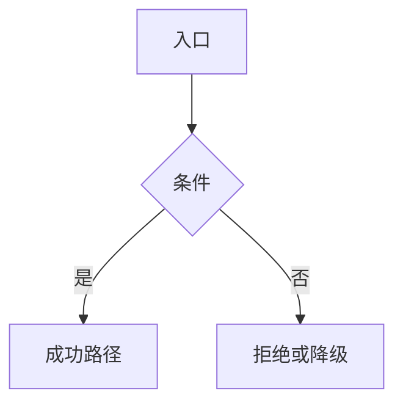

# 模块设计模板

> 用法：复制本文件到 `docs/design/plugins/` 或 `docs/design/services/`，重命名为模块名，替换占位内容。模板不登记文档编号；正式设计落盘时分配编号并加入[文档清单](../DOCUMENT-REGISTER.md)。

## 文档信息

| 项 | 内容 |
|---|---|
| 文档编号 | CORP-DSH-XXX-001 |
| 文档名称 | <模块名称>详细设计 |
| 版本 | V0.1 |
| 文档状态 | 草案 |
| 密级 | 内部 |
| 编制 | <团队>（代拟） |
| 审核 | 待定 |
| 批准 | 待定 |
| 最后更新 | YYYY-MM-DD |
| 门禁 | G0 / G1 / G2 |
| 模块状态 | 规划 / 可用 / 已废止 |

> 编制依据：目标 DSH 版本与 SDK、接口核验方式与日期；明确哪些已核验、哪些仅依据文档。
>
> 关联文档：[总体架构](../architecture/platform-architecture.md)、[需求基线](../requirements/requirements-baseline.md)、[设计索引](../design/README.md)。

## 1. 结论

<三到五句：模块解决什么问题、边界在哪、还缺什么才能进入实现。>

## 2. 目标与非目标

- 目标：
- 非目标：

## 3. 需求与依赖

| 需求/验收 | 关系 | 说明 |
|---|---|---|
| REQ-XX | 支撑 |  |

| 依赖 | 类型 | 版本约束 | 缺失时的行为 |
|---|---|---|---|
|  | 包 / 服务 / 配置 |  |  |

## 4. 扩展形态与边界

| 项 | 内容 |
|---|---|
| 形态 | Host 插件 / Client 插件 / 配置 bundle / MCP bundle / Skill pack / preset / 独立服务 |
| 运行位置 | 本机 Host / 浏览器 / 服务端 |
| 目标 DSH 与 SDK |  |
| 使用的 seam 或服务 |  |
| 不修改的核心 |  |

## 5. 接口与配置

<只写本模块声明的接口、配置项与导出；外部契约用链接引用，不复制字段表。>

| 配置项 | 类型 | 默认值 | 必填 | 说明 |
|---|---|---|---|---|
|  |  |  |  |  |

```ts title="导出面（示意）"
export interface ExampleConfig {}
```

## 6. 权限、凭据与数据

| 项 | 处理方式 | 生命周期 | 失败时 |
|---|---|---|---|
| 凭据 |  |  |  |
| 用户数据 |  |  |  |
| 日志 |  |  |  |

## 7. 流程



<正常流程、并发、超时、取消与退出各写一段可判定行为。>

## 8. 失败模式

| 场景 | 行为 | 用户可见结果 | 是否可重试 |
|---|---|---|---|
|  |  |  |  |

## 9. 可观测性

| 事件 | 字段 | 去向 | 保留 |
|---|---|---|---|
|  |  |  |  |

## 10. 测试矩阵

| 层级 | 覆盖 | 命令 |
|---|---|---|
| 单元 |  |  |
| 契约 |  |  |
| 集成 |  |  |
| 端到端 |  |  |

## 11. 打包、升级与回退

<包名、入口、`engines.dsh`、构建产物、版本策略、升级与回退步骤；未验证项显式标注。>

## 12. 未决事项

| 问题 | 需要谁回答 | 影响 |
|---|---|---|
|  |  |  |